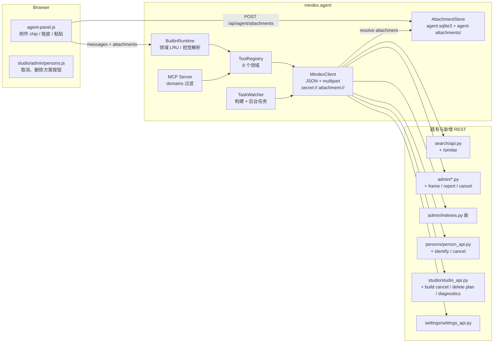

# Design Document

智能助手能力扩展

## Overview

本设计分三层：

1. **助手基础设施**：
   - 按领域动态加载工具；
   - 附件通道 `attachment://`；
   - 模型视觉输入；
   - MCP 领域过滤，以及远程 MCP 模式的补齐。
2. **后端能力补齐**：
   - 按片段找相似、区间抽帧；
   - 索引版本管理接口、素材报告、识别演员、创作诊断；
   - 全部后台任务和创作构建可取消；
   - 删除方案。
3. **工具封装**：六个业务领域，共新增约 50 个工具。

所有工具仍通过 `MindexClient` 回环调用 REST 接口，不复制业务逻辑。后端新增能力都先做成 REST 接口，再封装成工具，页面、CLI 和 MCP 共用同一套校验。

设计约束（来自 AGENT.md / CLAUDE.md）：

- 中文消息；
- UI 文案唯一源是 `messages.json`；
- 配置模型 strict；
- SQLite 是事实来源；
- 禁止跨嵌入空间比较向量；
- 业务读取镜头媒体一律经 `ShotMedia`；
- 保留检查点与互斥语义；
- 测试使用确定性 Fixture 适配器。

## Architecture



### 领域与页面映射

领域常量放在 `backend/src/shared/agent_domains.py`，`shared/config.py` 的校验器与 `agent/registry.py` 都从这里导入，避免循环依赖：

```python
AGENT_DOMAINS = ("meta", "studio", "studio_detail", "library", "search", "index", "persons", "settings")
LOADABLE_DOMAINS = AGENT_DOMAINS[1:]
PAGE_DOMAIN = {"studio": "studio", "settings": "settings", "search": "search",
               "admin": "library", "persons": "persons"}
DOMAIN_INFO = {  # 系统提示词中的领域目录
    "studio": "创作任务、方案、文案、分镜、构建与版本",
    "studio_detail": "创作诊断、版本依赖、召回词建议、人工选片、整列重做",
    "library": "素材与片段浏览、整理信息、素材报告、处理任务、上传素材与字幕",
    "search": "文字/图片/视频检索、找相似、区间抽帧、系统状态",
    "index": "内容索引版本列表、一致性检查、激活与回退",
    "persons": "演员/角色/参考图、识别演员、出镜审核、人物发布、检索组合、演员表导入",
    "settings": "模型档案、业务设置、音色库与音色克隆",
}
```

## Components and Interfaces

### 1. 动态加载

**会话存储**（`agent/session_store.py`）：
- `agent_sessions` 新增列 `loaded_domains TEXT NOT NULL DEFAULT '[]'`。迁移方式：用 `PRAGMA table_info` 检查列是否存在，不存在才 `ALTER TABLE`。
- `get()` 与 `update()` 对该列做 JSON 编解码。

**纯函数**（`agent/domains.py`）：

```python
def touch(loaded: list[str], domains: Iterable[str], limit: int = 3) -> list[str]:
    """把 domains 依次移到最近端（列表末尾）；meta 与未知领域忽略；超过 limit 从头部淘汰。"""
```

**运行时**（`agent/runtime.py`）：
- `_run_turn` 开头：如果页面能映射到领域，执行 `loaded = touch(loaded, [page_domain])` 并持久化。
- 每一步：`tools = registry.schemas(domains={"meta", *loaded}, first=(page_domain,))`，每步重新读取 `loaded`，使 `load_tools` 能在下一步生效。
- `_call_tool`：
  - 工具存在但领域不在 `{"meta", *loaded}` 中时，返回 `TOOL_NOT_LOADED` 错误，文本为「工具 X 属于领域 D，尚未加载；请先调用 load_tools(domains=["D"])」；
  - 执行成功后，对非 meta 工具执行 `touch`。
- `PAGE_DOMAINS` 与 `page_domains` 改为读取 `shared.agent_domains.PAGE_DOMAIN`。

**注册表**（`agent/registry.py`）：
- `DOMAINS = AGENT_DOMAINS`；
- `schemas(first=(), domains=None)`，`domains` 为 None 时不过滤，便于 CLI 与 MCP 使用；
- 新增 `domain_tools() -> dict[str, list[str]]`。

**`load_tools`**（`agent/tools/meta.py`）：
- 参数：`domains: list[Literal[*LOADABLE_DOMAINS]]`，长度 1–3；
- 风险 read，`mcp=False`；
- 通过 `ctx.extra["runtime"].load_domains(sid, domains)` 更新会话，追加 ignorable 事件 `plugin:mindex/tools-loaded {domains, loaded}`；
- 返回 `{loaded, tools: {domain: [names]}}`。

**系统提示词**（`agent/prompts.py`）：`system_prompt(page, loaded)` 追加「工具领域」一节，每个领域一行，格式为 `- studio（已加载）：说明。代表工具：list_jobs、run_build…`，并给出规则「需要未加载领域的工具时先调用 load_tools；最多同时保持 3 个领域」。现有规则中点名的工具都属于 studio、meta 或 settings，在这一节标注所属领域即可。

**工具模块骨架**：Task 1 一次性创建全部新工具模块，`specs()` 先返回空列表，并在 `build_registry` 中注册，后续任务只修改各自模块，避免多个任务同时修改 `tools/__init__.py`。新模块如下：

| 模块 | 领域 |
|---|---|
| `tools/search.py` | search（`search_media` 从 library.py 迁入） |
| `tools/index.py` | index |
| `tools/library_tasks.py` | library（任务与上传） |
| `tools/studio_detail.py` | studio_detail |
| `tools/persons.py` | persons（`list_persons` 迁入） |
| `tools/persons_review.py` | persons |

### 2. MCP 领域过滤与远程补齐

- `AgentMcpConfig.domains: list[str] | None = None`，`field_validator` 校验值属于 `LOADABLE_DOMAINS`。
- `exported(registry, domains)`：保留 `spec.mcp` 为真且满足下列任一条件的工具：`domains is None`、`spec.domain in domains`、`spec.name == "report_capability_gap"`。
- `build_server(..., domains=lambda: None)`：`list_tools` 与 `call_tool` 每次调用时重新计算导出集合，配置变更无需重启即可生效。
- `server_for_app`：`domains` 默认取 `lambda: runtime_config.current().agent.mcp.domains`，提供 `--domain` 时用其覆盖。
- `cli_agent.mcp_command` 增加 `domain: list[str] | None` 选项。远程模式下：
  - `agent_profile = RemoteAgentProfile(client)`：调用 `GET /api/settings?probe_embedding=false` 取 `roles[role=="agent"].active_profile_id`，结果缓存 10 秒；
  - `record_gap = remote_gap_recorder(client)`：调用新增的 `POST /api/agent/gaps {request, reason, suggestion}`。

  `agent_profile` 与 `record_gap` 都改为异步可等待：`build_server` 先检测返回值是否 awaitable，再决定是否 await，同步实现照常可用。

### 3. 附件通道

**存储**（`agent/attachments.py`）：

```python
class AttachmentStore:
    PREFIX = "attachment://"
    def __init__(self, data_dir: Path, sessions: SessionStore)  # 表建在 agent.sqlite3
    def put(self, upload_path: Path, *, filename, content_type, owner: Literal["session", "mcp"],
            session_id: str | None, ttl_hours: int) -> dict
    def get(self, ref: str) -> dict            # 元数据，不存在抛 AttachmentError
    def resolve(self, ref: str, *, session_id: str | None, owner: str) -> Path  # 归属/过期校验
    def delete(self, ref: str) -> None
    def delete_session(self, session_id: str) -> None
    def expired(self, now_ms: int) -> list[dict]
```

表结构：

```sql
CREATE TABLE IF NOT EXISTS agent_attachments (
  id TEXT PRIMARY KEY, session_id TEXT, owner TEXT NOT NULL, filename TEXT NOT NULL,
  content_type TEXT NOT NULL, bytes INTEGER NOT NULL, sha256 TEXT NOT NULL, path TEXT NOT NULL,
  created_at INTEGER NOT NULL, expires_at INTEGER NOT NULL
);
```

文件路径为 `data_dir/agent-attachments/<token>/<安全化文件名>`。

**接口**（`agent/api.py`，前缀 `/api/agent`）：

| 方法与路径 | 说明 |
|---|---|
| `POST /attachments` | multipart：`file`，可带 Form `session_id`；流式写盘，上限 `agent.attachment_max_mb`；201 返回 `{id, filename, content_type, bytes, sha256, expires_at}` |
| `GET /attachments/{token}` | 元数据 |
| `GET /attachments/{token}/content` | 文件内容 |
| `DELETE /attachments/{token}` | 撤销暂存；面板专用，不对应任何工具 |
| `POST /gaps` | 远程 MCP 记录能力缺口 |

路由使用 `{token}` 而不是完整引用，`attachment://<token>` 由服务端拼接。

**鉴权**：
- `web_auth.PUBLIC_PREFIXES` 增加 `/api/agent/attachments`，鉴权改由端点依赖 `attachment_caller(request)` 自行完成：
  1. 网页凭证（复用 `authorized()`；未启用网页令牌时视为已授权），owner 为 session，必须带有效 `session_id`；
  2. Bearer `MINDEX_MCP_TOKEN`（`hmac.compare_digest`），owner 为 mcp；
  3. 不满足以上两条时返回 401。
- 未启用任何令牌时与现有行为一致：本机可直接调用。此时 MCP 进程内调用方用 owner=mcp 上传，规则是请求不带 `session_id` 时 owner 为 mcp。

**消息**：
- `MessageBody.attachments: list[str] = []`，最多 12 个。
- `runtime.prompt(sid, content, context, attachments)` 逐个校验 `resolve(ref, session_id=sid, owner="session")`，然后写入 `user/message`，`data.attachments=[{ref, filename, content_type, bytes}]`。
- 文本末尾追加「附件：attachment://… 名称（类型，大小）」。图片附件同时生成 `image` 块，供视觉功能使用。

**回环客户端**（`agent/loopback.py`）：

```python
class MindexClient:
    def __init__(self, app=None, *, base_url=None, token=None, resolve_secret=None,
                 resolve_attachment: Callable[[str], AttachmentFile] | None = None, timeout=120)
    def with_resolvers(self, *, secret=None, attachment=None) -> "MindexClient"
    async def upload(self, path: str, *, files: dict[str, str | list[str]], data: dict | None = None,
                     method: str = "POST") -> dict
    async def fetch_bytes(self, path: str) -> tuple[bytes, str]  # 视觉解析用
```

- `AttachmentFile = (filename, Path | bytes, content_type)`。
- 进程内模式由 runtime 注入解析器：`lambda ref: store.resolve(ref, session_id=sid, owner="session")`，MCP 进程内模式使用 owner="mcp"。
- 远程模式（`base_url`）不注入解析器，`upload` 先 `GET /api/agent/attachments/{token}/content` 再上传。
- 解析失败时返回 `{ok: False, status: 400, error}`，不发送请求。
- `data` 中的 `secret://` 引用仍会被解引用。

**生命周期**：
- `api.delete_session` 调用 `attachments.delete_session(sid)`。
- `maintenance/clean.py` 注册 B 级规则 `agent_attachments`，stage 为 pipeline：
  - items 包括过期记录对应的文件，以及没有记录、mtime 超过 `clean.temp_grace_hours` 的孤儿目录；
  - `execute()` 同时删除文件和记录。
- `maintenance/backup_files.py` 的 `EXCLUDED_DIRS` 增加 `agent-attachments`。

**配置**：`AgentConfig.attachment_ttl_hours: int = Field(168, ge=1)`、`attachment_max_mb: int = Field(500, ge=1, le=20480)`、`max_images: int = Field(8, ge=0, le=32)`。

### 4. 面板附件 UI（`frontend/src/shared/agent-panel.js`）

- 在 `form.agent-composer` 中，`warning` 之后插入 `div.agent-attachments`（chip 列表）。`actions` 中增加 `button.agent-attach` 与隐藏的 `input[type=file][multiple]`。
- 状态：`state.attachments = [{localId, file, progress, ref, error, xhr}]`。
- `addFiles(files)`：调用 `ensureSession()` 后，用 `XMLHttpRequest` 向 `/api/agent/attachments` 上传（FormData 带 `file` 与 `session_id`），`upload.onprogress` 更新进度条（`<progress>`，带 aria-label）。
- 拖放：在 drawer 上监听 `dragover`/`dragleave`/`drop`，拖入时加 `is-dragover` 类。粘贴：先判断 `clipboardData.files.length`，有文件则走 `addFiles`，否则走原有的密钥检测。
- 移除：上传中的项调用 `xhr.abort()`，已上传的项发送 `DELETE /api/agent/attachments/{token}`。
- 发送：`await Promise.all(pending)`，有失败项时阻止发送；请求体为 `{content, context, attachments: refs}`，成功后清空列表。
- 渲染：`apply()` 在 `user/message` 分支读取 `data.attachments` 渲染 chip。图片 chip 的缩略图使用 `/api/agent/attachments/{token}/content`，点击后用 `openViewer`。
- 文案键：`ui.agent_attach`、`ui.agent_attach_remove`、`ui.agent_attach_failed`、`ui.agent_attach_uploading`、`ui.agent_attach_drop`。

### 5. 视觉输入

- `AgentLlmConfig.vision: bool = False`。`runtime_settings.PROFILE_FIELDS["agent"]` 和 `settings_api._effective` 的 extras 增加 `vision`，设置页 agent 档案表单增加复选框。
- `llm/types.py`：新增 `image_block(ref, media_type="image/jpeg")`，结构为 `{"type": "image", "ref": ...}`；新增 `resolved_image_block(data_b64, media_type)`，结构为 `{"type": "image", "data": ..., "mediaType": ...}`，只在发请求前存在于内存中。`tool_message(call_id, text, *, is_error, images=None)` 在消息上附带 `images: [ref]`。
- `ToolOutput.images: list[str] | None`，取值为本站 `/api/` 地址或 `attachment://`。`_result` 把它写进 tool 消息的 `images`（只存引用）。
- `agent/vision.py`：

```python
async def materialize(messages: list[dict], *, enabled: bool, limit: int,
                      load: Callable[[str], Awaitable[bytes]]) -> list[dict]:
    """返回新列表：enabled=False 时去掉全部 image 块与 tool.images；
    否则从末尾往前保留最近 limit 张，解析为 ≤1024 JPEG base64，其余替换为文字「（图片已省略）」。
    tool.images 在该批 tool 结果之后合成一条 user 消息（source.kind=context）承载图片。
    解析失败替换为「（图片无法读取：原因）」。"""
```

- `load(ref)`：遇到 `attachment://` 从 `AttachmentStore` 读取，遇到 `/api/` 通过 `client.fetch_bytes` 获取。缩放用 PIL：`thumbnail((1024, 1024))`，以 JPEG quality 85 编码。
- 适配器：
  - `openai_compat.convert_messages` 对含 image 块的 user 消息输出数组形式，元素为 `{"type": "text"}` 和 `{"type": "image_url", "image_url": {"url": "data:..."}}`；
  - `anthropic.convert_messages` 对 user 消息和 tool_result 都输出块数组，图片为 `{"type": "image", "source": {"type": "base64", "media_type", "data"}}`；Anthropic 下 tool 图片直接放进 tool_result，不生成合成 user 消息，由 `materialize(protocol=...)` 区分。
- 预算：`estimate_tokens` 对每个 image 块按 800 计。`derive_messages` 的输出仍只含引用，所以事件日志和 SSE 中不会出现 base64。
- `vision` 为 false 时，工具文本由 runtime 追加「（图片仅在面板展示）」。

### 6. 检索

**`SearchEngine.similar`**（`search/search.py`）：

```python
def similar(self, segment_id: str, granularity: str | None = None, limit: int = 20,
            filters: Filters | None = None) -> dict:
    active = 当前/固定索引, status 必须 ready（否则 ModelError→503）
    seed = index_members(active, segment_id, complete=1) 否则 EntityNotFound
    format 2 且 "video" not in seed.indexed_views → ValueError（422）
    ids = SELECT id FROM representations WHERE index_id=? AND segment_id=? AND view='video'
    vectors = VectorIndex(root, active).vectors(ids)；为空 → SimilarUnavailable（409）
    snapshots = self._snapshots(active, granularity or seed.kind, filters)  # 由 _context 抽出、不校验空间
    eligible = [s for s in snapshots if format1 or "video" in indexed_views
                and s.id != seed.id
                and not (s.source_id == seed.source_id and overlap(s, seed) > 0)]
    routes = {f"video_{i}": vectors.query(v, "video", eligible_ids, candidates)}，权重 1/n
    result = self._result(...); result["seed_segment_id"] = segment_id
```

- `_context` 拆成 `_active()`、`_snapshots(active, granularity, filters)` 和原有的空间校验，`text/image/video` 的行为不变。
- `POST /api/search/similar`：请求体为 `SimilarSearch{segment_id, granularity?, limit 1..50, filters}`（定义在 `shared/types.py`）。在 `api.py` 注册 409 映射：新增异常 `Conflict(ValueError)` 的子类处理器，放在 `ValueError` 处理器之前；也可以直接抛 `HTTPException(409)`。

**区间抽帧**（`admin/admin.py`）：
- `GET /api/admin/sources/{id}/frame?t=&width=768`，用同步 `def` 端点。
- `ShotMedia.frame_jpeg(source_id, t, width) -> (bytes, revision)` 复用 `_frame_reference`，ffmpeg 参数为 `-vf scale=W:-2 -vcodec mjpeg`。
- ETag 为 `sha256(revision:t:width)[:20]`，带 `Cache-Control: private, max-age=3600`。
- 进程内用 `threading.BoundedSemaphore(4)` 限流。
- `t` 非有限数或超出范围时返回 422。

**工具**（`tools/search.py`）：

| 工具 | 风险 | 接口 |
|---|---|---|
| `search_media` | read | POST /api/search/text（参数见 Req 6.1） |
| `search_by_media` | read | POST /api/search/image\|video（附件，`file` 字段） |
| `find_similar` | read | POST /api/search/similar |
| `sample_frames` | read | 仅生成 `/api/admin/sources/{id}/frame?t=` URL；segment_id 经 GET /api/admin/segments/{id} 取区间 |
| `get_system_status` | read | GET /api/status?summary=true，可选再调 GET /api/settings/embedding-status |

### 7. 索引版本管理（新模块 `admin/indexes.py`，`create_app` 注册）

```python
def indexes_router(runtime, store, embedder=None) -> APIRouter  # prefix /api/indexes
GET  ""                 -> {active: {content_id, release_id}, versions: [{id,status,mode,format,created_at,space_model}]}
GET  "/{id}/check"      -> run_in_threadpool(check_index) -> {index_id, ok, issues}
POST "/{id}/activate"   -> 见下
```

激活流程（同步 def，线程池执行）：
1. `ProcessingLock(cfg).acquire()`，Timeout 时返回 409；
2. `lock = index_write_lock(root); lock.timeout = 10`，Timeout 时返回 409；
3. 执行 `check_index`，有问题时返回 422，detail 为 `{message, issues}`；
4. `spec.space.schema == 2` 时：`client.identity() == spec.space`，并执行 `require_gate()`；
5. `cfg.video.model_dump() == spec.preprocessing`，第 4、5 步不满足时抛 ModelError，返回 503；
6. `store.activate(id)`；
7. 后台线程执行 `warm_up(cfg, startup=False)`；
8. 返回 `{active, release_id}`。

工具（`tools/index.py`）：`list_index_versions`、`check_index`、`activate_index`（danger）。`activate_index` 的预览读取版本列表和 `/api/settings/embedding-status`，若本地空间与目标索引不同则给出警告；同时用 `/api/persons/releases` 查出该索引最近一次检索组合，在预览中说明激活后会切到哪个组合。

### 8. 素材领域

新增接口：`GET /api/admin/sources/{id}/report`，在线程池中调用 `diagnostics.film.source_report(runtime.current(), id)`。

工具分布：
- `tools/library.py`：`list_sources`、`get_source`、`list_segments`、`get_segment_details`、`get_source_report`、`update_curation`（write）。
- `tools/library_tasks.py`：`start_source_task`（danger）、`get_task_status`、`retry_task`（write）、`cancel_task`（write）、`upload_source`（write）、`upload_subtitle`（write）。

任务类别与路由：

| kind | 状态 / 重试 / 取消 |
|---|---|
| source | /api/admin/source-tasks/{id}[/retry\|/cancel] |
| dialogue | /api/admin/dialogue-tasks/{id}[/retry\|/cancel] |
| person | /api/persons/tasks/{id}[/retry\|/cancel] |

**跟踪**（`agent/watcher.py`）：`BuildWatcher` 泛化为 `TaskWatcher`。`watch(sid, {"kind": "build"|"source"|"dialogue"|"person", ...})` 按类别轮询，终态集合为 `{complete, partial, failed, cancelled, interrupted}`，到达终态后发 followup。`ToolOutput.watch_build` 保留，新增 `watch_task`。MCP 不自动跟踪任务，只在结果文本中提示改用 `get_task_status` 查询。

### 9. 后台任务取消（`shared/task_cancel.py`）

```python
class TaskCancelled(Exception): ...
class CancelRegistry:
    def __init__(self, root: Path)                 # 哨兵目录 root/locks/cancel/
    def request(self, key: str) -> None            # Event.set + touch 哨兵
    def requested(self, key: str) -> bool          # 进程内 Event 或哨兵存在
    def check(self, key: str) -> None              # requested → raise TaskCancelled
    def clear(self, key: str) -> None
def registry_for(root) -> CancelRegistry           # 每个 data_dir 一个单例
```

- `save_task_progress(store, table, task_id, value)` 写入进度后调用 `registry_for(store.root).check(task_id)`。
- `PublicationLock.admit(check=None)` 在循环中调用 `check()`。
- `SourceTasks/DialogueTasks/PersonTasks.run` 捕获 `TaskCancelled` 后执行：`UPDATE ... SET status='cancelled', error='已取消'`，`clear`，然后释放锁。
- `cancel(task_id)`：
  - queued 状态：直接执行 `UPDATE status='cancelled'`，并 `request`，防止竞态启动；
  - running 状态：`request`；
  - 其他状态：返回 409。
- `retry` 的状态白名单增加 `cancelled`，启动前先 `clear`。
- 分析阶段需要逐片段上报进度（`Pipeline.analyze` 的 progress 回调）。若当前没有逐片段上报点，就补上报 `{"stage": "analyze", "completed", "total", "unit": "segments"}`。
- 索引构建通过 `channel_index.notify` 回调上报进度，会被同样中断。版本保持 `building`，已经 upsert 的向量下次可以复用，活动指针不变。
- 前端：
  - `admin.js` 的 `taskStatus` 增加 `cancelled`；queued/running 状态的任务卡片显示“取消”按钮，failed/interrupted/cancelled 状态显示“重试”。
  - `persons.js` 做同样修改。

### 10. 创作构建取消与删除方案

- **取消标记**：`studio_router` 内部维护 `cancels: dict[bid, Event]`，哨兵文件为 `jobs/<job>/builds/<bid>.cancel`。`studio_workspace.build_cancelled(config, job_id, bid, event=None) -> bool` 检查两者。
- **`_run_build`**：
  - 每个节点开始前，以及 auto_split 重新预检之后，都检查取消标记；命中则执行 `cancel_remaining(build)`，把后续 pending 节点改为 `status=blocked, error="已取消"`，然后 break。
  - 收尾时，若已取消，则 `status="cancelled"`。
  - 节点标签映射与结束文案映射各增加 `cancelled: "已取消"`。
  - `recover` 只处理 running 状态的构建，不受影响。
- **取消接口**：`POST /api/studio/jobs/{job}/builds/{bid}/cancel`：
  - 读取 `workspace.json` 时不加锁（构建期间锁由 worker 持有）；
  - 找不到构建时返回 404；状态不是 running 时返回 409；
  - 否则 `request`，并写一条执行日志「已请求取消」；
  - 返回 `{build_id, status: "cancelling"}`。
- **旧任务执行器**：`launch()` 的 worker 在步骤之间检查 `jobs/<job>/steps.cancel`，命中则 `set_execution(cfg, job, "cancelled", ...)`。新增 `POST /api/studio/jobs/{job}/cancel`：执行状态不是 running 时返回 409。
- **删除方案**：`DELETE /api/studio/jobs/{job}/plans/{pid}`，在 `mutation_lock` 内执行：
  1. 存在 running 构建时返回 409；
  2. `len(plans) == 1` 时返回 422「至少保留一个方案」；
  3. 执行 `pop`；若删除的是当前方案，`active_plan` 改为其余方案中 `created_at` 最大的一个；
  4. `persist`，返回 `detail`。
- **前端**（`studio.js`）：
  - `STATUS.cancelled`；构建与节点的状态显示改为 `STATUS[x] || x`。
  - 运行中构建的摘要旁显示“取消执行”按钮（POST cancel 后刷新）。
  - 方案切换区域增加“删除方案”按钮（`confirm()` 二次确认，只剩一个方案时禁用）。
  - 旧任务运行区显示“取消执行”按钮。

### 11. 创作工具

- **`tools/studio_build.py`**：增加 `cancel_build`（write）和 `delete_plan`（danger）。`delete_plan` 的预览显示方案名，以及是否为当前方案、删除后切换到哪个方案。
- **`tools/studio_write.py`**：
  - `ShotFields` 增加三个字段：`recall: ShotRecallArgs | None`（字段与 `ShotRecall` 一致，`extra=forbid`）、`granularity`、`recall_limit`。
  - `ShotOperation` 增加 `clear: list[Literal["recall", "granularity", "recall_limit", "visual"]]`。
  - update 先应用 `clear`（pop 或置 None），再应用字段；`LABELS` 增加「召回设置/召回粒度/召回数量」。
  - 修改了召回相关字段时，`Preview.warnings` 追加级联重建提示。
  - 新增 `rename_job`（write）。
  - 新增 `attach_query_media`（write），两步执行：
    1. 执行阶段先 `client.upload(.../query-media, files={"file": ref}, data={"kind": kind})` 得到 `media_id`；
    2. 再用 `plan_shots` 把该分镜的 recall 设为 `{mode: kind, media_id, media_kind: kind}` 并 PATCH 提交。
    
    预览不执行上传，只说明会把哪个分镜改成图片或视频召回。
- **`tools/studio_detail.py`**：
  - `diagnose_plan`：GET `/plans/{pid}/diagnostics`。
  - `get_version_lineage`：GET `/versions/{vid}/dependencies`，输出摘要树（阶段、分镜、状态、创建时间）。
  - `suggest_shot_query`：POST `.../query-suggestion`。
  - `get_material_digest`：GET `/material-digest`。
  - `preview_version`：GET `/versions/{vid}/preview`，返回视频媒体。
  - `run_column`：danger。用工作台中各分镜 `specification` 的 inputs 组装 `inputs_by_shot`（取自 workspace detail 的 `specs` 字段；如果没有该字段，就在诊断接口里一并返回，见下文），调用 execute-column 或 regenerate-column，并跟踪构建。
  - `get_selection_candidates`、`preview_selection`、`confirm_selection`：见 Req 15。
- **诊断接口**：`GET /api/studio/jobs/{job}/plans/{pid}/diagnostics`，返回：

```json
{"plan_id":"…","revision":"…",
 "storyboard":{"hard":null|"原因","soft":[{"index":1,"kinds":["short"]}],"coverage":null|"原因"},
 "subtitle":{"burn":true,"filter":true,"font":"ok"|"原因"},
 "nodes":[{"key":"tts:shot-x","stage":"tts","shot_id":"…","version":"…","state":"ok|missing|failed|corrupt|stale",
           "reasons":["旁白已变化"]}],
 "inputs_by_stage":{"recall":{"shot-x":{…}}, "tts":…, "select":…, "render":…}}
```

  `inputs_by_stage` 中各分镜的值由 `workspace.specification(...)["inputs"]` 给出，供 `run_column` 使用。字体检查在临时目录中写一条 srt 后调用 `check_font`。

### 12. 人物领域

- **识别接口**：`POST /api/persons/identify`（multipart `file`，上限 20MiB，可带 Form `top_k`，默认 5）：
  1. 用 `image_png` 归一化后写入临时文件；
  2. 构造 `PersonClient(cfg)`，`cfg.person.timeout` 取 `min(原值, 60)`；
  3. 执行 `space = identity()`、`extracted = image(path)`，并校验空间；
  4. `refs = EvidenceReferences(cfg, store).candidates(space)`，计算 `uncovered = len(references) - len(refs)`；
  5. 对每条带 `face_feature` 的观测：按 role_id 和 actor_id 分组，各取最大 cosine，排序后取前 top_k；由 `face_match` 得到 accepted；每个候选附上获胜参考图的 `image_url`；
  6. 返回 `{faces: [{face_bbox, face_quality, roles: [...], actors: [...], accepted_role}], uncovered_references, space_model}`。

  人物服务出错时抛 ModelError，返回 503。
- **`tools/persons.py`**：`list_persons`、`get_person`（实体、关联镜头和参考图）、`save_person`（write）、`delete_person`（danger）、`assign_source_work`（write）、`add_person_reference`（write；附件走 `/references` 并带 actor_id/role_id Form，否则走 `/references/from-source`）、`remove_person_reference`（danger）、`identify_person`（read，images 为获胜参考图与上传图）。
- **`tools/persons_review.py`**：`list_review_shots`、`review_shot`（write）、`publish_persons`（danger）、`list_search_releases`、`change_search_release`（danger）、`import_cast`（write：POST /imports 用多附件 `files` 字段，然后 parse）、`confirm_cast_import`（write）。

### 13. 设置领域（`tools/settings_tools.py`）

新增工具：`delete_model_profile`（danger）、`reset_business_settings`（danger）、`list_voice_catalog`、`register_voice`（write）、`delete_voice`（danger）、`clone_voice`（danger）。

`clone_voice` 的执行流程：
1. 读取当前 TTS 后端；
2. 调用 `runtime.ask_question` 展示表单。字段包括：name（text）、ref_text（text，可选）、`consent`（select，选项为「我确认拥有该声音的合法使用授权」和「取消」）；dashscope 后端额外增加 audio_url（text）。
3. 只有 `consent` 选项被选中时，才调用 `client.upload("/api/settings/voices/clone", files={"file": ref}?, data={name, consent: "true", ref_text, audio_url})`。

`clone_voice` 的参数模型中没有 consent 字段。`ctx.extra` 中没有 runtime 时（例如 MCP 调用），返回错误「需要在 Mindex 页面助手中确认授权」。工具的风险级别为 danger，确认卡之后还会弹出这张表单。

### 14. 风险分级汇总

| 级别 | 新增工具 |
|---|---|
| read | load_tools、search_by_media、find_similar、sample_frames、get_system_status、list_index_versions、check_index、get_source、list_segments、get_segment_details、get_source_report、get_task_status、diagnose_plan、get_version_lineage、suggest_shot_query、get_material_digest、preview_version、get_selection_candidates、preview_selection、get_person、identify_person、list_review_shots、list_search_releases、list_voice_catalog |
| write | update_curation、retry_task、cancel_task、upload_source、upload_subtitle、rename_job、cancel_build、attach_query_media、confirm_selection、save_person、assign_source_work、add_person_reference、review_shot、import_cast、confirm_cast_import、register_voice |
| danger | activate_index、start_source_task、delete_plan、run_column、delete_person、remove_person_reference、publish_persons、change_search_release、delete_model_profile、reset_business_settings、delete_voice、clone_voice |

不提供的工具：删除素材、删除演员表导入图片。

## Data Models

- `agent_sessions.loaded_domains`：JSON 数组，按最近使用排序（末尾为最近），最多 3 项。
- `agent_attachments`：表结构见上文；`owner` 取 session 或 mcp。
- 任务表 `status` 新增取值 `cancelled`。表结构不变，`status` 列是 TEXT。
- Studio 构建 `status` 新增 `cancelled`；节点状态复用 `blocked`，`error` 为「已取消」。
- 旧任务 `job.json` 的 `execution.status` 新增 `cancelled`。
- 配置新增：
  - `agent.attachment_ttl_hours`
  - `agent.attachment_max_mb`
  - `agent.max_images`
  - `agent.llm.vision`
  - `agent.mcp.domains`

## Error Handling

| 场景 | 处理 |
|---|---|
| 调用未加载领域的工具 | 工具结果错误 `TOOL_NOT_LOADED`，不执行，模型可自行恢复 |
| 附件引用无效、过期或越权 | 回环返回 400，工具转为 ToolError `attachment_invalid` |
| 附件超限或为空 | 413 / 422 |
| 附件端点无凭证 | 401 |
| 找相似：种子不存在 / 无画面 / 向量缺失 | 404 / 422 / 409 |
| 抽帧参数非法 | 422 |
| 索引激活：检查失败 / 空间不符 / 锁冲突 | 422 / 503 / 409，活动索引不变 |
| 取消非运行中任务或构建 | 409 |
| 删除方案：有运行中构建 / 只剩一个方案 | 409 / 422 |
| 人物服务不可用 | 503 |
| 音色克隆未授权或没有提问通道 | 工具错误，不调用接口 |
| 视觉图片解析失败 | 替换为说明文字，本步继续 |

所有新增中文错误消息都会经过 `shared/i18n.py` 反向映射；未匹配的消息回落到 `system.diagnostic`，不需要额外登记。

## Testing Strategy

- **单元与性质测试**：用 hypothesis 测试纯函数（`domains.touch`、MCP `exported`、`vision.materialize`、相似检索的候选排除、抽帧时间点生成、`plan_shots` 召回往返、取消后的节点状态转换），每条性质 `@settings(max_examples=100, deadline=None)`，并注释 `# Feature: agent-capability-expansion, Property <n>`。
- **集成测试**：使用真实 FFmpeg、SQLite、Chroma 和 HTTP（`create_app` + TestClient / 进程内回环），模型侧使用 `conftest.py` 中的确定性 Fixture 适配器。人物识别使用测试内的确定性 person 服务桩。
- **运行时测试**：用 `ScriptedLlm.requests` 断言每一步的 tools、system 和图片块，用 `agent_helpers` 驱动会话。
- **UI 回归**：Playwright（`tests/*_ui.cjs`），覆盖面板附件、创作页取消与删除方案、素材页取消按钮。
- **文档与静态检查**：ruff、`check-doc-links`、`build-messages --check`、`node --check`、完整 pytest。

测试文件规划：

| 文件 | 范围 |
|---|---|
| `tests/test_agent_domains.py` | 动态加载、load_tools、提示词目录 |
| `tests/test_agent_mcp.py`（扩展） | 领域过滤、远程补齐 |
| `tests/test_agent_attachments.py` | 附件存储、端点、鉴权、回环、清理、备份 |
| `tests/test_agent_vision.py` | 视觉 materialize 与两种协议 |
| `tests/test_search_similar.py` | 找相似 |
| `tests/test_source_frame.py` | 抽帧端点 |
| `tests/test_index_api.py` | 索引管理 |
| `tests/test_task_cancel.py` | 后台任务取消 |
| `tests/test_studio_cancel.py` | 构建取消、旧执行器取消、删除方案 |
| `tests/test_studio_diagnostics.py` | 诊断接口 |
| `tests/test_person_identify.py` | 识别接口 |
| `tests/test_agent_search_tools.py`、`test_agent_library_tools.py`、`test_agent_studio_detail.py`、`test_agent_persons.py`、`test_agent_settings_ext.py` | 各领域工具 |

## Correctness Properties

1. **领域 LRU**：对任意领域序列，`touch` 的结果最多 3 个领域，不含 meta 与重复项；最后被 touch 的合法领域一定在结果末尾；结果中的领域是输入里最近使用的那几个。（Req 1.3–1.5）
2. **每步工具集合**：每一步下发的工具名集合等于 meta 工具，加上 Loaded_Domains 中各领域的工具。（Req 1.2, 1.7）
3. **未加载即不执行**：对任意未加载领域的工具调用，处理函数调用次数为 0，结果 code 为 `TOOL_NOT_LOADED`。（Req 1.9）
4. **MCP 导出过滤**：对任意 domains 配置，导出集合等于 `{s | s.mcp ∧ (domains=None ∨ s.domain∈domains ∨ s.name=report_capability_gap)}`，且不含 load_tools、navigate、ask_user_question。（Req 2.1, 2.2）
5. **附件隔离**：对任意引用与调用方组合，只有 owner 与会话都匹配、且未过期时才能解析成功；其余情况都抛 AttachmentError，且不发送 HTTP 请求。（Req 3.4, 3.5）
6. **日志无图片数据**：对任意含图片的会话，事件日志 JSON 中不出现 base64 图片数据（`data:image/` 前缀或长度超过 1000 的 base64 串）。（Req 5.3）
7. **图片上限**：`materialize` 输出中 image 块数量不超过 `max_images`，且保留的是按出现顺序最晚的那些；`enabled=False` 时 image 块数为 0。（Req 5.5, 5.6）
8. **相似排除**：`similar` 的结果中不含种子片段，也不含与种子同源且时间有交集的片段；所有结果都满足粒度、隐藏与过滤条件。（Req 7.2, 7.3）
9. **抽帧时间点**：`sample_frames` 生成的时间点数量等于 `min(count, 12)`，单调不减，全部落在 `[start, end]` 内。（Req 8.4）
10. **取消后状态**：对任意节点序列和取消位置 k，第 k 个节点之后的节点都不会进入 running，状态全部为 blocked 且 error 为「已取消」；构建状态为 cancelled；第 k 个节点之前的节点保持原结果。（Req 13.2）
11. **删除方案不丢版本**：删除方案前后，`versions` 的键集合不变；`active_plan` 始终指向存在的方案。（Req 13.5）
12. **召回设置往返**：对任意合法的 recall/granularity/recall_limit，经 `plan_shots` update 后得到的分镜可以通过 `ShotBody` 校验，且这些字段等于输入；`clear` 之后字段为空。（Req 14.1）
13. **授权只来自表单**：`clone_voice` 的参数模型不含 consent 字段；在任意表单答复下，只有答复中选择了授权项时才会调用克隆接口。（Req 18.3）
14. **不开放物理删除**：注册表中任何工具都不会向 `DELETE /api/admin/sources/*` 或 `DELETE /api/persons/imports/*/images/*` 发请求（用记录请求的假客户端执行全部工具的最小参数集来验证）。（Req 19.2）
