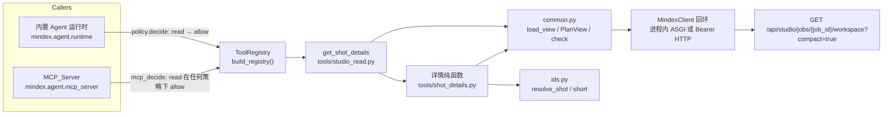
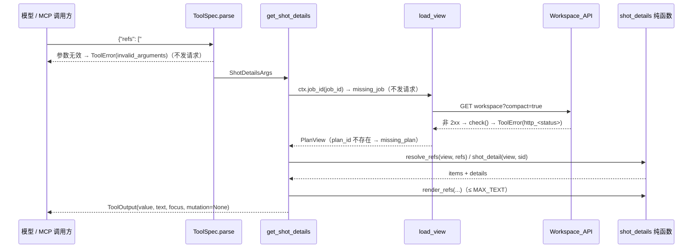
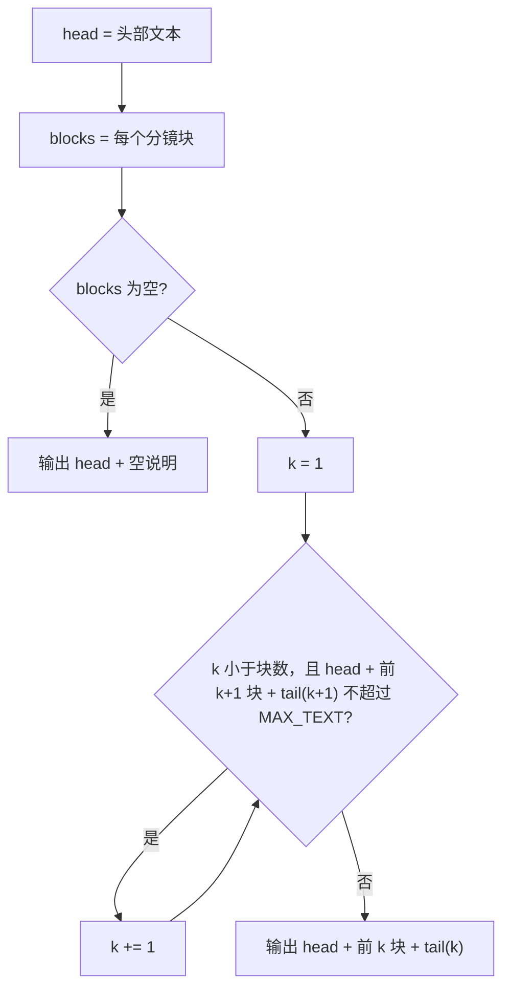

# Design Document

智能助手读取分镜工作台分镜详情

## Overview

新增只读工具 `get_shot_details`（`studio` 领域，风险 `read`，`mcp=True`），让内置智能助手与 MCP 调用方读取当前方案分镜的完整信息：不截断的旁白、查询、画面意象，预估时长、召回粒度与数量覆盖、召回设置、人工区间，四个阶段的 Stage_State，以及选片版本中的字幕时间轴（`data.event.subtitle`）和配音版本时长（`data.duration`）。

工具有两种模式：

- 列表模式（不传 `refs`）：按方案分镜顺序分页返回（`offset`/`limit`），并受 12000 字符渲染上限约束，超限时在完整分镜边界处停止并给出下一次 `offset`。
- 指定模式（传 `refs`，1–50 个）：用既有 `resolve_shot` 逐项解析，ok 项返回 Shot_Detail，ambiguous / not_found 项只返回状态与候选，整体仍是成功结果。

同时调整三处既有文本，让模型在拆分、合并、改写旁白前先读完整旁白：

- `SYSTEM_PROMPT`（`mindex.agent.prompts`）新增工作方式条目；
- `get_workspace_summary` 工具描述与 `board_text` 渲染注明截断并指向 `get_shot_details`；
- `edit_shots` 工具描述与 `parts` 字段描述注明 split 旁白须由 `get_shot_details` 的完整旁白切分。

`edit_shots` 现有的 split 旁白一致性校验（`"".join(joined.split()) != "".join(original["text"].split())` → `invalid_operation`）已满足 Requirement 6.5，本功能不改其逻辑。

### 关键设计决策

| 决策 | 选择 | 理由 |
|---|---|---|
| 工具名 | `get_shot_details` | 与 `get_workspace_summary`、`get_preflight`、`get_build_status` 的 `get_*` 只读命名一致；`mcp__mindex__get_shot_details` 为 29 字符，远低于 64 字符上限 |
| 数据来源 | 复用 `load_view` → `GET /api/studio/jobs/{job_id}/workspace?compact=true` | `compact_version` 只裁剪召回候选与选片 `anchor` 的诊断字段，保留 `data.event.subtitle` 与配音 `data.duration`；一次 GET 即可拿到全部所需数据，不新增 REST 接口 |
| 任务与方案定位 | 复用 `ToolContext.job_id` 与 `load_view`/`PlanView` | 已实现 Requirement 4 的 `missing_job`（在 GET 之前抛出）、页面 Plan 回退规则与 `missing_plan` 错误文本；与 `get_workspace_summary` 行为完全一致 |
| Stage_State | 复用 `PlanView.stage_state` | Requirement 3.6 要求与 `get_workspace_summary` 分镜表相等；同一函数天然相等 |
| 纯函数拆分 | 详情构建、引用解析、分页与渲染预算均为不依赖 I/O 的纯函数，输入 workspace 字典 | 便于用 hypothesis 生成任意 workspace 做性质测试，不需要真实任务 |
| 参数校验 | Pydantic 模型 + `model_validator`，`offset`/`limit` 使用 `StrictInt` 且默认 `None` | 区分「未提供」与「提供了默认值」以满足 7.5 的互斥规则；`StrictInt` 拒绝 `true`/`1.5`/`"3"` 等非整数；校验在 `ToolSpec.parse` 中完成，早于任何回环请求（2.7） |
| 渲染预算 | 工具自行控制 `text` 长度 ≤ `MAX_TEXT`，按完整分镜块累加 | `ToolOutput.render()` 在显式提供 `text` 时不会截断；必须由工具保证不切断任何分镜 |

## Architecture



调用时序（指定模式）：



### 文件改动

| 文件 | 改动 |
|---|---|
| `backend/src/agent/tools/shot_details.py`（新） | 纯函数：`shot_detail`、`subtitle_info`、`speech_info`、`resolve_refs`、`page_details`、`render_detail`、`fit_blocks`、`render_list`、`render_refs` |
| `backend/src/agent/tools/studio_read.py` | 新增 `ShotDetailsArgs` 与 `get_shot_details` 处理函数，在 `specs()` 中注册（位于 `resolve_shots` 之后）；更新 `get_workspace_summary` 描述 |
| `backend/src/agent/tools/common.py` | `board_text` 在分镜表末尾追加截断说明行 |
| `backend/src/agent/tools/studio_write.py` | 更新 `edit_shots` 工具描述与 `ShotOperation.parts` 字段描述 |
| `backend/src/agent/prompts.py` | `SYSTEM_PROMPT` 第 2 条后新增拆分/合并/改写旁白的工作方式条目 |
| `backend/src/agent/mcp_server.py` | `INSTRUCTIONS` 补充一句：拆分或改写旁白前用 `get_shot_details` 读取完整旁白 |
| `tests/test_agent_tools.py`、`tests/test_agent_changes.py`、`tests/test_agent_mcp.py` | 工具总数断言 30 → 31，MCP 导出数 28 → 29 |
| `tests/test_agent_shot_details.py`（新） | 性质测试与示例测试 |

## Components and Interfaces

### 1. 参数模型 `ShotDetailsArgs`（`studio_read.py`）

```python
from pydantic import Field, StrictInt, field_validator, model_validator

class ShotDetailsArgs(StrictModel):
    refs: list[str] | None = Field(
        default=None, min_length=1, max_length=50,
        description="要读取的分镜：完整 ID、界面短 ID（如 a1daad59 或 shot-a1daad59）或 #序号；省略时按顺序读取全部分镜")
    offset: StrictInt | None = Field(
        default=None, ge=0, description="仅在省略 refs 时使用：从第几个分镜开始（从 0 计），默认 0")
    limit: StrictInt | None = Field(
        default=None, ge=1, le=100, description="仅在省略 refs 时使用：最多返回多少个分镜（1–100），默认 100")
    job_id: str | None = JobId
    plan_id: str | None = PlanId

    @field_validator("refs")
    @classmethod
    def no_blank(cls, value):
        if value is not None and any(not item.strip() for item in value):
            raise ValueError("refs 不能包含空字符串或仅含空白的项")
        return value

    @model_validator(mode="after")
    def exclusive(self):
        if self.refs is not None and (self.offset is not None or self.limit is not None):
            raise ValueError("refs 与 offset/limit 不能同时提供")
        return self
```

- `refs=[]`、超过 50 项、含空白项、`offset=-1`、`limit=0/101`、`offset=1.5`、`offset=true`、`refs`+`offset` 都在 `ToolSpec.parse` 里转为 `ToolError(code="invalid_arguments")`，处理函数不会执行，因而不会读 Workspace_API（2.7、7.5）。
- `refs: null` 与省略等价（列表模式）。`ShotDetailsArgs` 的 JSON Schema 经 `inline_schema` 展开，内置运行时与 MCP 都使用 `spec.parameters()`，因此两边 Schema 完全相等（5.3）。

### 2. 处理函数 `get_shot_details`（`studio_read.py`）

```python
async def get_shot_details(args: ShotDetailsArgs, ctx: ToolContext) -> ToolOutput:
    view = await load_view(ctx, args.job_id, args.plan_id)      # missing_job / http_* / missing_plan
    header = plan_header(view)                                   # job_id, plan_id, plan_name, revision, active, total
    if args.refs is None:
        offset = args.offset or 0
        limit = args.limit or 100
        details = page_details(view, offset, limit)
        text, shown = render_list(header, details, offset)       # 受 MAX_TEXT 约束
        value = {**header, "mode": "list", "offset": offset, "returned": shown,
                 "has_more": offset + shown < header["total"],
                 "next_offset": offset + shown if offset + shown < header["total"] else None,
                 "shots": details[:shown]}
        focus = details_focus(view, None)
    else:
        items = resolve_refs(view, args.refs)
        text, rendered = render_refs(header, items)
        value = {**header, "mode": "refs", "results": items,
                 "returned": sum(i["status"] == "ok" for i in items),
                 "unrendered_refs": [i["ref"] for i in items[rendered:] if i["status"] == "ok"]}
        focus = details_focus(view, items)
    return ToolOutput(value, text=text, meta={"kind": "shot_details", "job_id": view.job["id"],
                                              "plan_id": view.plan_id}, focus=focus)
```

- 只调用一次 `ctx.client.get(...)`（经 `load_view`），不发起任何非 GET 请求；`mutation`、`watch_build` 为 `None`（5.5、5.6）。
- 不返回 `media`：详情工具面向文本信息，媒体卡片已由 `resolve_shots` 提供，避免长列表在面板里产生大量卡片。

注册：

```python
ToolSpec("get_shot_details", "studio",
         "读取分镜的完整详情（不截断）：旁白、查询、画面意象、预估时长、召回粒度/数量与召回设置、人工区间、"
         "召回/配音/选片/渲染各阶段状态、字幕文本与时间轴（秒）、配音时长（秒）。省略 refs 时按顺序分页读取全部分镜"
         "（offset/limit，结果给出下一次 offset）；提供 refs（短 ID、完整 ID 或 #序号）时读取指定分镜。"
         "拆分、合并或改写旁白前必须先用它读取完整旁白。",
         ShotDetailsArgs, "read", get_shot_details),
```

### 3. 纯函数模块 `tools/shot_details.py`

| 函数 | 签名 | 说明 |
|---|---|---|
| `plan_header` | `(view: PlanView) -> dict` | `{job_id, plan_id, plan_name, revision, active, total}`；`revision` 取 `view.revision`，`total = len(view.order)` |
| `shot_detail` | `(view: PlanView, sid: str, index: int) -> dict` | 构建单个 Shot_Detail（见 Data Models） |
| `subtitle_info` | `(view, sid, narration) -> dict` | 读取 `plan.shots[sid].select` 版本；`status == "complete"` 且 `data.event.subtitle` 是含 `text/start/end` 的字典时返回 `{"available": True, "text", "start", "end", "stale": text != narration}`，否则 `{"available": False}` |
| `speech_info` | `(view, sid) -> dict` | 读取 `plan.shots[sid].tts` 版本；`status == "complete"` 且 `data.duration` 为数值时返回 `{"available": True, "duration", "version": short(vid)}`，否则 `{"available": False}` |
| `page_details` | `(view, offset, limit) -> list[dict]` | `[shot_detail(view, sid, i + 1) for i, sid in enumerate(view.order)][offset:offset + limit]`；只为切片内分镜构建详情 |
| `resolve_refs` | `(view, refs) -> list[dict]` | 逐个调用 `resolve_shot(view.order, ref)`，把 `missing` 映射为 `not_found`；ok 项附 `index`、`shot_id`、`detail`；ambiguous 项附 `candidates`；not_found 项附 `reason`（超范围 `#N` 时为「方案只有 N 个分镜」） |
| `render_detail` | `(detail: dict) -> str` | 渲染单个分镜块（多行）；Narration、`query`、`visual`、字幕 `text` 原样写入，不经 `clip` |
| `fit_blocks` | `(head: str, blocks: list[str], tail: Callable[[int], str], budget: int = MAX_TEXT) -> int` | 返回可放入的完整块数 k：`k ≥ 1`（blocks 非空时），且 `len(head + blocks[:k] + tail(k)) ≤ budget`，或 k = 1 |
| `render_list` | `(header, details, offset) -> tuple[str, int]` | 列表模式全文与实际输出的分镜数 |
| `render_refs` | `(header, items) -> tuple[str, int]` | 指定模式全文与实际渲染的结果项数 |
| `details_focus` | `(view, items: list[dict] \| None) -> dict` | 页面定位：`items is None`（列表模式）或无 ok 项 → `section="storyboard"`；否则 `shots = 去重后的 ok shot_id[:20]` |

处理函数中的 focus 计算即调用 `details_focus`，便于单独做性质测试。

#### 渲染格式

单个分镜块（`render_detail`）示例：

```text
## #3 shot-a1daad59（完整ID shot-a1daad59aa）
旁白：「红色开场。」
查询：「红色」
画面意象：（无）
预估时长：1.5 秒；召回粒度：（无）；召回数量：（无）
召回设置：（无）
人工区间：（无）
阶段：召回 ✓ 3f2a91c0 | 配音 ✓ 8c1d0e22 | 选片 ✓(过期) 77aa0b13 | 渲染 —
字幕：「红色开场。」 0–1.5 秒
配音时长：1.52 秒（版本 8c1d0e22）
```

- 字符串字段放在「」内原样输出，保留换行与空白（1.4）。`recall` 与人工区间用 `json.dumps(..., ensure_ascii=False, separators=(",", ":"))` 输出。
- 字幕缺失：`字幕：缺失（选片 <状态>[ 版本 <短ID>]）`；配音缺失：`配音时长：缺失（配音 <状态>[ 版本 <短ID>]）`（3.7）。
- 字幕过期：`字幕：「…」 0–1.5 秒（字幕已过期：按旧旁白生成，与当前旁白不一致）`。
- `start`/`end`/`duration` 用 `repr(float)` 风格（`f"{value!r}"` 对 int 与 float 都保持原值）输出，不做 `:g` 取整，以免模型看到的值与结构化值不同（3.1、3.2）。

列表模式全文（`render_list`）：

```text
任务 <job_id> 方案 <name>(<plan_id>)【当前方案|非当前方案】 revision=<rev>
分镜共 <total> 个；本次第 <offset+1>–<offset+shown> 个
<块 1>
...
<块 k>
还有后续分镜：下一次请用 offset=<offset+k> 读取。      ← 仅 has_more
```

- `total == 0`：`当前方案还没有分镜。`（1.6）
- `offset ≥ total > 0`：`offset=<offset> 已超出分镜范围（共 <total> 个分镜）。`（7.4）

指定模式全文（`render_refs`）：每个结果项一行标题 + ok 项的分镜块；ambiguous 项写 `<ref> → 有歧义，候选：#2 shot-…、#3 shot-…（请向用户确认）`；not_found 项写 `<ref> → 未找到[：原因]`。

#### 渲染预算算法



- 列表模式 `tail(k)`：`k < len(details)` 或 `offset + k < total` 时为「下一次 offset」提示，否则为空；结构化 `shots` 只保留前 k 个，`returned = k`，`next_offset = offset + k`（7.6、7.7）。
- 指定模式按结果项累加：ambiguous / not_found 项只有一行，也计入预算。若预算在第 r 项处耗尽，`tail` 写「以下引用因输出上限未展开，请分批再次调用：<refs>」，结构化 `results` 仍包含全部项及其 Shot_Detail（2.2），`unrendered_refs` 列出未渲染的 ok 项。
- 单个分镜块的上界：旁白 ≤ 200、查询 ≤ 400、画面意象 ≤ 120、字幕文本同量级，加上 recall JSON 与固定标签，远小于 12000，因此「至少输出 1 个」不会导致超限；`fit_blocks` 仍按「至少 1 个」实现以保证 7.6 的下界。

### 4. 既有文本调整

`board_text`（`common.py`）在分镜表最后追加一行：

```text
（旁白与画面意象截断到 60 字、查询截断到 30 字；完整内容请用 get_shot_details 读取）
```

仅在有分镜时追加；空方案仍返回 `（当前方案还没有分镜）`。`get_workspace_summary` 描述改为：「…分镜表（序号、短ID、完整ID、旁白、查询、各阶段状态；旁白与画面意象截断到 60 字、查询截断到 30 字，完整内容用 get_shot_details 读取）…」（6.2）。

`edit_shots` 描述追加：「split 的各段旁白须由 get_shot_details 返回的完整旁白按顺序切分，各段按顺序拼接（忽略空白）须等于原旁白。」`ShotOperation.parts` 描述同步（6.3）。

`SYSTEM_PROMPT` 在第 2 条后插入（后续条目顺延编号）：

```text
3. 拆分（split）、合并（merge）分镜，或用 update 修改旁白（text）前，先用 get_shot_details 读取涉及的全部分镜
   （split/update 的目标分镜、merge 的每个被合并分镜）的完整旁白；get_workspace_summary 与 resolve_shots 中的旁白
   是截断摘要，不能作为新旁白的依据。split 的各段旁白必须由完整旁白按顺序切分。edit_shots 因旁白不一致或
   工作台已变化被拒绝时，重新调用 get_shot_details 读取当前旁白后再提交，不要沿用之前读到的旁白。
```

（6.1、6.6）

## Data Models

### Shot_Detail

```python
{
    "index": 3,                         # 从 1 开始，与 view.order 位置一致
    "short_id": "shot-a1daad59",        # short(sid)，与 board_text 相同
    "shot_id": "shot-a1daad59aa",
    "text": "红色开场。",                 # Narration，原样
    "query": "红色",                     # 原样
    "visual": None,                      # 无 visual 键或空串 → None（结构化中保留键，渲染为「（无）」）
    "estimated_seconds": 1.5,
    "granularity": None,                 # content.get("granularity")
    "recall_limit": None,                # content.get("recall_limit")
    "recall": None,                      # content.get("recall") or None
    "manual_range": None,                # plan["ranges"].get(sid)
    "stages": {                          # PlanView.stage_state，四个阶段齐全
        "recall": {"status": "complete", "version": "3f2a91c0"},
        "tts":    {"status": "complete", "version": "8c1d0e22"},
        "select": {"status": "complete", "version": "77aa0b13", "stale": ["…"]},
        "render": {"status": "missing"},
    },
    "subtitle": {"available": True, "text": "红色开场。", "start": 0.0, "end": 1.5, "stale": False},
    "speech":   {"available": True, "duration": 1.52, "version": "8c1d0e22"},
}
```

字段来源：

| 字段 | 来源 | 空值规则 |
|---|---|---|
| `text`、`query`、`estimated_seconds` | `view.content(sid)`（内容版本 `data`） | 必填，ShotBody 保证存在 |
| `visual` | `content.get("visual") or None` | 空 → `None` |
| `granularity`、`recall_limit` | `content.get(...)` | 缺省 → `None` |
| `recall` | `content.get("recall") or None` | 缺省或 `{}` → `None` |
| `manual_range` | `view.plan.get("ranges", {}).get(sid)` | 缺省 → `None` |
| `stages` | `view.stage_state(sid, stage)` for `STAGES` | 无版本 → `{"status": "missing"}` |
| `subtitle` | 选用的选片版本 `data.event.subtitle` | 见 `subtitle_info` |
| `speech` | 选用的配音版本 `data.duration` | 见 `speech_info` |

缺失时 `subtitle`/`speech` 只有 `{"available": False}`，不含 `text/start/end/duration` 键；对应阶段状态由同一 Shot_Detail 的 `stages.select` / `stages.tts` 给出（3.3、3.4）。

### 结果值

列表模式：

```python
{"job_id", "plan_id", "plan_name", "revision", "active", "total",
 "mode": "list", "offset", "returned", "has_more", "next_offset", "shots": [Shot_Detail, ...]}
```

指定模式：

```python
{"job_id", "plan_id", "plan_name", "revision", "active", "total",
 "mode": "refs", "returned", "unrendered_refs": [...],
 "results": [
   {"ref": "#3", "status": "ok", "index": 3, "shot_id": "...", "detail": Shot_Detail},
   {"ref": "925281d", "status": "ambiguous", "candidates": [{"index": 2, "shot_id": "..."}, ...]},
   {"ref": "#9", "status": "not_found", "reason": "方案只有 3 个分镜"},
 ]}
```

### 输入数据形状（Workspace_API，`compact=true`）

- `plans[pid].board` → 版本 `data.order`：分镜顺序；`plans[pid].shots[sid]`：`{content, recall, tts, select, render}` 版本 ID；`plans[pid].ranges[sid]`：人工区间。
- 选片版本（stage `select`）：`data.event` 为 `TimelineEvent.model_dump()`，其中 `subtitle = {start, end, text}`，由 `studio_select.build_event` 生成（`start=0.0`、`end=round(render_duration, 3)`、`text=shot["text"]`），固定窗口模式下 `studio_window` 会把 `end` 恢复为精确窗口时长。`compact_version` 仅裁剪 `data.anchor`，`event` 完整保留。
- 配音版本（stage `tts`）：`data.duration` 为 `audio_info(...)["duration"]`（秒）。
- `conflicts[f"{stage}:{sid}"]`：仅当前激活方案存在，`PlanView.stage_state` 已按此处理。

## Correctness Properties

*A property is a characteristic or behavior that should hold true across all valid executions of a system-essentially, a formal statement about what the system should do. Properties serve as the bridge between human-readable specifications and machine-verifiable correctness guarantees.*

以下性质都作用于纯函数（`shot_details.py`、`ShotDetailsArgs`、`plan_shots`），输入是 hypothesis 生成的 workspace 字典，不需要回环或真实任务。经过冗余合并：字段保真与 Stage_State 一致合为性质 1；字幕的可用、缺失与过期合为性质 3；1.7、4.6、7.3、7.4 合为分页性质 5；2.1–2.5 合为引用解析性质 6；2.7 与 7.5 合为参数校验性质 8；7.6 与 7.7 合为渲染预算性质 10。

### Property 1: 列表详情完整且与工作台数据一致

*For any* 工作台（任意分镜数，含 0；任意分镜 ID；任意内容字段与选用版本），`page_details(view, 0, total)` 返回的 Shot_Detail 的 `shot_id` 序列等于 `view.order`，`index` 依次为 1..n；每个 Shot_Detail 都含 Data Models 中列出的全部键，`text`、`query`、`visual`、`estimated_seconds`、`granularity`、`recall_limit`、`recall`、`manual_range` 与该分镜内容版本及 `plan.ranges` 中的值相等（缺省值为 `None`），且 `short_id` 与 `stages` 与 `view.shot_rows()` 同位置行的 `short_id`、`stages` 相等。

**Validates: Requirements 1.1, 1.2, 1.3, 1.5, 3.6**

### Property 2: 渲染文本逐字保留并完整呈现各字段

*For any* Shot_Detail（旁白、查询、画面意象、字幕文本可含换行、连续空白、标点与任意 Unicode），`render_detail(detail)` 包含 `「text」`、`「query」` 原样子串；`visual`、`recall`、`manual_range`、`granularity`、`recall_limit` 为空时对应标签后为「（无）」，非空时包含其原值；字幕可用时包含 `「字幕 text」` 与 `repr(start)`、`repr(end)`，不可用时包含「字幕：缺失」与选片阶段状态；配音可用时包含 `repr(duration)`，不可用时包含「配音时长：缺失」与配音阶段状态；字幕过期时包含「字幕已过期」。

**Validates: Requirements 1.3, 1.4, 3.7**

### Property 3: 字幕信息可用性与过期标记

*For any* 分镜与其选用的选片版本（缺失、状态为任意值、`data.event` 缺失或 `subtitle` 缺失、或含任意 `text` 与有限浮点 `start`/`end`），`subtitle_info` 返回 `available=True` 当且仅当版本存在、`status == "complete"` 且含 `event.subtitle`；可用时 `text`、`start`、`end` 与存储值完全相等，且 `stale == (subtitle.text != narration)`（逐字符比较）；不可用时结果不含 `text`、`start`、`end` 键。

**Validates: Requirements 3.1, 3.3, 3.5**

### Property 4: 配音时长可用性

*For any* 分镜与其选用的配音版本（缺失、状态为任意值、`data.duration` 缺失或为任意有限非负浮点），`speech_info` 返回 `available=True` 当且仅当版本存在、`status == "complete"` 且含数值 `data.duration`；可用时 `duration` 与存储值完全相等、`version == short(版本 ID)`；不可用时结果不含 `duration` 键。

**Validates: Requirements 3.2, 3.4**

### Property 5: 分页窗口与头部信息

*For any* 工作台与任意 `offset ≥ 0`、`1 ≤ limit ≤ 100`，列表模式结果满足：`total == len(order)`、`revision == view.revision`、`active == (plan_id == active_plan)`；`shots` 的 `shot_id` 序列是 `order[offset:offset + limit]` 的前缀，`returned == len(shots)`，`has_more == (offset + returned < total)`；当 `offset ≥ total` 时 `shots` 为空且 `has_more` 为假。

**Validates: Requirements 1.7, 4.6, 7.3, 7.4**

### Property 6: 引用解析与 resolve_shot 一致

*For any* 分镜顺序与任意引用列表（混合完整 ID、带或不带 `shot-` 的任意大小写前缀、任意整数的 `#N`、随机字符串），`resolve_refs` 不抛异常，返回项数等于引用数且第 i 项的 `ref` 等于第 i 个引用；每项状态为 `resolve_shot` 结果的映射（`ok`→`ok`，`ambiguous`→`ambiguous`，`missing`→`not_found`）；ok 项含 `index`、`shot_id` 与 `detail`，ambiguous 项的候选集合等于 `resolve_shot` 的候选集合且不含 `detail`，not_found 项不含 `detail`，超范围 `#N` 的 `reason` 包含分镜总数。

**Validates: Requirements 2.1, 2.2, 2.3, 2.4, 2.5**

### Property 7: 按引用读取与按列表读取结果相同

*For any* 工作台与任意引用列表，每个 ok 项的 `detail` 都等于 `page_details(view, 0, total)[index - 1]`；指向同一分镜的多个引用得到相等的 `detail`。

**Validates: Requirements 2.6**

### Property 8: 非法参数一律拒绝

*For any* 非法参数组合——`refs` 为空列表、超过 50 项或含空串或仅含空白的项；`offset` 为负数、非整数浮点、布尔或字符串；`limit` 不在 1–100 或不是整数；或同时提供 `refs` 与 `offset`/`limit`——`ToolSpec.parse` 都抛出 `code == "invalid_arguments"` 的 `ToolError`；*for any* 合法组合，`parse` 成功。

**Validates: Requirements 2.7, 7.5**

### Property 9: 页面定位

*For any* 工作台与任意引用列表，`details_focus` 返回的定位含 `page="studio"` 与 `job_id`、`plan_id`；存在 ok 项时 `shots` 等于按引用顺序去重后的 ok `shot_id` 前 20 个，且不含 `section`；没有 ok 项或处于列表模式时 `section == "storyboard"`，且不含 `shots`。

**Validates: Requirements 7.1, 7.2**

### Property 10: 渲染预算与结构化结果一一对应

*For any* 分镜集合（包括接近字段上限的长旁白、查询、画面意象，以及上百个分镜）与任意合法 `offset`/`limit`，列表模式的渲染文本长度不超过 `MAX_TEXT`（窗口非空时至少输出 1 个分镜）；文本中的分镜标题数等于 `returned`，结构化 `shots` 中每个分镜的完整 `text`、`query`、`visual` 都以原样子串出现在文本中；`has_more` 为真时文本包含 `offset=<next_offset>` 且 `next_offset == offset + returned`。

**Validates: Requirements 7.6, 7.7, 1.4**

### Property 11: 按完整旁白切分的 split 往返

*For any* 长度 L ≥ 2 的旁白（1–200 字）与 1 至 L−1 个互不相同的切点，切出的非空段按顺序拼接等于原旁白；以这些段作为 `parts` 的 `split` 操作经 `plan_shots` 成功，新分镜的 `text` 序列按顺序拼接等于原旁白，且其余分镜不变。

**Validates: Requirements 6.4**

### Property 12: 旁白不一致的 split 被拒绝

*For any* 旁白与任意至少 2 个 `parts`，若各段拼接去掉空白后不等于原旁白去掉空白，`plan_shots` 抛出 `code == "invalid_operation"` 的 `ToolError`，且输入的 `PlanView` 数据不被修改。

**Validates: Requirements 6.5**

## Error Handling

| 情形 | 发生位置 | 结果 | 是否读 Workspace_API |
|---|---|---|---|
| 参数非法（2.7、7.5） | `ToolSpec.parse` | `ToolError(code="invalid_arguments")`，消息列出字段与原因 | 否 |
| 无 `job_id` 且页面无任务（4.3） | `ctx.job_id()`（`load_view` 首行） | `ToolError(code="missing_job")`：「未指定创作任务：请提供 job_id，或先用 list_jobs 查找」 | 否 |
| Workspace_API 非 2xx（4.5，含任务不存在 404） | `check()` | `ToolError(code="http_<status>")`，消息含状态与接口错误；409/422 revision 时附既有提示 | 是（一次） |
| Plan 不存在（4.4） | `PlanView.__init__` | `ToolError(code="missing_plan")`：「方案不存在：<pid>；可用方案：名称(ID), …」 | 是（一次） |
| 部分或全部引用 ambiguous / not_found（2.5） | `resolve_refs` | 成功结果，逐项标注状态；ambiguous 文本提示向用户确认 | 是 |
| 空方案（1.6）、`offset` 超范围（7.4） | `render_list` | 成功结果，空 `shots` 与说明文本 | 是 |
| 文本超过上限（7.6） | `fit_blocks` | 成功结果，在完整分镜边界截止并给出下一次 `offset` 或未展开引用 | 是 |
| 工作台数据形状异常（如选片版本缺 `data`） | `subtitle_info` / `speech_info` | 使用 `.get()` 链容错，视为缺失，不抛异常 | 是 |

- 所有错误都是 `ToolError`，内置运行时按既有路径把消息作为可恢复的工具结果交给模型；MCP 服务按既有 `call_tool` 返回 `isError=True` 的结果，失败时 `output` 未生成，因此不会执行 `publish`（5.7）。
- 工具只发一次 GET，任何错误路径都不写数据（4.7、5.6）。

## Testing Strategy

本功能的核心是纯数据变换（workspace 字典 → 详情、分页、渲染文本），输入空间大（任意分镜数、文本内容、ID 前缀、版本状态组合），适合性质测试；注册、MCP 导出与系统提示等部分用示例与冒烟测试覆盖。

### 性质测试

- 库：项目已有的 `hypothesis`（`tests/test_agent_write.py` 已使用 `@given`/`@settings`），不自行实现。
- 每个性质对应一个测试函数，`@settings(max_examples=100, deadline=None)`（至少 100 次迭代）。
- 每个测试注释标注：`# Feature: agent-storyboard-detail-access, Property <n>: <性质标题>`。
- 位置：`tests/test_agent_shot_details.py`。
- 生成器：
  - `shot_ids`：`shot-` + 10 位十六进制，刻意让部分 ID 共享 7–8 位前缀以产生 ambiguous；保证唯一。
  - `contents`：`text` 1–200 字（含 `\n`、全角空格、标点、emoji），`query` 1–400 字，`visual` 可缺省或 ≤120 字，`estimated_seconds ∈ (0, 60]`，`granularity`/`recall_limit`/`recall` 可缺省。
  - `versions`：选片版本状态取自 `complete/failed/running/pending`，`data.event.subtitle` 可缺省，`start/end` 为有限浮点（`allow_nan=False`）；配音版本 `data.duration` 可缺省；阶段版本 ID 可缺省（missing）。
  - `workspace`：由以上组装出 `{"job", "active_plan", "plans", "versions", "conflicts", "revision"}`，直接构造 `PlanView(workspace, plan_id)`；可选生成第二个非激活方案。
  - `refs`：从 order 中取完整 ID、随机长度前缀（随机大小写、随机加 `shot-`）、`#N`（N 取 -2..total+3）、随机字符串混合。
- 性质 11/12 直接调用 `studio_write.plan_shots(view, [ShotOperation(op="split", shot=..., parts=[...])])`，生成器保证旁白 ≥ 2 字。

### 示例与集成测试

沿用 `tests/test_agent_tools.py` 的 `board` 夹具与 `run_tool`（真实应用 + `MindexClient` 进程内回环）：

- 读取 `board` 三个分镜：列表模式与 `refs=["#2", "a1daad59", "925281d", "#9"]` 的文本与结构化结果（ok / ambiguous / not_found）。
- 构造带完整选片版本（含 `event.subtitle`）与配音版本（`data.duration`）的分镜，验证字幕与时长在结构化与文本中的值；修改旁白后字幕过期提示出现。
- 任务与方案定位（4.1、4.2）：页面同任务含 `plan_id`、页面是其他任务、页面无 plan 三种情况；`missing_plan` 消息包含方案列表；不存在的 `job_id` 返回 `http_404`。
- 用记录调用的假客户端验证：`missing_job` 与参数非法时零次请求，正常执行只有一次 `get`（4.3、5.5）。
- 只读不变性（4.7、5.6）：执行前后 workspace 的 revision、分镜数量与各分镜选用版本 ID 相同，`output.mutation is None`。
- 运行时直接执行（5.2）：用 `ScriptedLlm` 调用 `get_shot_details`，会话事件中没有 approval-asked。
- MCP（5.3、5.4、5.7）：沿用 `tests/test_agent_mcp.py`，`list_tools` 中该工具的 `inputSchema == spec.parameters()`，`readOnlyHint=True`、`destructiveHint=False`；在 `read`/`write`/`all` 三种策略下调用成功且文本与 `structuredContent` 与内置调用相同；参数非法时 `isError=True` 且 `publish` 未被调用。

### 冒烟与文本检查

- `build_registry()` 中恰好一个 `get_shot_details`，`domain == "studio"`、`risk == "read"`、`mcp is True`；更新既有断言：`tests/test_agent_tools.py` 的 `len(registry) <= 30` 与 `tests/test_agent_changes.py` 的 `len(registry) == 30` 改为 31，`tests/test_agent_mcp.py` 的导出数 28 改为 29（5.1）。
- `SYSTEM_PROMPT` 包含 `get_shot_details` 以及 split、merge、旁白重读的指引；`get_workspace_summary`、`edit_shots` 描述与 `board_text` 输出包含截断说明和工具名（6.1、6.2、6.3、6.6）。`test_agent_library.py` 对 `SYSTEM_PROMPT` 的既有断言不受影响。

### 运行

```bash
.venv/bin/python -m pytest tests/test_agent_shot_details.py tests/test_agent_tools.py tests/test_agent_write.py tests/test_agent_mcp.py tests/test_agent_changes.py -q
```
