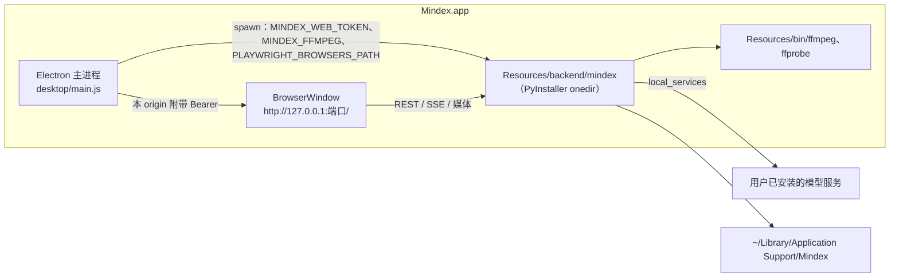
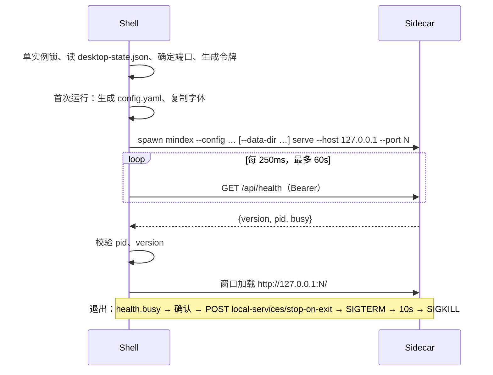

# Design Document: macos-desktop

## Overview

桌面应用 = Electron 外壳 + 冻结的 `mindex serve`。外壳只负责进程生命周期、认证注入、窗口行为与打包；所有业务能力（包括本机服务管理与动画组件安装）实现在 Python 后端，Web 版同样可用。前端不改动加载方式：窗口直接加载 `http://127.0.0.1:<端口>/`，现有的根相对请求、`EventSource`、`location.href`、下载链接全部原样工作。

背景调查与选型理由见 [plans/MACOS_NATIVE_PLAN.md](../../../plans/MACOS_NATIVE_PLAN.md)。

## Architecture

启动时序：

## Components and Interfaces

### 后端

| 模块 | 内容 |
|---|---|
| `api.py` | `GET /api/health` → `{version, pid, data_dir, busy, tasks}` |
| `studio/executor.py` | `StudioExecutor` 实例登记在模块级 `WeakSet`，`active_executors()` |
| `shared/background_tasks.py` | `BackgroundTaskRunner` 实例登记在模块级 `WeakSet`，`active_runners()`；类别取 `table` |
| `shared/media.py` | `ffmpeg_bin()`、`ffprobe_bin()`；`command()` 把首参数 `ffmpeg`/`ffprobe` 解析为配置路径 |
| `desktop/sidecar/mindex.spec` 的 `SOURCE_MODULES` | 以自身源码哈希作指纹的模块（`content_hash(Path(__file__))`：`models/llama_cpp.py` 的 `adapter_sha256` 属于嵌入空间身份）以 `.py` 源码打包（PyInstaller `module_collection_mode="py"`），冻结后 `__file__` 指向同一份源码，哈希不变。不改这些模块本身：改动其源码就会改变嵌入空间身份，使现有索引失配 |
| `desktop_entry.py` | 冻结入口：`-m <模块>` → `runpy.run_module`；否则 `mindex.cli:app` |
| `shared/config.py` | `LocalServiceConfig`、`LocalServicesConfig`；`Config.local_services` |
| `settings/local_services.py` | `LocalServiceManager`：start/stop/status/logs/stop_on_exit/autostart，pid 文件接管 |
| `settings/settings_api.py` | `/api/settings/local-services` 路由 |
| `settings/browser_install.py` | Chromium 安装后台任务（单例），`/api/settings/animation-browser` |
| `agent/tools/settings_tools.py` | `list_local_services`（read）、`start_local_service`、`stop_local_service`（danger） |

`/api/settings/local-services` 接口：

| 方法 | 路径 | 说明 |
|---|---|---|
| GET | `/api/settings/local-services` | `{enabled, items:[{name, role, port, autostart, stop_on_exit, running, pid, healthy, detail}]}`；未开启时 `{enabled:false, items:[]}`（列表只读，便于页面显示说明） |
| POST | `/{name}/start`、`/{name}/stop` | 未开启 403；未知服务 404 |
| GET | `/{name}/logs?tail=200` | 日志尾部文本 |
| PATCH | `/{name}` | 只接受 `autostart`、`stop_on_exit`（`extra="forbid"`），写入 settings KV 覆盖层 |
| POST | `/stop-on-exit` | 停止所有 `stop_on_exit` 且由本后端启动或接管的服务 |

服务进程：`Popen(argv, cwd, env=os.environ|env, start_new_session=True, stdout=log, stderr=STDOUT)`；pid 文件 `data_dir/locks/services/<name>.json` 记录 `{pid, argv, started_at}`；接管时用 `ps -o command= -p <pid>` 校验命令行前缀仍与 `argv[0]` 一致。停止：`os.killpg(pgid, SIGTERM)`，5 秒后 `SIGKILL`。健康：`httpx.get(f"http://127.0.0.1:{port}{health_path}", timeout=1.5)`，2xx 为健康。

### 外壳（`desktop/`）

| 文件 | 内容 |
|---|---|
| `main.js` | 生命周期、窗口、菜单、下载、退出流程 |
| `preload.js` | `contextBridge.exposeInMainWorld("MindexDesktop", {version, platform})` |
| `lib/paths.js` | 用户数据、日志、资源路径；开发/生产模式判断 |
| `lib/state.js` | `desktop-state.json` 读写（端口、数据目录） |
| `lib/ports.js` | 空闲端口检测与持久化端口复用 |
| `lib/sidecar.js` | 启动参数拼装（全局选项在 `serve` 之前）、环境变量、日志轮转、健康轮询、停止 |
| `lib/security.js` | origin 判定、外链协议白名单 |
| `lib/firstrun.js` | 生成 `config.yaml`、复制字体 |
| `pages/loading.html`、`pages/error.html` | 本地页面（不依赖后端） |
| `config.template.yaml` | 桌面默认配置 |
| `test/*.test.js` | `node --test` 纯逻辑测试 |
| `sidecar/mindex.spec` | PyInstaller 规格 |

认证注入：`session.defaultSession.webRequest.onBeforeSendHeaders({urls: [origin + "/*"]})` 附带 `Authorization: Bearer`。同时预置 Cookie `mindex_session = HMAC-SHA256(token, "mindex-web-session-v1")`，覆盖不经过 `webRequest` 的请求（以冒烟测试为准，保留两者）。

### 构建脚本

| 脚本 | 产物 |
|---|---|
| `scripts/build-desktop-ffmpeg.sh` | `desktop/build/ffmpeg/bin/{ffmpeg,ffprobe}`、`desktop/build/ffmpeg/sources/*.tar.*` |
| `scripts/build-desktop-sidecar.sh` | `desktop/build/backend/`（含 `mindex` 可执行文件） |
| `scripts/check-desktop-sidecar.py` | 冻结后端冒烟 |
| `scripts/build-desktop-mac.sh` | `desktop/dist/Mindex-<version>-arm64.{dmg,zip}` |
| `scripts/desktop-bench.py` | 性能对比报告 |

## Data Models

`desktop-state.json`：`{"port": 51234, "data_dir": null | "/abs/path"}`。

`config.template.yaml` 关键项：`data_dir: data`；`studio.subtitle.font_file: fonts/NotoSansCJKsc-Regular.otf`；embedding/asr/tts 等指向 `127.0.0.1` 本机端口；`local_services.enabled: true`，服务预设以注释给出（用户填写安装目录后取消注释）。

`LocalServiceConfig`：`name`（`^[a-z0-9][a-z0-9-]{0,31}$`）、`role`、`argv: list[str]`（非空）、`cwd: Path | None`、`env: dict[str,str]`、`port: int`、`health_path: str = "/health"`、`autostart: bool = False`、`stop_on_exit: bool = True`。

## Error Handling

- Sidecar 启动超时、提前退出、健康校验失败（pid 或版本不符）：错误页显示原因与日志尾部。
- 端口被他人占用：换新端口并提示；健康 `pid` 不符视为端口被占用。
- 本机服务启动失败（可执行文件不存在、立即退出）：接口返回 422 与中文原因；日志保留。
- 动画浏览器安装失败：任务状态 `failed`，保留日志尾部。

## Testing Strategy

- 后端：pytest（TestClient、真实子进程测试服务、真实 ffmpeg 包装脚本）。
- 外壳纯逻辑：`node --test desktop/test`。
- 外壳集成：pytest 包装的 Playwright `_electron` 冒烟（缺依赖时跳过）。
- 冻结后端：`scripts/check-desktop-sidecar.py`。
- 安装包：在当前账户安装 DMG 后运行冒烟。
- 页面控制器：Node vm 桩测试（沿用现有 `.cjs` 写法）。
- 不变量：签名快照测试、现有快速 pytest 全量通过。
