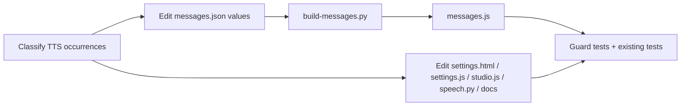

# Design Document

## Overview

This feature is a terminology rename. It changes the Settings page voice section label from "TTS 设置" / "TTS settings" to "语音合成设置" / "Speech synthesis settings". It also replaces other generic, user-visible uses of the abbreviation "TTS" with "语音合成" (zh) or "speech synthesis" (en). Product names (Qwen3-TTS, MiniMax TTS, DashScope TTS) stay as they are. Code identifiers, API routes, config keys, file names and log-only strings also stay as they are.

No new runtime components are introduced. The work consists of:

1. Editing display values in `frontend/src/shared/messages.json` without changing keys.
2. Regenerating `frontend/src/shared/messages.js` with `scripts/build-messages.py`.
3. Editing default text in `frontend/src/settings/settings.html`.
4. Editing user-visible strings in `settings.js`, `studio.js`, `backend/src/models/speech.py` and `docs/*.md`.
5. Updating tests and adding a guard test that checks the rename invariants.

Language for code examples: Python (backend, tooling and tests) and JavaScript (frontend tests).

## Architecture

The i18n pipeline is unchanged:

```
messages.json (source of truth)
     │  scripts/build-messages.py
     ▼
messages.js  (window.MindexMessages = {...};)
     │  loaded by pages via <script>
     ▼
MindexI18n.msg("ui.<hash>")  /  data-i18n="[[0,&quot;ui.<hash>&quot;]]"
```

Keys are derived from the source text by a hashing scheme, for example `ui.3401af34627a`. Changing display values does not recompute keys. Existing keys stay stable and only the zh/en values change (Requirement 3.4). The Section_Key `ui.3401af34627a` is used by both the `<h2>` and the `data-i18n-aria-label` attribute in `settings.html`.



## Components and Interfaces

### Occurrence classification (Requirement 6.2)

Each match of `TTS` (case-insensitive) is put into exactly one class before it is edited:

| Class | Examples | Action |
|---|---|---|
| Generic_TTS_Wording | "TTS 设置", "TTS 服务", "TTS service", "the TTS service in Settings" | Replace |
| Protected_Product_Name | "Qwen3-TTS", "MiniMax TTS", "DashScope TTS" | Keep |
| Non-user-visible identifier | `config.studio.tts`, `ROLE_ORDER 'tts'`, `tts_backend`, `test_studio_tts_feedback.py`, routes, log strings | Keep |

### Replacement rules

Replacement uses a protect-and-replace approach, shown here as a helper that is also reused by the guard tests:

```python
import re

PROTECTED = ("Qwen3-TTS", "MiniMax TTS", "DashScope TTS")
_SENTINEL = "\u0000P{}\u0000"

def mask_protected(text: str) -> str:
    for i, name in enumerate(PROTECTED):
        text = text.replace(name, _SENTINEL.format(i))
    return text

def unmask_protected(text: str) -> str:
    for i, name in enumerate(PROTECTED):
        text = text.replace(_SENTINEL.format(i), name)
    return text

def has_generic_tts(text: str) -> bool:
    return re.search(r"(?<![A-Za-z0-9_])TTS(?![A-Za-z0-9_])", mask_protected(text)) is not None

def replace_generic(text: str, lang: str) -> str:
    word = "语音合成" if lang == "zh" else "speech synthesis"
    masked = mask_protected(text)
    # Chinese wording attaches without a space ("TTS 服务" -> "语音合成服务").
    if lang == "zh":
        masked = re.sub(r"(?<![A-Za-z0-9_])TTS\s*(?=[\u4e00-\u9fff])", word, masked)
    masked = re.sub(r"(?<![A-Za-z0-9_])TTS(?![A-Za-z0-9_])", word, masked)
    return unmask_protected(masked)
```

The helper is a guide for mechanical edits and a test oracle. The actual edits to `messages.json` are reviewed by hand, so grammar stays correct. For example, "TTS settings" becomes "Speech synthesis settings" with a capital letter when it starts a label.

### Target edits

- `messages.json`
  - `ui.3401af34627a`: zh "语音合成设置", en "Speech synthesis settings".
  - Messages containing "check the TTS service", "TTS 服务返回的 JSON", "TTS service did not return recognizable audio data", and the Studio voice-load failure ("the TTS service in Settings" becomes "the speech synthesis service in Settings").
  - Any other entry whose zh/en value matches `has_generic_tts`.
- `messages.js`: regenerated only by `python scripts/build-messages.py` and never edited by hand.
- `settings.html`
  - Line 46: `aria-label="语音合成设置"`.
  - Line 47: `<h2 ...>语音合成设置</h2>`.
  - The `data-i18n*` attributes are unchanged.
- `backend/src/models/speech.py`
  - Module docstring: "TTS 语音合成客户端..." becomes "语音合成客户端...".
  - `ModelError("TTS 服务未返回可识别的音频数据")` becomes `"语音合成服务未返回可识别的音频数据"`.
  - `ModelError("TTS 服务返回的 JSON 中没有可解码的音频字段")` becomes `"语音合成服务返回的 JSON 中没有可解码的音频字段"`.
  - `config.studio.tts` is a config key and stays.
  - Because these strings are also catalog source texts, the matching catalog entries are updated to the same wording so runtime translation lookup still works.
- `settings.js` and `studio.js`: user-visible literals only. `ROLE_ORDER`, `ROLE_DESC.tts`, `PROVIDERS.tts` and `state.data.business.tts_backend` are identifiers and stay.
- `docs/*.md`: user-facing prose only. Code fences, paths and config keys stay.

### Build script interface (Requirement 4)

`scripts/build-messages.py` already behaves as the requirements need. `render()` calls `json.loads` first, so invalid JSON raises and Python exits non-zero. `--check` returns exit code 1 when `messages.js` differs from the rendering of `messages.json`. No code change is needed. A test covers the exit-code contract.

## Data Models

`messages.json` entry shape (unchanged):

```json
{
  "ui.3401af34627a": { "zh": "语音合成设置", "en": "Speech synthesis settings" }
}
```

Invariants across the change:
- The key set is identical before and after.
- For each entry, the multiset of placeholders (`{p0}`, `{p1}`, ...) is identical.
- For each entry, the multiset of Protected_Product_Name occurrences is identical.
- `messages.js` equals `"window.MindexMessages = " + messages.json.rstrip() + ";\n"`.

A baseline snapshot of the original catalog is taken from git (`git show HEAD:frontend/src/shared/messages.json`) for before/after comparison in the guard test.

## Error Handling

- Invalid `messages.json` makes the build script abort with a non-zero exit status and without writing `messages.js`, so a broken file is never generated.
- A stale `messages.js` is caught by `python scripts/build-messages.py --check` (exit 1). The guard test and CI run this check.
- A mistaken replacement inside a Protected_Product_Name is prevented by the masking step. It is also caught by the protected-name-count invariant.
- A missing i18n key referenced from `settings.html` is caught by the key-existence check.
- If a catalog source text is changed but the code that uses it is not updated (or the reverse), that string falls back to its default text. The guard test and the full existing suite surface the mismatch.

## Testing Strategy

Dual approach: example-based unit tests for the specific strings, and property-style tests for the repo-wide invariants. The Python property tests use Hypothesis (already present, see `.hypothesis/`) with at least 100 iterations. Repo-scan invariants are deterministic data-driven checks that iterate over every catalog entry or file, so there is no generator for them.

Not property-tested: the specific heading values (1.1 to 1.5), the three named messages (2.3, 2.4), and the test-update requirements (5.x). These are example or smoke tests.

Test locations:
- `tests/settings_releases_ui.cjs`: line 123 asserts "语音合成设置" instead of "TTS 设置". A `lang=en` case asserts that the heading and aria-label are "Speech synthesis settings". It also asserts that Protected_Product_Names are still present in the relevant user-visible strings.
- `test_studio_tts_feedback.py`, `test_cloud_adapters.py`, `test_voices.py`: assertions on generic wording are switched to the unified wording. They also assert that the product names remain.
- New `test_tts_rename.py`: catalog invariants, the masked-scan checks over the scoped files, the `replace_generic` property tests, the build round trip and the build error-exit test.

Property tests are tagged `Feature: settings-tts-rename, Property N: <text>`.

## Correctness Properties

*A property is a characteristic or behavior that should hold true across all valid executions of a system-essentially, a formal statement about what the system should do. Properties serve as the bridge between human-readable specifications and machine-verifiable correctness guarantees.*

### Property 1: No generic TTS wording remains in the catalog

For any entry in `messages.json` and for any language in {zh, en}, the value, after masking Protected_Product_Names, contains no standalone "TTS" token.

**Validates: Requirements 2.1, 2.2, 6.3**

### Property 2: No generic TTS wording in scoped source files and docs

For any file in {`settings.html`, `settings.js`, `studio.js`, `backend/src/models/speech.py`, `docs/*.md`}, the user-visible text of that file (HTML text and attributes, string literals, docstrings, and doc prose outside code fences), after masking Protected_Product_Names, contains no standalone "TTS" token.

**Validates: Requirements 2.5, 2.6, 6.3**

### Property 3: Protected product names are preserved

For any entry in the catalog and for any scoped file, the number of occurrences of each Protected_Product_Name after the change is at least the number before the change (baseline from git HEAD).

**Validates: Requirements 3.1, 3.2**

### Property 4: Replacement affects only generic wording

For any string composed of arbitrary text, Protected_Product_Names and generic standalone "TTS" tokens, and for any language, `replace_generic` produces a string that has the same Protected_Product_Name occurrences as the input and contains no standalone generic "TTS".

**Validates: Requirements 3.3, 2.1, 2.2**

### Property 5: Keys and placeholders are stable

For any entry in the baseline catalog, the same key exists after the change, and the multiset of placeholders in its zh and en values is unchanged.

**Validates: Requirements 3.4**

### Property 6: Build round trip

For any valid catalog JSON text, the output of `render()` equals `"window.MindexMessages = " + text.rstrip() + ";\n"`. Stripping the prefix and the trailing `;` and parsing gives back the original catalog. For the repository, `build-messages.py --check` exits 0 after regeneration.

**Validates: Requirements 4.1**

### Property 7: Referenced i18n keys exist

For any `data-i18n`, `data-i18n-aria-label` or other i18n key reference found in `settings.html`, the key exists in the Message_Catalog.

**Validates: Requirements 4.2**

### Property 8: Build errors produce a non-zero exit

For any input that is not valid JSON placed in `messages.json`, running the build script exits with a non-zero status and does not modify `messages.js`.

**Validates: Requirements 4.3**

### Property 9: Identifiers are untouched

For any scoped code file, the multiset of lowercase `tts` tokens outside string literals (identifiers, keys, routes) is the same before and after the change.

**Validates: Requirements 6.1**
