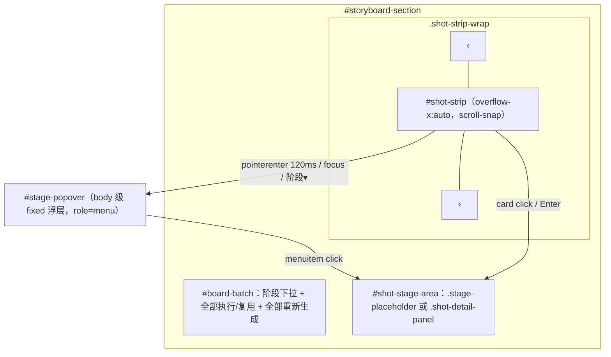

# Design Document

## Overview

把创作页分镜工作台从固定五列表格改为「批量操作栏 + 顶部横向分镜条 + 卡片下方阶段浮层 + 全宽阶段详情区」。阶段详情的渲染函数（`renderShotEditor`、`renderStageDetails`、`renderSourceDetails`）原样复用；变化集中在 `studio-board.js` 的渲染与交互、`studio-state.js` 的阶段状态纯函数、`studio.html`/`studio.css` 的结构与样式，以及后端新增一个只读播放列表接口。

### 关键设计决策

| 决策 | 选择 | 理由 |
|---|---|---|
| 过期判定 | `state.data.conflicts["{stage}:{sid}"]` 非空 | 后端 `details.detail()` 已对每个已选版本重算签名，无需改后端 |
| 失败/执行中 | 最近一次包含该节点的构建 `latestNode()`：`failed`；构建 `running` 且节点 `pending/running` → running | 与原表格单元格的状态行一致 |
| 浮层位置 | `#stage-popover` 放在分镜条之外，`position:fixed`，按卡片 `getBoundingClientRect()` 定位 | `overflow-x:auto` 会让纵向溢出也被裁剪，浮层放在条内会被截断 |
| 卡片缓存 | `state.shotCards: Map<sid, {card, key, mediaKey, media}>`，按 `summaryKey` 增量重建文字部分，媒体按 `mediaKey` 独立保留 | 轮询刷新不打断播放，与原 `matrixRows` 策略一致 |
| 详情区 | 单一面板 `state.stagePanel = {key, sid, stage, historyKey}`，沿用原 `panelKey` 计算 | 保留未提交输入；原逻辑已验证 |
| 选择记录 | `state.selection: Map<scopeKey, {sid, stage}>` 取代 `state.expanded` | 按方案恢复（需求 6.4） |
| 选片播放 | 新接口 `source-playlist` 返回 `ShotMedia.playlist()`，前端点击后才 `ShotPlayer.attach` | 原 `/preview` 需要 ffmpeg 与变更锁；ShotPlayer 会预加载两路视频，点击才挂载避免多卡同时加载 |
| 兼容名 | 保留 `renderMatrix`（= `renderBoard`）、`toggleCell(sid, stage)`（打开/关闭）、`invalidatePanel(sid)` | 编辑器、音乐、素材等模块已有调用，减少改动面 |

## Architecture



### 数据流

`render()` → `renderRetrieval()` → `renderBoard()`：
1. scope 变化时清空卡片与详情（暂停媒体）。
2. 对 `order()` 中每个分镜：取得或创建卡片；`summaryKey` 变化时重建卡片文字部分；`mediaKey` 变化时重建媒体占位（懒加载）。
3. 删除不再存在的分镜卡片，按顺序插入。
4. 校正 Selection（分镜被删 / 阶段不再属于分镜 → 清除）。
5. 渲染详情区（`panelKey` 未变则只更新标题、执行结果、版本历史）。
6. 若浮层打开，重新渲染浮层并定位。
7. `updateLocks()`。

## Components and Interfaces

### studio-state.js（纯函数）

```js
const STAGE_STATES = ["none", "complete", "stale", "failed", "running"];
function barStages(sid)            // ["content", cellStage(sid,"recall"), ...["tts","select","render"] ∩ shotStages(sid)]
function stageState(sid, stage)    // content/source 也适用；source 只看 content 的状态
function cardStage(sid)            // 第一个 stale；否则最后一个已选版本；否则 "content"
```

- `source`（上传素材预览）没有版本：其状态跟随 `content`（有上传文件 → complete，否则 none），不参与「最后一个已选版本」以外的判定——有上传文件时视为已有产物。
- `running`：存在 `status==="running"` 的构建，其节点中该 `{stage, shot_id}` 状态为 `pending` 或 `running`。

### studio-board.js

- `stageSummaryNodes(sid, stage)`：从原 `cellSummary` 提取，返回摘要节点数组（徽标、摘要、音乐、冲突、状态、失败原因）。`cellSummary(sid, stage)` 保留为返回包装元素的函数（单测与编辑器刷新使用），内部调用 `stageSummaryNodes`。
- `renderBoard()`；`renderMatrix = renderBoard`。
- `shotCard(sid, index)`、`refreshShotCard(sid)`（编辑器草稿变化时调用，替代 `summary.children[1].replaceWith`）。
- `openStage(sid, stage)`、`closeStage()`、`toggleCell(sid, stage)`（已打开同一阶段则关闭，否则打开）。
- `selection()`：当前 scope 的 Selection。
- 浮层：`showPopover(sid, {focus})`、`hidePopover({restoreFocus})`、`positionPopover()`；悬停计时器 `HOVER_OPEN_MS=120`、`HOVER_CLOSE_MS=200`。
- 媒体：`cardMedia(sid, stage)` 返回 `{key, build()}`；`IntersectionObserver`（root = `#shot-strip`，`rootMargin:"0px 200px"`）进入时调用 `build()`，离开时 `pauseMedia`。媒体容器 `.card-media` 上的 `click/pointerdown/pointerenter` 停止冒泡并标记 `data-card-media`，卡片的悬停/点击逻辑忽略来自其中的事件。

#### 卡片媒体映射

| Card_Stage | 媒体 | 来源 |
|---|---|---|
| tts | `<audio controls preload=metadata>` | `files.audio.url` |
| render | `<video controls preload=metadata>` + 该镜字幕 `<track>`（不静音、不单独显示音频；详情区同样） | `files.preview.url \|\| files.video.url`，字幕取 `data.event.subtitle` 生成 WebVTT 轨（hidden），由叠加层按 `activeCues` 显示；`pictureBottom` 取帧检测黑边，`placeCaption` 按 object-fit 计算画面矩形，使字幕底边对齐可视画面底边 |
| generate | 同上 | `files.generated.url` |
| draw | `` | `files.image.url` |
| recall | 最多 3 张 `` | `data.results[].thumbnail_url` |
| source | 上传图片 `` / 视频 `<video muted>` | `inputUrl(media_id)` |
| select（library） | 缩略图 + 「▶ 播放原片区间」按钮 → 点击后 `<video muted>` + `ShotPlayer.attach(v, source-playlist)` | 缩略图取锚点候选或第一个召回候选的 `thumbnail_url` |
| select（file） | `<video muted controls preload=metadata src="url#t=s,e">` | 生成画面 `generate.files.generated` 或上传片段 `inputUrl` |
| content / animate / music | 无 | — |

注意：`media()` 会对 `/api/media/` 地址自动挂 ShotPlayer；卡片里的 `files.*` 都是 `/api/studio/.../artifacts/...`，不会触发。

### studio.html 结构

```html
<details id="storyboard-section" open><summary>分镜工作台 <span id="shot-count"></span></summary>
  <div class="section-head"><span id="storyboard-warning" class="warn-text"></span></div>
  <div id="retrieval-deps" ...></div>
  <div id="board-batch" class="board-batch" role="group" aria-label="批量操作">
    <span class="board-batch-label">批量操作</span>
    <select id="batch-stage" aria-label="批量操作的阶段">…5 项…</select>
    <button id="batch-execute" class="quiet execute-column">全部执行/复用</button>
    <button id="batch-regenerate" class="quiet regenerate-column">全部重新生成</button>
  </div>
  <div class="shot-strip-wrap">
    <button id="strip-prev" class="quiet strip-nav" aria-label="上一组分镜">‹</button>
    <div id="shot-strip" class="shot-strip" role="list" aria-label="分镜"></div>
    <button id="strip-next" class="quiet strip-nav" aria-label="下一组分镜">›</button>
  </div>
  <div id="shot-stage-area" class="shot-stage-area" aria-live="polite"></div>
</details>
<div id="stage-popover" class="stage-popover" role="menu" hidden></div>
```

批量按钮保留 `execute-column`/`regenerate-column` 类，`data-stage` 由下拉值同步，原 `updateLocks` 与 `regenerateColumn` 逻辑不变；`studio-main.js` 的点击绑定改为读取下拉值。

### CSS 要点

- `.shot-strip{display:flex;gap:12px;overflow-x:auto;scroll-snap-type:x proximity;overscroll-behavior-x:contain}`
- `.shot-card{flex:0 0 max(220px, calc((100% - 48px) / 5));scroll-snap-align:start}`；容器宽度小于 220px 时 `flex-basis:100%`（`min(…,100%)`）。
- `.stage-popover{position:fixed;z-index:30;min-width:200px;max-width:calc(100vw - 16px)}`。
- 「阶段 ▾」按钮：默认 `display:none`；`@media (hover:none)` 与 `.shot-card:focus-within` 时显示。
- 状态点颜色：none 灰、complete 绿、stale 琥珀、failed 红、running 蓝（带脉动，`prefers-reduced-motion` 时关闭）。

### 后端：Source_Playlist

```python
@router.get("/jobs/{job_id}/versions/{version_id}/source-playlist")
def source_playlist(job_id: str, version_id: str):
    w = read_workspace(job_id)                    # 不存在任务 → 404
    item = workspace.version(w, version_id)       # 不存在版本 → StudioError(422)
    if item["stage"] != "select" or item["status"] != "complete" or item.get("incomplete"):
        raise studio.StudioError("只有已完成的选片版本可以播放原片区间")
    video = item["data"]["event"]["video"]
    if video.get("kind", "library") != "library":
        raise studio.StudioError("此选片来自上传片段或生成画面，请直接播放对应文件")
    if not studio_steps.interval_visible(store, video["source_id"], video["start"], video["end"],
                                         overlays=Library(store).overlays()):
        raise studio.StudioError("所选区间包含隐藏素材")
    return ShotMedia(store).playlist(video["source_id"], video["start"], video["end"], prefix="/api/admin/shots")
```

- 镜头地址前缀用 `/api/admin/shots`：`/api/shots/{id}/media` 只放行当前生效索引中的素材，而选片可能来自已不在生效索引里的素材（工作台依赖的组合与当前生效不一致时）。admin 路由在启用 `MINDEX_WEB_TOKEN` 时同样受登录保护，与创作页一致。
- 版本属于任务：版本按 `w["versions"]` 查找，其他任务的版本 ID 自然查不到。
- 不加 `mutation_lock`、不调用 ffmpeg（`references()` 只读 SQLite 与已登记的镜头文件信息）。

## Data Models

前端状态变更（`studio-state.js` 的 `state`）：

| 字段 | 旧 | 新 |
|---|---|---|
| `expanded` | `Map<scope, Map<sid, stage>>` | 删除，改 `selection: Map<scope, {sid, stage}>` |
| `matrixRows` | `Map<sid, {summary, detail, panel, panelKey}>` | 删除，改 `shotCards: Map<sid, {card, key, mediaKey, mediaBox}>` |
| `matrixScope` | scope | 改名 `boardScope` |
| — | — | `stagePanel: {key, historyKey, node}`、`popover: {sid, timer}` |

## Error Handling

- 卡片媒体加载失败（播放列表 4xx）：在媒体区显示中文错误文字（`shortIds(error.message)`），不影响卡片其他部分。
- 详情区渲染沿用原逻辑的错误显示。

## Testing Strategy

- `tests/studio_card_stage_unit.cjs`（新，pytest 包装 `test_studio_card_stage_ui.py`）：沙箱运行真实 `studio-state.js`，覆盖 Stage_State / Card_Stage / Bar_Stages 组合。
- `tests/test_studio_source_playlist.py`（新，标记 slow，复用 `test_studio_workspace.py` 的 `prepared` 构建）：成功（`duration` ≈ 区间长度、items 指向 `/api/admin/shots/`）、非选片、其他任务、未知版本、上传片段来源、隐藏素材。
- 迁移：`studio_visual_ui.cjs`（锚点与 `refreshShotCard` 桩）、`studio_catalogue_loading_unit.cjs`（`shotCards`）、`studio_picture_column_unit.cjs`（保持 `matrixStages`/`cellStage` 行为）、浏览器脚本 `ui_layout_browser.cjs`、`studio_alignment_ui.cjs`、`recall_filters_ui.cjs`、`i18n_ui.cjs`、`studio_candidate_identities_ui.cjs` 的选择器。
- 新浏览器脚本 `tests/studio_board_ui.cjs`（隔离 fixture 服务，手动/本地运行，与其他浏览器脚本一致）：悬停展开、移入浮层保持、移出收起、点击卡片打开 Card_Stage、点击阶段打开、键盘路径、触屏模拟「阶段 ▾」、滚动后浮层位置、媒体无 autoplay、点击媒体不打开详情、六种宽度无横向溢出。
