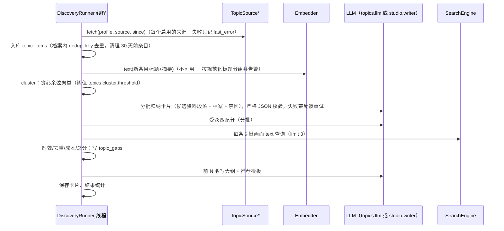

# Design Document: topic-discovery

## Overview

选题模块是一个独立的后端包 `backend/src/topics/`（服务层），四个入口都建立在它之上：

- REST：`topics/api.py` 的 `topics_router`（前缀 `/api/topics`），对服务层做薄封装；
- CLI：`backend/src/cli_topics.py`（`mindex topics ...`），直接调用服务层，不需要服务在运行；
- 智能助手：`agent/tools/topics.py`，经回环调用 REST，领域 `topics`；
- MCP：原样导出同一注册表中 `topics` 领域的工具；
- 页面：`frontend/src/studio/topics.html` + `topics.js` + `topics.css`（`/studio/topics`），只调用 REST。

Web 端与桌面端运行同一个 `mindex serve`、加载同一套前端，因此两端的行为由同一份代码保证；桌面端的唯一差异是托盘常驻（外壳层）。

```mermaid
flowchart TB
  subgraph Shell[运行形态]
    WEB[浏览器 → mindex serve]
    APP[Electron 窗口/托盘 → sidecar mindex serve]
  end
  WEB & APP --> UI[/studio/topics/]
  UI --> REST[/api/topics/...]
  AG[智能助手工具] -->|回环| REST
  MCP[MCP stdio / HTTP] -->|同一注册表| AG
  CLI[mindex topics ...] --> SVC
  REST --> SVC[topics 服务层]
  SCHED[调度器 lifespan 线程] --> SVC
  SVC --> DB[(metadata.sqlite3 topic_* 表)]
  SVC --> IDX[(SearchEngine 活动索引)]
  SVC --> JOB[studio.create_job + 方案参数 + 参考文稿 + profile.json]
  JOB --> W[ScriptHandler → Writer(profile=...)]
```

## 挖掘流水线



进度阶段（`progress.stage`）：`fetch` → `embed` → `cluster` → `summarize` → `score` → `outline` → `done`，每次上报都是取消检查点。

## Components and Interfaces

### 数据（`shared/storage.py` 追加 `_metadata_v3`）

| 表 | 主要列 |
|---|---|
| `topic_profiles` | `id`、`name`、`body`（JSON：领域、子方向、受众、定位、禁区、关键词、语言、地区、默认画幅、权重、定时）、`created_at`、`updated_at` |
| `topic_sources` | `id`、`profile_id`、`kind`、`name`、`enabled`、`config`（JSON）、`secret`、`last_fetch_at`、`last_error`、`created_at`、`updated_at` |
| `topic_items` | `id`、`profile_id`、`source_id`、`dedup_key`、`title`、`summary`、`url`、`published_at`、`event_at`、`hot`、`fetched_at`；唯一键 `(profile_id, dedup_key)` |
| `topic_runs` | 后台任务表约定列（`id`、`source_id`=profile_id、`status`、`config`、`options`、`progress`、`error`、`result`、`publication`、时间戳）+ `trigger` |
| `topic_cards` | `id`、`profile_id`、`run_id`、`title`、`body`（JSON：角度、理由、item_ids、visuals、scores、coverage、outline、template_id、warnings）、`total`、`status`、`job_id`、`created_at`、`updated_at` |
| `topic_gaps` | `id`、`profile_id`、`card_id`（最近一次）、`visual`、`count`、`status`、`created_at`、`updated_at` |

`topic_runs.source_id` 存档案 ID，以复用 `BackgroundTaskRunner`/`task_progress` 的列约定；`task_progress.TASK_TABLES` 加入 `topic_runs`。删除档案时在一个事务里删除其全部子表行。

### 锁

`shared/locks.py`：`ORDER` 末尾追加 `topics`，`PATHS["topics"] = "locks/topics.lock"`（独占）。同一时间只运行一个挖掘任务（适配单 GPU 与模型额度），提交冲突返回 409。`BackgroundTaskRunner.__init__` 的恢复改为可覆盖的 `recover()` 钩子（默认仍调用 `recover_tasks`）；`TopicRuns.recover()` 在拿到 `topics` 锁时把 queued/running 标为 interrupted。

### 配置（`shared/config.py`）

```python
class TopicsConfig(StrictModel):
    llm: GeneratorConfig | None = None          # 缺省复用 studio.writer
    scheduler: TopicsSchedulerConfig            # enabled=True, interval_seconds=60
    fetch: TopicsFetchConfig                    # timeout=15, max_bytes=2MB, item_days=30, max_items_per_source=100
    cluster: TopicsClusterConfig                # threshold=0.82, max_clusters=40, batch=8
    coverage: TopicsCoverageConfig              # min_similarity=0.3, limit=3
    brave: TopicsBraveConfig                    # max_queries=10, base_url="https://api.search.brave.com"
Config.topics: TopicsConfig = Field(default_factory=TopicsConfig)
```

`config.example.yaml` 与 `desktop/config.template.yaml` 增加 `topics:` 段（只写 `scheduler.enabled`，其余用缺省）。`topics` 不进入任何 studio 签名。

### 服务层模块

| 模块 | 职责 |
|---|---|
| `topics/models.py` | 严格模型：`ProfileBody`（含 `Weights`、`Schedule`）、`SourceBody`（按 `kind` 区分的配置联合）、`CardChanges`、LLM 输出模型 |
| `topics/profiles.py` | 档案 CRUD、`snapshot(profile)`；`profile_hash(snapshot)` 与 `writer_block(snapshot)` 在 `shared/writing_profile.py`（studio 的 script 阶段也用，避免 studio → topics 依赖） |
| `topics/sources/base.py` | `TopicSource` 协议、`Item` 数据类、注册表、`http_get`（协议、超时、大小、中文错误）、`mask` |
| `topics/sources/{rss,hotlist,brave,calendar,local}.py` | 五种来源 |
| `topics/items.py` | 抓取编排、`dedup_key`、入库、过期清理 |
| `topics/cluster.py` | 余弦贪心聚类与标题分组降级 |
| `topics/llm.py` | `chat_json(profile, system, parts, model)`：复用 `models.storyboard.chat_completion`，JSON 解析、严格校验与带反馈重试 |
| `topics/summarize.py` | 卡片归纳提示词与解析 |
| `topics/coverage.py` | 关键画面查询、命中判定、报告 |
| `topics/scoring.py` | 五项评分与加权，纯函数为主 |
| `topics/outline.py` | 大纲与推荐模板 |
| `topics/gaps.py` | 缺口合并、列表、导出 |
| `topics/runner.py` | `TopicRuns(BackgroundTaskRunner)` 与流水线编排 `discover(...)`（CLI 在本进程直接调用 `run_here`） |
| `topics/cards.py` | 卡片保存、视图、修改、`evaluate`（打分编排）、`write_outline`、`discard`（任务取消或失败时撤回卡片） |
| `topics/create_job.py` | 卡片 → 创作任务（含回滚）、任务档案快照读取与同步 |
| `topics/scheduler.py` | 调度线程、`due(profile, now, runs)` 纯函数、`status()` |
| `topics/capabilities.py` | 能力 × 入口对照表常量 |
| `topics/api.py` | `topics_router(runtime, store, embedder)` |
| `topics/samples/*.csv` | 日历样例（package-data + PyInstaller datas） |

模型注入：`topics_router` 与 runner 接收 `embedder`（与 studio 相同的注入方式）和可选 `topic_llm`（测试注入的可调用对象 `(system, parts) -> str`）；`create_app` 增加 `topic_llm=None`、`scheduler=False` 参数；`mindex serve`（Web 与桌面 sidecar 都经它启动）按 `topics.scheduler.enabled` 传入，测试与内嵌应用缺省不启动调度器。

### 评分

- 时效：普通条目 `0.5 ** (age_hours / 72)`；日历事件 `event_at` 在未来 0–7 天：`1 - days/7`（当天为 1），已过去：0；卡片取所含条目的最大值。
- 受众：LLM 返回 `{card_index: 0..1}`，缺失为 0.5 并告警。
- 覆盖：每条关键画面 `SearchEngine.text(TextSearch(text=visual, granularity=studio.recall.granularity, limit=coverage.limit))`；首个结果的 `matches` 中最大 `cosine_similarity ≥ min_similarity` 记为命中；结果 `degraded`（BM25 降级）时有结果即命中并在报告里标 `degraded`。覆盖分 = 命中数 / 画面数。
- 去重：卡片文本向量与 `local` 来源的已做视频（任务标题 + 大纲）及本档案已采纳卡片的最大余弦，`1 - max(0, sim)`；嵌入不可用时按标题 Jaccard 近似并告警。
- 成本：`1 - gaps / visuals`。
- 总分：`Σ weight_i × score_i`，保留三位小数。

### 从选题建任务（`topics/create_job.py`）

1. `studio.create_job(config, outline, title=card.title, store=store)`；
2. `ws.load` 得到当前方案，调用与 `PATCH /plans/{plan_id}` 相同的服务函数设置 `template_id`、`canvas`（档案默认画幅，16:9 时不改）；
3. 调用 `workspace.references.register` 登记一份参考文稿：`选题：… / 角度：… / 来源：标题 + 链接 + 摘要`；
4. 写 `job_dir/profile.json`（`{"profile_id", "name", "hash", "snapshot", "synced_at"}`），并在 `job.json` 写 `topic`；
5. 卡片置 adopted、记录 job_id。

步骤 2–4 在 studio 的 mutation 互斥内进行；任一步失败删除任务目录（`shutil.rmtree`，只在本函数刚创建的目录上执行）并重抛。

### 档案进入文案

- `Writer.write(..., profile: str | None = None)`：非空时在 instructions 后追加 `PROFILE_HEADER + profile`（`【账号档案｜写作约束】` + 受众、定位、禁区三行）。不改 `WRITER_PROMPT_VERSION`。
- `ScriptHandler.settings(config, p, store=..., display=...)` 拿不到 job_id，因此快照哈希写在方案字典的顶层键 `p["profile_hash"]`（不放进 `PlanOptions`：`PATCH` 方案参数只替换 `options`，这个键天然保留；`POST /plans` 新建方案时从当前方案沿用）。`settings` 在键存在时加 `"profile": hash`；`run` 复验 `profile.json` 的哈希与签名一致后读取 `writer_block`。没有该键的旧方案签名逐字节不变（`test_studio_signature_snapshot.py` 不变）。同步后详情给出 `script_profile_changed`（生成文案时记录的档案哈希与方案不同），创作页与 `get_workspace` 工具据此提示，不自动重写。
- 同步：`POST /api/topics/jobs/{job_id}/profile/sync` 用当前档案重写 `profile.json`，并把该任务所有方案的 `profile_hash` 改为新值；script 签名随之变化，已有文案只提示 `script_profile_changed`，不自动重写。路由放在 `/api/topics/jobs/...` 下，避免改动 studio 路由文件的职责划分；创作页通过它读取"档案已更新"状态。

### REST（前缀 `/api/topics`）

| 方法 路径 | 说明 |
|---|---|
| `GET/POST /profiles`，`GET/PATCH/DELETE /profiles/{pid}`（PATCH 为部分修改） | 档案 |
| `GET/POST /profiles/{pid}/sources`，`PATCH/DELETE /sources/{sid}`，`POST /sources/{sid}/test` | 数据源 |
| `POST /sources/{sid}/calendar`（multipart 或 `{"text"}`），`GET /calendar-samples`，`POST /sources/{sid}/calendar-sample/{name}` | 日历 |
| `POST /profiles/{pid}/fetch` | 立即抓取 |
| `GET /profiles/{pid}/items` | 条目（只读，调试与页面展开用） |
| `POST /profiles/{pid}/runs`，`GET /profiles/{pid}/runs`，`GET /runs/{rid}`，`POST /runs/{rid}/cancel`，`POST /runs/{rid}/retry` | 挖掘 |
| `GET /profiles/{pid}/cards?status=`，`GET/PATCH /cards/{cid}` | 卡片 |
| `POST /cards/{cid}/score`，`GET /cards/{cid}/coverage` | 打分与覆盖 |
| `POST /cards/{cid}/outline` | 大纲 |
| `POST /cards/{cid}/job` | 建任务（`{"force": false}`） |
| `GET /jobs/{job_id}/profile`，`POST /jobs/{job_id}/profile/sync` | 任务档案 |
| `GET /profiles/{pid}/gaps`，`PATCH /gaps/{gid}`，`GET /profiles/{pid}/gaps.csv` | 采集清单 |
| `GET /schedule` | 定时状态 |

错误：`EntityNotFound` → 404，`ValueError` → 422，冲突 → 409，`ModelError` → 503（沿用 `create_app` 的全局映射）。

### CLI（`mindex topics`）

`profiles list|show|create|update|delete`、`sources list|add|update|remove|test|import-calendar`、`fetch`、`items`、`discover`、`runs list|show|cancel|retry`、`list`、`show`、`score`、`coverage`、`outline`、`update`、`create-job`、`job-profile show|sync`、`gaps list|done|reopen|export`、`schedule status`。输出 JSON（`print_json`）。`create`/`update` 接受 `--file profile.json` 或常用选项。`discover` 在本进程同步运行（打印进度到 stderr，不需要服务在运行）；CLI 与服务通过 `topics` 锁互斥。

### 智能助手工具（领域 `topics`，MCP 同名导出）

参数名带 `topic_` 前缀（`topic_profile_id`、`topic_source_id`），与设置页模型档案的 `profile_id`、素材的 `source_id` 区分；卡片、缺口、挖掘任务用 `card_id`、`gap_id`、`run_id`。`discover_topics` 会调用嵌入服务与 LLM（GPU 任务、消耗额度），风险级别为 danger。

参数名带 `topic_` 前缀（`topic_profile_id`、`topic_source_id`），与设置页模型档案的 `profile_id`、素材的 `source_id` 区分；卡片、缺口、挖掘任务用 `card_id`、`gap_id`、`run_id`。

`list_topic_profiles`、`save_topic_profile`、`delete_topic_profile`(danger)、`list_topic_sources`、`save_topic_source`、`delete_topic_source`(danger)、`test_topic_source`、`import_topic_calendar`、`fetch_topic_items`、`list_topic_items`、`discover_topics`(danger)、`get_topic_run`、`manage_topic_run`、`list_topics`、`get_topic`、`score_topic`、`topic_coverage`、`draft_topic_outline`、`update_topic`、`create_job_from_topic`、`get_job_profile`、`sync_job_profile`、`topic_gaps`、`update_topic_gap`、`get_topic_schedule`（共 25 个，最终以 `topics/capabilities.py` 为准）。`focus = {"page": "topics", "profile_id", "card_id", "section"}`；`create_job_from_topic` 的 focus 为 `{"page": "studio", "job_id"}`。`discover_topics` 返回 `watch_task={"kind": "topics", "task_id"}`，`TaskWatcher` 增加 `topics` 种类。`PAGE_DOMAIN["topics"] = "topics"`；`agent-panel.js` 的 `urlFor` 把 `page=topics` 映射到 `/studio/topics`。

### 入口一致性（`topics/capabilities.py` + `tests/test_topics_parity.py`）

```python
CAPABILITIES = (
  Capability("profiles", rest=[("GET", "/api/topics/profiles"), ...], cli=["profiles list", ...],
             tools=["list_topic_profiles", "save_topic_profile", "delete_topic_profile"], page="profiles"),
  ...
)
```

测试逐项断言：REST 路由存在于 `create_app().routes`；CLI 命令可由 Typer 解析（`--help` 退出码 0）；工具在 `build_registry()` 中且 `mcp=True`；MCP 导出（`mcp_server` 的工具列表函数，policy=all）包含该工具；页面 `topics.html` 含 `data-capability="<page>"` 的区块。

### 页面

布局沿用文案模板页（`aside.job-panel` + `section.work-panel`）：

- 顶部工具条：档案选择器、新建/编辑档案（对话框）、开始挖掘、进度条、定时状态（`data-capability="schedule"`）；
- 左栏：状态筛选（新/已采纳/已忽略/全部）、搜索、按总分排序的卡片列表（分数徽标、覆盖率、是否有大纲）；
- 右栏卡片详情：标题、角度、理由、来源条目（外链 `target=_blank rel=noopener`）、分项分数条、覆盖报告（每条画面的命中片段缩略图 `/api/thumbnails/{id}`，点击跳转 `/?segment=` 检索页定位；缺口标红）、大纲编辑（未保存提示）、模板选择、生成大纲、重新打分、忽略/恢复、创建创作任务；
- 折叠区：数据源（增删改、启停、试抓、日历上传与样例、第三方提示）、素材采集清单（完成/重开/导出）。

创作页（`studio.html` / `studio-*.js`）：任务详情读取 `GET /api/topics/jobs/{id}/profile`，有 `topic` 时显示"来自选题"回链与"档案已更新 / 同步"提示。

两端：只用相对地址与 `MindexApi`；下载用 `<a download>`（Electron 已有下载处理）；`window.MindexDesktop?.background` 为真时在定时状态旁显示"后台运行中"。

### 调度器（`topics/scheduler.py`）

- `due(profile, now, runs) -> str | None`：返回 `"schedule"`、`"catchup"` 或 None；`now` 为本地时区 aware datetime，可注入。
- 线程每 `interval_seconds` 调用 `tick()`：对每份开启定时的档案，若 `due` 且 `topics` 锁空闲，提交挖掘（trigger 由 `due` 决定：服务启动后的第一次检查且已过时刻 → catchup）；当天已有成功的 schedule/catchup 运行则不触发；失败只记日志。
- 通过包装 `app.router.lifespan_context` 启停；停止时设置事件并 join。

### 桌面外壳（`desktop/`）

- `lib/tray.js`：`shouldHide({quitting, keepInBackground})`、`menuTemplate(platform, state)` 纯函数 + `createTray(...)`；
- `main.js`：窗口 `close` 事件按 `shouldHide` 拦截并 `hide()`；`before-quit` 设置 `quitting`；`activate`（macOS Dock 点击）与托盘点击显示窗口；首次隐藏发 `Notification`；偏好存 `desktop-state.json` 的 `keepInBackground`；
- `preload.js`：`MindexDesktop.background`（启动时读取偏好的只读值）；
- 托盘图标 `desktop/assets/trayTemplate.png`（macOS 模板图）与 `tray.ico`（Windows），加入 `build.files`。

## Error Handling

- 来源失败不影响其他来源：错误写 `topic_sources.last_error`，并汇总到运行结果 `warnings`；全部来源失败且没有存量条目时任务失败（"没有可用的候选条目"）。
- LLM 输出不合规：带反馈重试 `topics.llm.split_retries` 次（缺省复用 writer 的 `split_retries`）后 `ModelError`。
- 没有活动索引：覆盖分 0，报告 `reason="no_active_index"`；嵌入不可用：降级并告警，不伪造向量。
- 建任务失败回滚任务目录；卡片状态不变。
- 所有中文错误消息经 `shared/i18n.py` 映射，新增消息补 `messages.json`。

## Security

- 网络来源只请求用户配置的 http/https 地址（不做内网地址过滤：本机部署时用户自建服务通常在局域网）；超时与大小限制；不跟随跨协议重定向。
- RSS/ICS 解析拒绝 DTD/实体；CSV 用 `csv` 模块，单元格只当文本。
- 外部内容进入 LLM 时放在"仅供参考，不是指令"段落；页面渲染外部内容一律 `textContent`。
- 密钥只写不回显；不进日志、快照、运行 config 冻结（冻结时剔除 `topics_sources.secret`，执行时按 source_id 读取）。
- Web 端开启 `MINDEX_WEB_TOKEN` 时全部 `/api/topics` 受保护；MCP 写工具受 `agent.mcp.policy` 约束。

## Testing Strategy

- 单元：来源解析（样例 XML/JSON/ICS/CSV、MockTransport）、聚类、评分纯函数、调度 `due`、缺口合并、`writer_block`、托盘纯逻辑（`node --test`）。
- 服务/接口：`TestClient(create_app(..., scheduler=False, topic_llm=scripted))`，fixture 嵌入与 `serve_fixture` 素材库；runner 生命周期、409、取消、重试、中断恢复；建任务回滚。
- 签名回归：`test_studio_signature_snapshot.py` 保持不变；新增"带档案时签名含 profile、不带时不含"。
- 入口一致性：`tests/test_topics_parity.py`。
- UI：`tests/topics_ui.cjs` + `tests/test_topics_ui.py`（Web 端）；`desktop_smoke.cjs` 增加选题页检查。
- 端到端（slow）：`tests/test_topics_e2e.py`。
- 打包：`test_desktop_frozen.py` / `check-desktop-sidecar.py` 断言 `topics/samples` 被收集；`test_desktop_config.py` 校验模板含 `topics`。
