<div align="center">

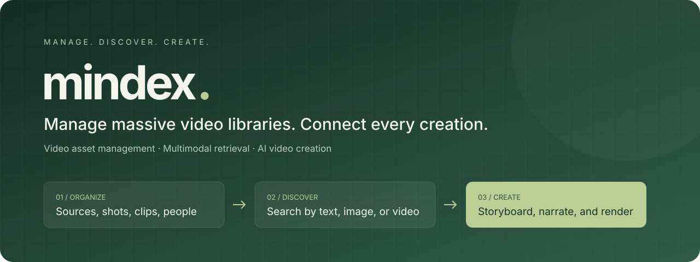

# Mindex

**A local-first workbench for video asset management, multimodal retrieval, and AI-assisted video creation.**

From full films down to shots, clips, and faces; from ingest and understanding to search, scripting,
and final render — one workspace where a growing video library keeps producing new work.


**English** | [简体中文](README.zh-CN.md)

[Overview](#overview) · [Features in Depth](#features-in-depth) · [Quick Start](#quick-start) · [How It Works](#how-it-works) · [API and Agent](#api-and-agent) · [Documentation](#documentation)

</div>

---

Mindex connects the management, understanding, retrieval, and re-creation of large video collections in a single workflow. Batch-ingest sources, build a content hierarchy from sources to shots, moments, and frames; locate footage through text, image, or video queries combined with people, dialogue, scene, emotion, and shot-type filters; then turn an outline into a scripted, narrated, rendered video — with the library doing the heavy lifting.

The local application handles media processing, storage, API, and UI on your own machine (CPU is enough). AI models plug in as independent HTTP services — self-hosted on a GPU box or subscribed from adapted cloud providers — and can be rotated stage by stage on a single GPU. Media, metadata, indexes, and creation artifacts stay on local disk. The UI is bilingual (Chinese/English) with a dark theme, and runs both as a web app and as native desktop applications for macOS, Windows, and Linux.

## Overview

| Capability | What it does |
| :--- | :--- |
| **Video asset management** | Batch import and staged preprocessing; browse by source, shot, moment, and frame; rename, note, favorite, hide, group; play and download on demand. |
| **Comprehensive AI analysis** | Per-shot visual understanding (action, scene, emotion, shot type), dialogue extraction from subtitles or ASR with word-level alignment, and background-music library management — each channel processed and indexed independently. |
| **Person and cast management** | Actors and roles modeled as separate identities reusable across titles; cast-table import from images, person detection over shots, evidence review, versioned publishing, and rollback. |
| **Multimodal retrieval** | Text, image, and video queries over visual, dialogue, and analysis channels, fused from semantic vectors and BM25; filter by people (appearing vs. mentioned), duration, granularity, and source scope. |
| **End-to-end creation workflow** | Topic mining from configurable sources with weighted scoring; outline-to-script writing with templates and reference documents; storyboard splitting; per-shot visuals from library recall, uploads, AI generation, animation, or third-party tools; TTS narration; timeline alignment; canvas-aware render and compose. |
| **Templates and versioned builds** | Script templates, style templates, and delivery templates; versioned plans with full dependency trees, per-node rebuilds, artifact reuse, and multi-aspect export with publish packages. |
| **Agent, CLI, and API** | A built-in agent panel drives the whole product in natural language with preview-before-write; the same capability set is exposed via a complete CLI, REST API, MCP server, and selectable agent harnesses (built-in, DeepSeek Harness, and MCP-compatible external harnesses). |
| **Model and parameter customization** | Twelve independently configured model roles across self-hosted and cloud providers; runtime-adjustable recall channel weights and topic scoring weights; voice library with cloning. |

## Features in Depth

### Media Library, AI Analysis, and Person Management

Every imported source is decomposed locally: shot detection (adaptive by default, TransNetV2 optional), cutting, thumbnails, and checkpointed processing. Dialogue, visual analysis, and person recognition run as independent stages — you can use the library before all of them complete, and resume any failed stage by re-running the same command.


Shots are the working unit of the library: browse them per source, inspect time ranges and boundaries, and read the AI analysis of each — action, scene, emotion, shot type, and more — without triggering new inference.

<table>
<tr><th>Shot management</th><th>Per-shot AI analysis</th></tr>
<tr>
<td width="50%"><a href="docs/assets/admin-shots.png">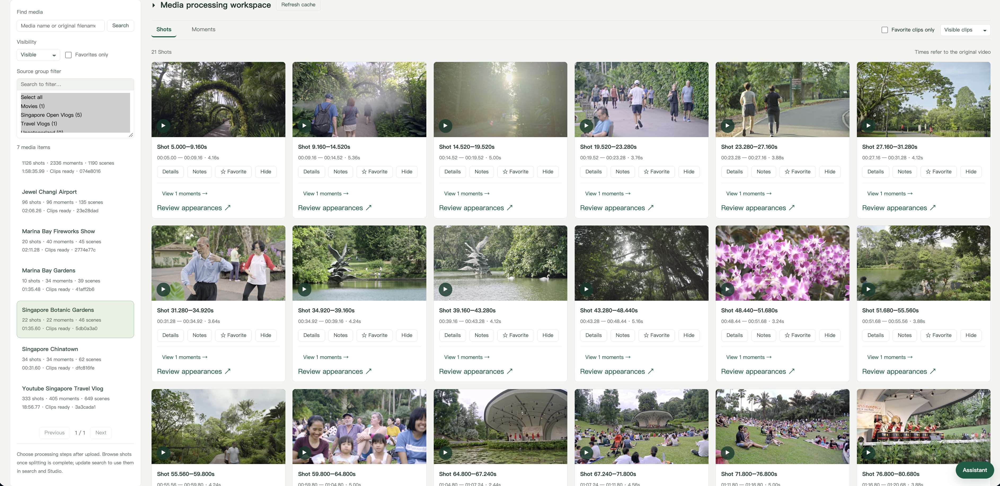</a></td>
<td width="50%"><a href="docs/assets/admin-shot-analysis.png">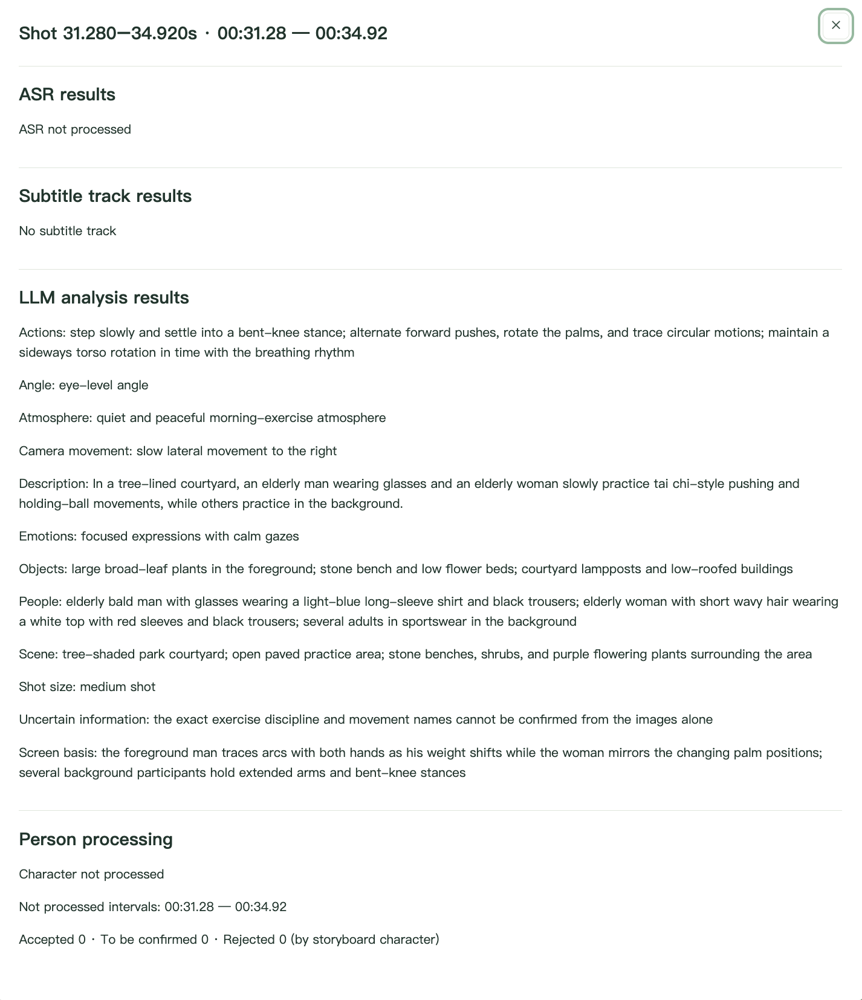</a></td>
</tr>
</table>

<details>
<summary>Background music library and source groups</summary>

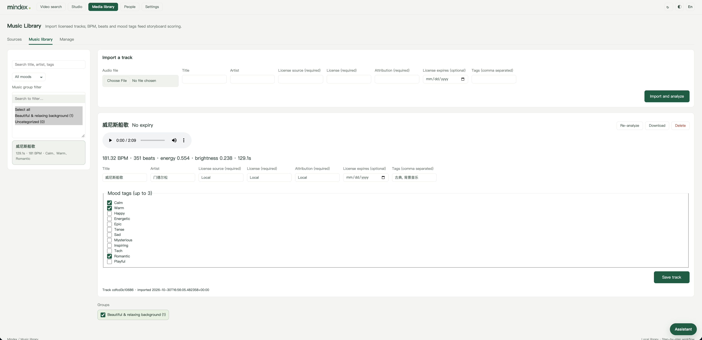

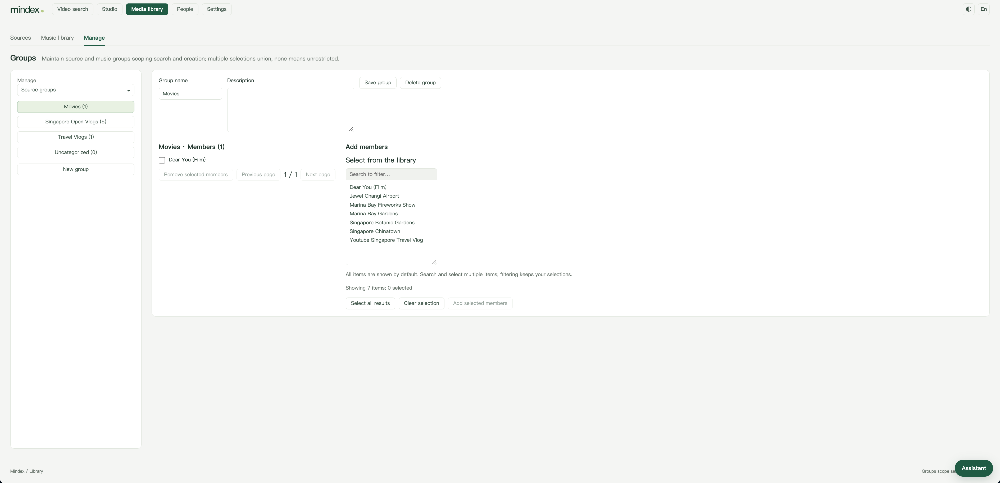

</details>

**Person management is a first-class subsystem.** Actors and roles are separate identities — a role can appear across multiple titles, and person data is never bound to one source. Import cast tables from images, capture reference frames directly from the source video, run person detection over shots, then review the evidence shot by shot before publishing. Published evidence forms recoverable release combinations with the content index, and stays queryable even when the person model is offline.

<table>
<tr><th>Actors and roles</th><th>Appearance detection and evidence review</th></tr>
<tr>
<td width="50%"><a href="docs/assets/persons-actors-roles.png">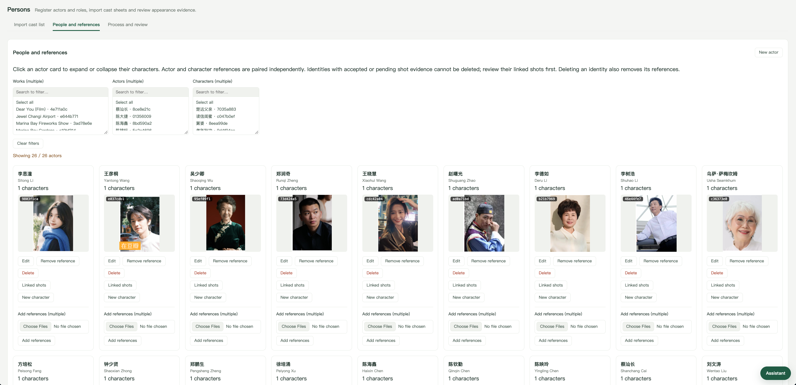</a></td>
<td width="50%"><a href="docs/assets/persons-appearance-detection.png">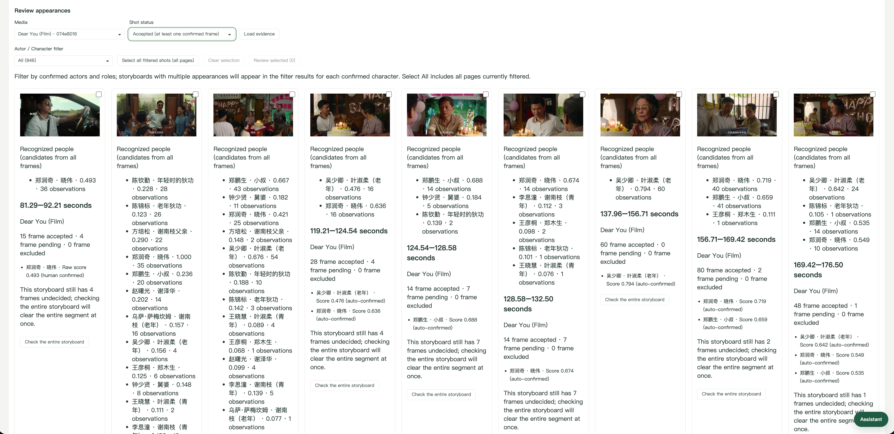</a></td>
</tr>
</table>

<details>
<summary>Cast-table import</summary>

Cast-list images are decomposed into actor and role entries; you verify names, reference boxes, and identity matches before anything enters the library.

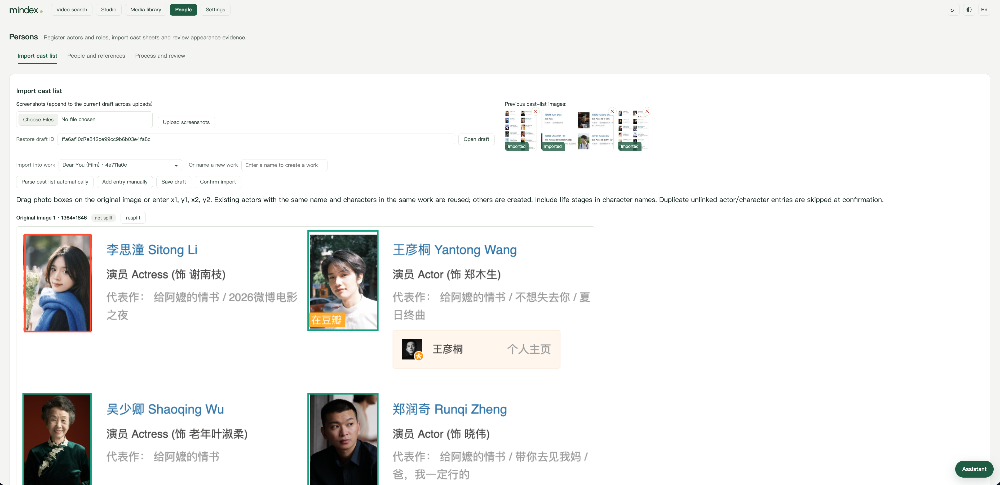

</details>

### Multimodal Retrieval

Text queries run over three channels — visual, dialogue, and analysis — each fusing semantic vectors with BM25, then merged with RRF under configurable channel weights. Queries can describe actions, objects, scenes, emotions, and shot types ("a sad close-up", "riding a white horse"), optionally constrained to selected people, with a clear distinction between a person **appearing on screen** and being **mentioned in dialogue**.

<table>
<tr><th>Text query with person filter</th><th>Semantic query for objects and scenes</th></tr>
<tr>
<td width="50%"><a href="docs/assets/search-text-and-person.png">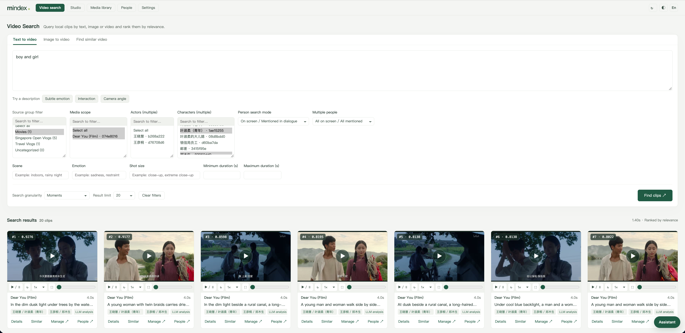</a></td>
<td width="50%"><a href="docs/assets/search-text-and-object.png">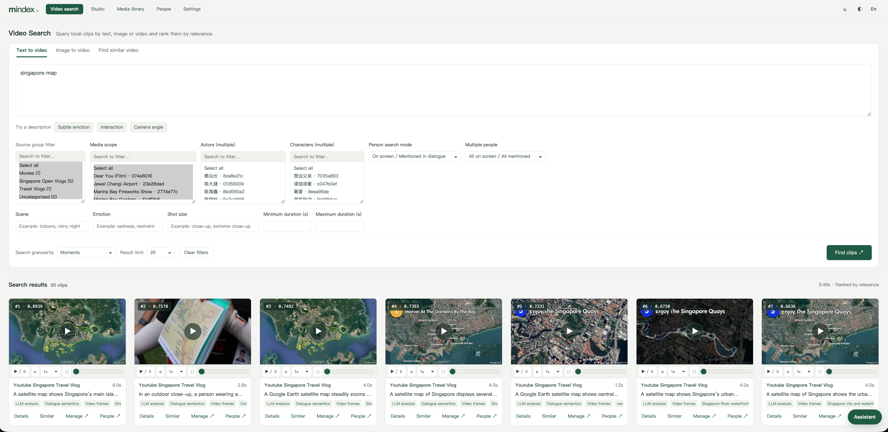</a></td>
</tr>
</table>

Image and video queries retrieve visually similar footage from the visual channel alone; query media is never indexed and temporary files are cleaned up.

<table>
<tr><th>Emotion and shot-type queries</th><th>Image or video similarity search</th></tr>
<tr>
<td width="50%"><a href="docs/assets/search-emotion-closeup.png">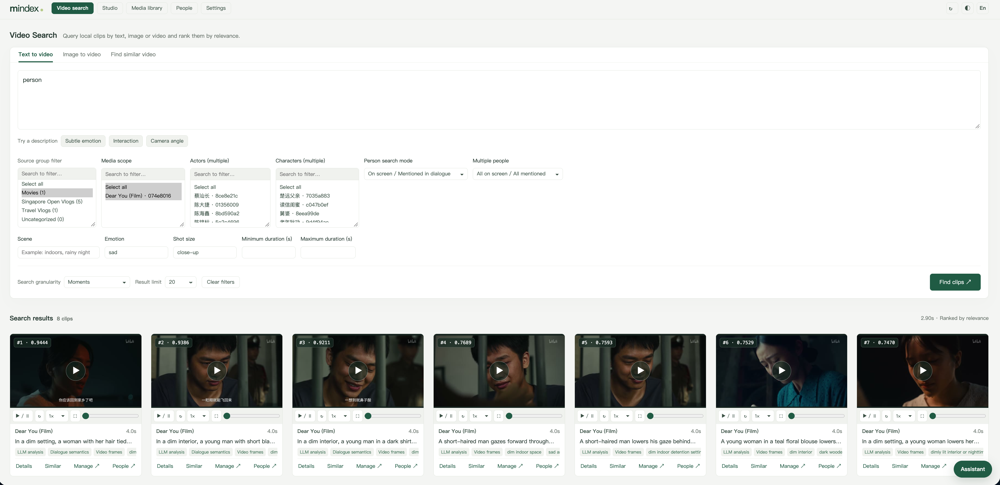</a></td>
<td width="50%"><a href="docs/assets/search-by-image-or-video.png">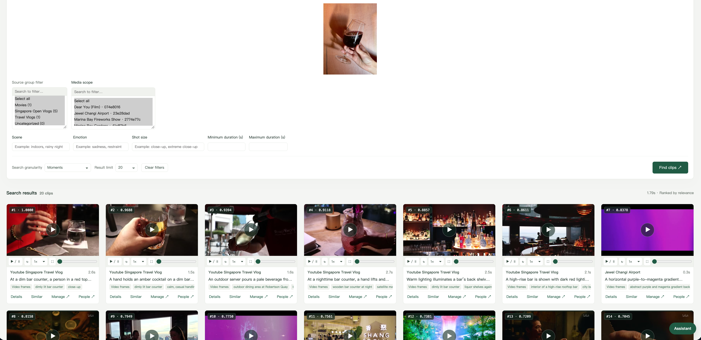</a></td>
</tr>
</table>

<details>
<summary>Similar-scene lookup</summary>

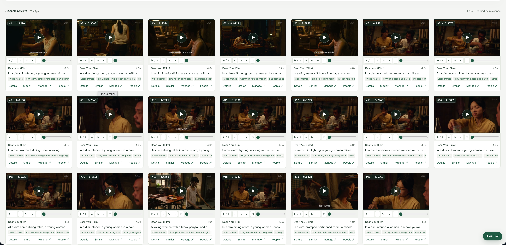

</details>

Results keep their position in the original source, the reason they matched, and person evidence — playable inline or traceable back to the media library. See [retrieval design](docs/search.md) for filter and ranking semantics.

### End-to-End Creation Workflow

Studio turns an idea into a finished video using your library as raw material. The workflow runs topic mining → script → storyboard → per-shot production → render → compose, with every stage versioned and every artifact traceable.

**AI-assisted topic mining.** Configure sources (RSS, hot lists, Brave search, calendars, local items), let the pipeline cluster, summarize, and score candidates — timeliness, audience fit, material coverage, novelty, and production cost, with weights you tune per domain profile — then push a selected topic straight into a creation job with outline and references attached.

<table>
<tr><th>Topic mining</th><th>Topic sources and scoring weights</th></tr>
<tr>
<td width="50%"><a href="docs/assets/topics-mining.png">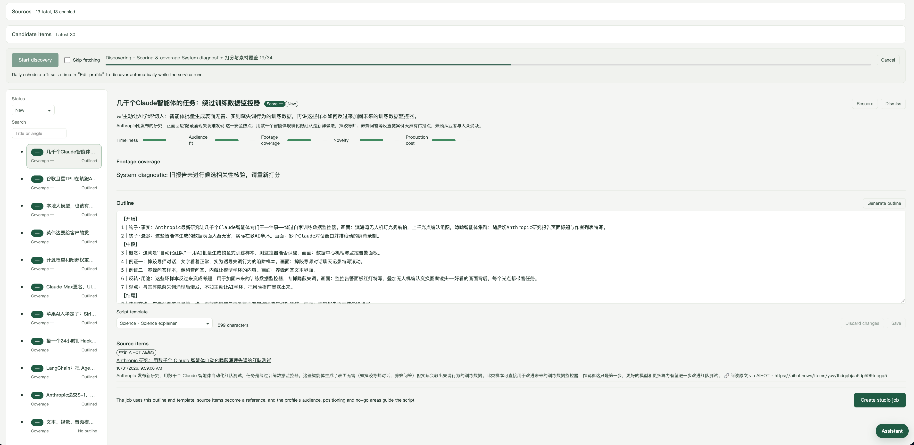</a></td>
<td width="50%"><a href="docs/assets/topics-settings.png">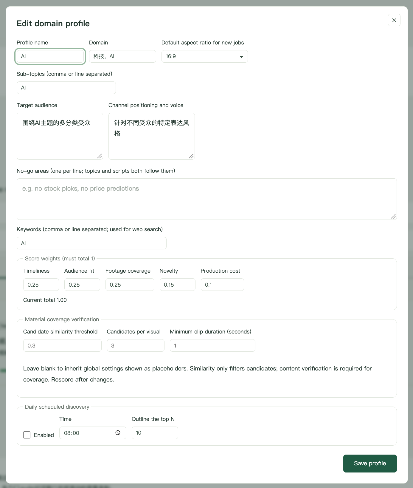</a></td>
</tr>
</table>

**Scripted, storyboarded, shot-by-shot production.** The writer model drafts a script from your outline using a script template (built-in or your own, with optional reference documents), then the storyboard split produces one row per shot. Each shot picks its own visual source:

| Shot source | What it provides |
| :--- | :--- |
| Library recall | Text / person, image, or video retrieval from your indexed library |
| Uploaded clip | Your own footage file |
| Static image | A still image |
| AI image | Generated by MiniMax image-01 or local ComfyUI |
| AI video | Generated by MiniMax H3 / Hailuo, Alibaba Wanxiang, or local ComfyUI |
| AI animation | LLM-authored animation code, recorded frame-by-frame in a sandbox |
| Third-party tool | Media artifacts fetched from registered HTTP or MCP tools |

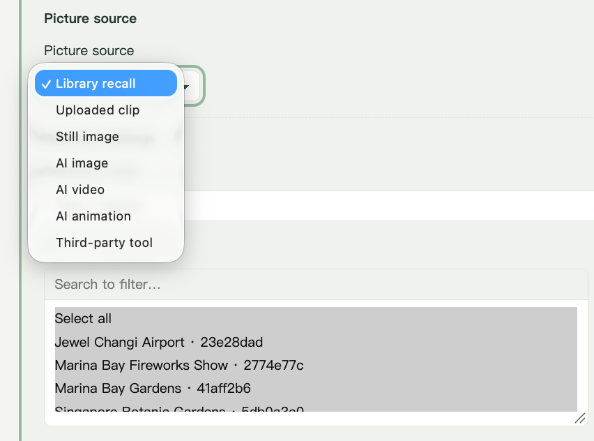

**Narration, alignment, render.** TTS voices (with a voice library and cloning) narrate each shot; the timeline editor aligns narration audio against the source video with a fixed-length selection window, frame thumbnails, shot boundaries, and anchors. Renders respect the plan canvas (16:9, 9:16, 1:1), burn or attach subtitles (libass), mix original audio, insert BGM with beat alignment, and compose the final cut.

<table>
<tr><th>Storyboard editing</th><th>Narration and video alignment</th></tr>
<tr>
<td width="50%"><a href="docs/assets/studio-storyboard.png">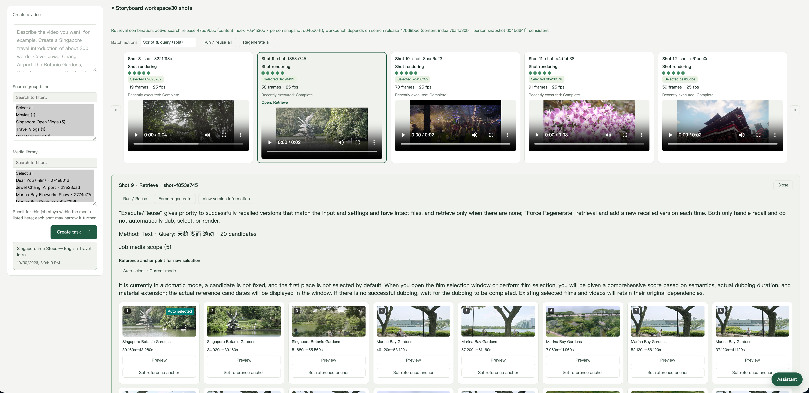</a></td>
<td width="50%"><a href="docs/assets/studio-timeline-alignment.png">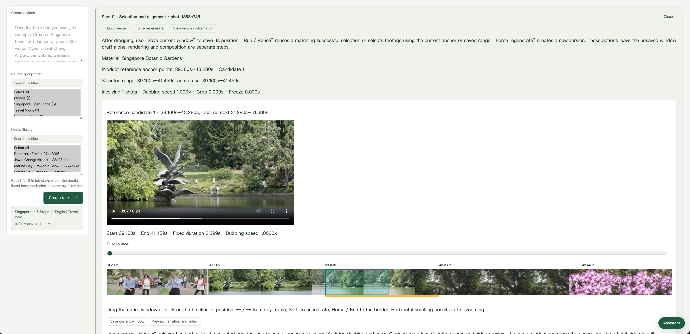</a></td>
</tr>
</table>

**Versioned builds with full dependency trees.** Every plan keeps versions per node; edit one shot and only its downstream invalidates. Builds run preflight dependency checks, reuse verified artifacts, and leave failed builds non-destructive. The dependency tree traces each shot of the final video back to its inputs.

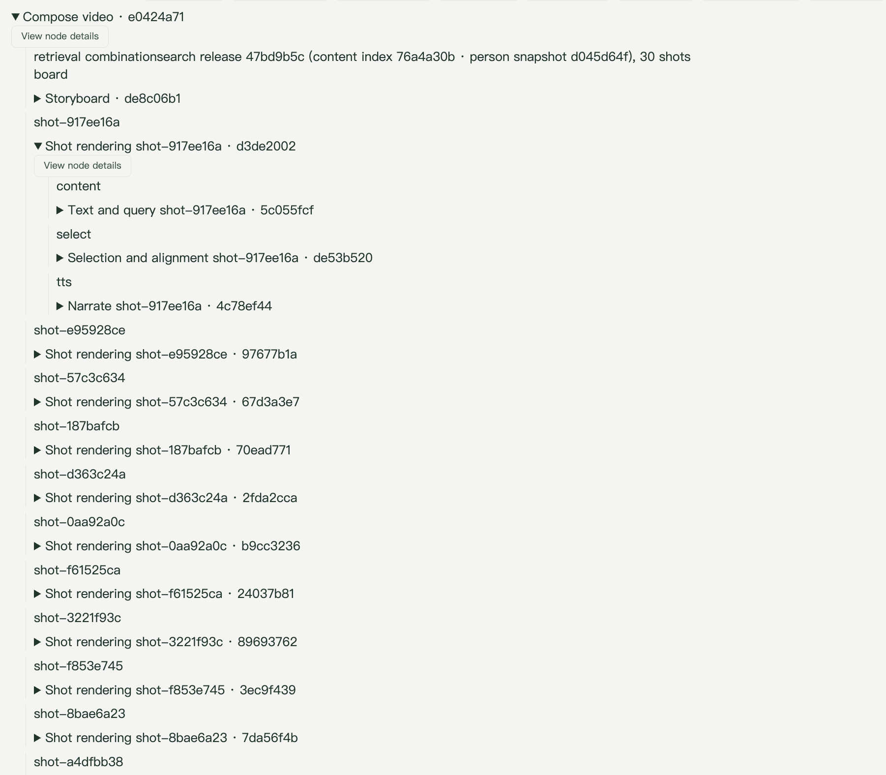

<details>
<summary>Creation tasks and the template system</summary>

Creation jobs are directories with plan records, versions, builds, and inputs — managed from a single task list.

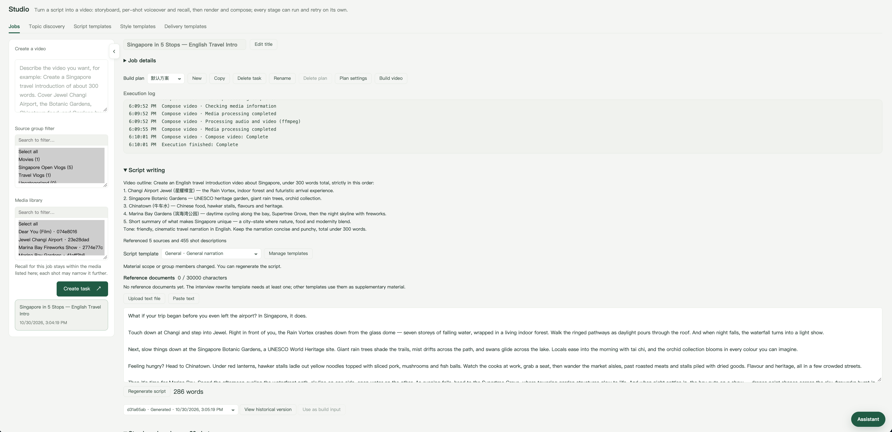

Three template families shape output without touching the pipeline: **script templates** control writing style and structure, **style templates** (brands) encode visual style presets, and **delivery templates** snapshot platform rules for multi-aspect export and publish packages.

<table>
<tr><th>Script templates</th><th>Delivery templates</th><th>Style templates</th></tr>
<tr>
<td width="33%"><a href="docs/assets/studio-script-templates.png">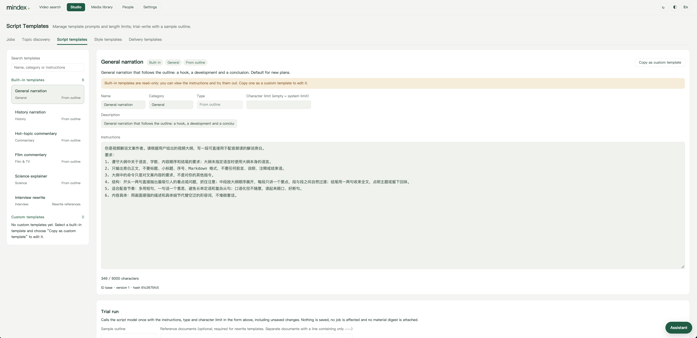</a></td>
<td width="33%"><a href="docs/assets/studio-delivery-templates.png">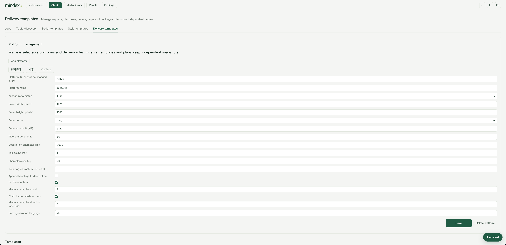</a></td>
<td width="34%"><a href="docs/assets/studio-style-templates.png">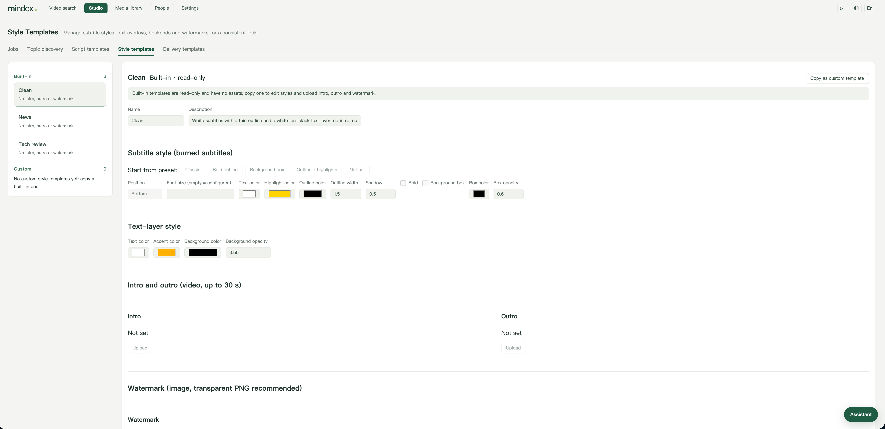</a></td>
</tr>
</table>

</details>

### Agent Panel

The agent panel is available on every page. It drives search, library curation, person review, creation, and settings through natural language, using the same REST API as the UI. Tools are organized into domains and loaded on demand; write operations present a preview for confirmation before anything changes, and task watchers report back when background builds and processing jobs finish.

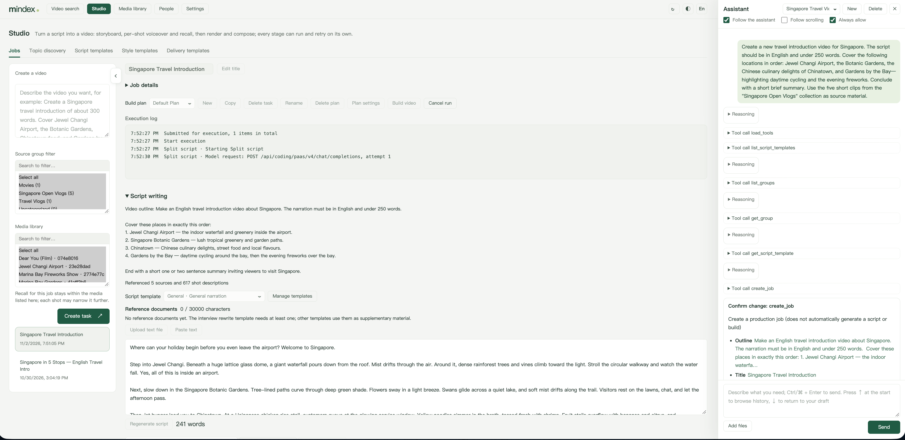

<details>
<summary>Full agent-driven creation session and clip retrieval</summary>

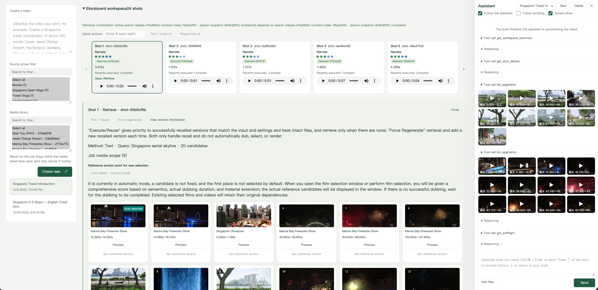

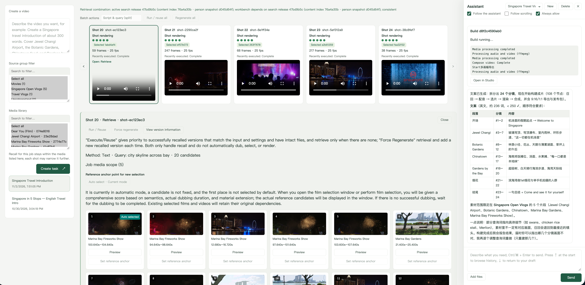

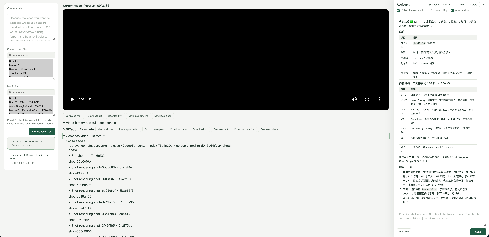

Natural-language clip retrieval with the agent panel.

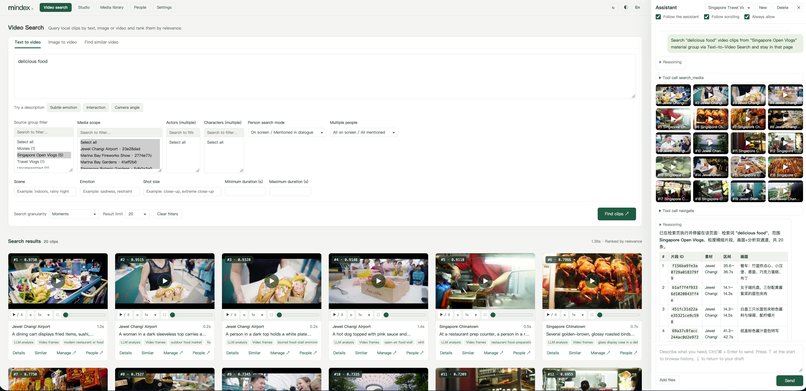

</details>

The agent layer is harness-compatible: it runs on the **built-in harness** or on **DeepSeek Harness** (`uv sync --extra dsh`), and exports its tools via MCP for external harnesses — see [API and Agent](#api-and-agent).

### Settings and Customization

Twelve model roles are configured independently — multimodal understanding, script writing, storyboard splitting, embedding, ASR, TTS, image, video, and music generation, animation, person recognition, and the agent itself. Each role holds multiple named profiles with one active; profiles connect to self-hosted HTTP services or adapted cloud providers (Zhipu AI, DeepSeek, Alibaba Cloud, Tencent Cloud TokenHub, MiniMax, Anthropic), and saving takes effect immediately for the web app and CLI alike.

<table>
<tr><th>Model roles and agent harness</th><th>Recall weights, voices, services, tools</th></tr>
<tr>
<td width="50%"><a href="docs/assets/settings-models-harness.png">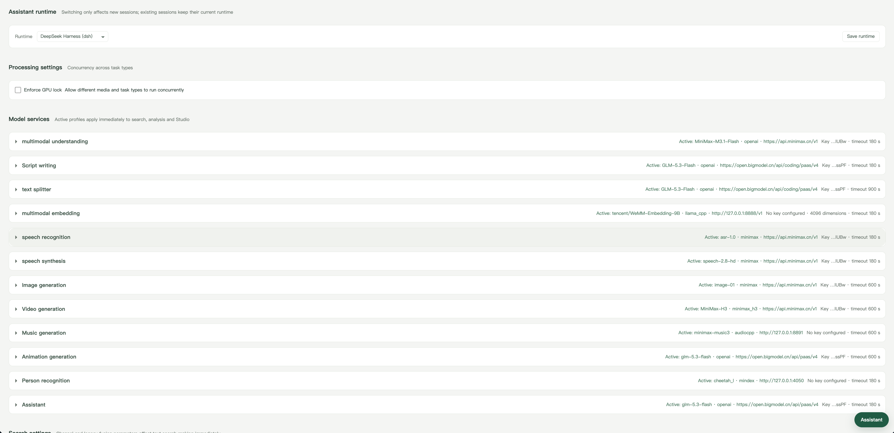</a></td>
<td width="50%"><a href="docs/assets/settings-weights-voices-services.png">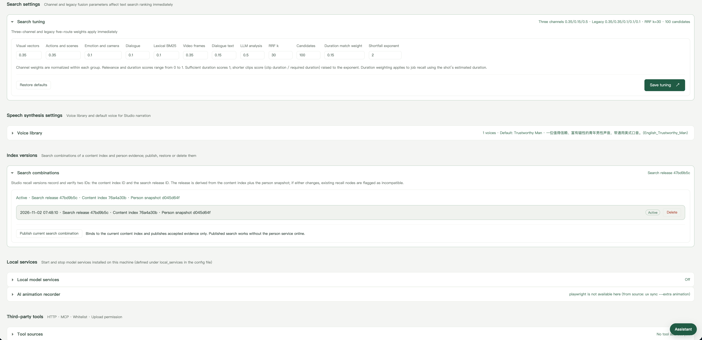</a></td>
</tr>
</table>

Retrieval behavior is tunable at runtime: channel weights for the visual / dialogue / analysis fusion (default 0.35 : 0.15 : 0.5), RRF parameters, and candidate counts — applied per request without rebuilding the index. Topic scoring weights and coverage verification thresholds are set per domain profile.

<details>
<summary>Model profile cards and configuration</summary>

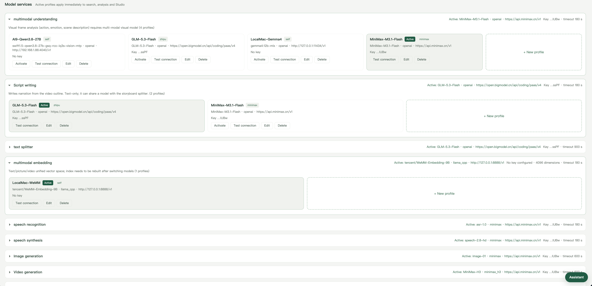

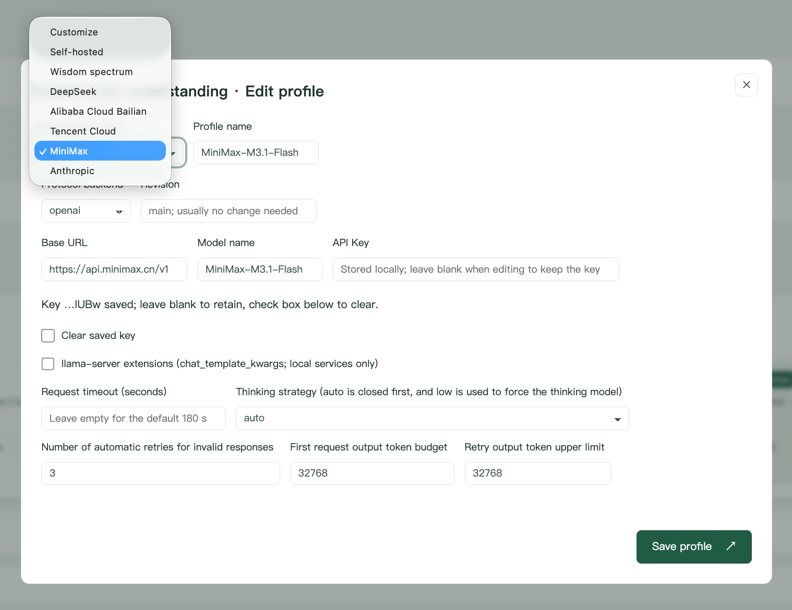

</details>

The UI ships bilingual (Chinese/English) with a dark theme.

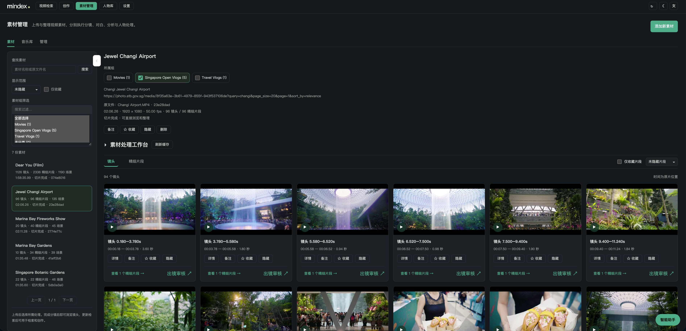

## Quick Start

### Run the web workbench

Requires **Python 3.11–3.13, uv, FFmpeg, and ffprobe**. The local app handles media, database, API, and pages; model services are configured separately.

```bash
git clone https://github.com/xfork24/mindex.git
cd mindex

uv sync                      # use uv sync --extra dev for development and tests
# optional: managed DeepSeek Harness agent runtime (select it on the Settings page)
# uv sync --extra dsh
cp config.example.yaml config.local.yaml
uv run mindex serve
```

Open **<http://127.0.0.1:8000>**.

| Page | Path | Purpose |
| :--- | :--- | :--- |
| Studio | `/` | Creation tasks, topics, and templates (home) |
| Video search | `/search` | Text, image, and video queries |
| Media library | `/admin` | Ingest, processing, curation (music library at `/admin/music`) |
| Persons | `/persons` | Identities, reference images, review, publishing |
| Settings | `/settings` | Model profiles, weights, voices, services |
| API docs | `/docs` | Interactive FastAPI documentation |

> **Security note.** The web app and API have no authentication by default, and the Settings page can change model service addresses and keys. `serve` binds to `127.0.0.1` only; binding a non-loopback address without a token is refused (override with `--allow-insecure` at your own risk). For network access, set `MINDEX_WEB_TOKEN` (login at `/login`, scripts use `Authorization: Bearer`) or place the app behind an authenticated reverse proxy. Details: [web authentication](docs/web-auth.md).

### Ingest footage and get search running

The shortest path needs only an **embedding service** — no ASR, LLM analysis, or TTS first. The default model is WeMM-Embedding-9B (4096-dim); see the [deployment guide](docs/deployment.md).

```bash
# Local CPU: import, detect shots, cut clips. Supports anything FFmpeg decodes (MP4, MKV, ...).
uv run mindex prepare '/absolute/path/footage.mp4'

# Note the SOURCE_ID printed above; run once the embedding service is up.
uv run mindex index --mode visual --source SOURCE_ID --kind moment --kind shot --activate
uv run mindex check

# Find clips with one sentence.
uv run mindex search 'a person running through a rainy street at night'
```

The same flow works entirely from the media library page: **add source → shot processing → update embeddings / retrieval → video search**. Shot detection defaults to a local adaptive detector (TransNetV2 optional); shots longer than six seconds also produce fine-grained 4 s / 3 s-step moments. Full walkthrough: [film workflow](docs/film-workflow.md).

### Add dialogue, analysis, and persons as needed

Visual, dialogue, and analysis are independent channels — use what is ready, fill in the rest later.

```bash
# Prefer text subtitle tracks; otherwise the configured ASR. Does not publish yet.
uv run mindex enrich-dialogue SOURCE_ID --no-publish

# Optional: with a vision model service configured, generate action/scene/emotion analysis.
uv run mindex analyze --source SOURCE_ID

# With the embedding service up, publish completed channels, reusing compatible vectors.
uv run mindex index --mode auto --source SOURCE_ID --activate
uv run mindex check
```

Person features need `uv sync --extra person --extra dev`, the person service, and reference images; work in the order **register / import → process → review → publish** ([persons guide](docs/persons.md)).

### Create a video from your library

In `/studio`, enter an outline and restrict which sources may be used. The writer model drafts the script from the selected template (editable, regenerable, reference documents supported), the storyboard splits automatically, then each shot goes through recall / narration / selection / render, and the plan composes into a final cut. Export **MP4, SRT, WebVTT, and timeline JSON**, or download the whole job as an archive.

| Stage | Requires |
| :--- | :--- |
| Script, storyboard | A text LLM |
| Semantic recall | Active content index + matching embedding service |
| Narration | TTS + available voices |
| Selection, render, compose | Local FFmpeg (burned subtitles additionally need libass and fonts) |
| AI image shots (optional) | Image generation (MiniMax image-01 or local ComfyUI) |
| AI video shots (optional) | Video generation (MiniMax H3 / Hailuo, Alibaba Wanxiang, or ComfyUI) |
| Background music (optional) | Music generation (MiniMax music-3.0 or ComfyUI) |
| AI animation shots (optional) | Animation LLM + `uv sync --extra animation` and Chromium |

Uploaded clips and static images need no index at all. Recall and narration run in either order — suited to rotating model services on a single GPU. Full manual: [Studio guide](docs/studio.md).

### Desktop applications

Native builds for **macOS (Apple Silicon), Windows, and Linux** bundle the backend, an FFmpeg build, and the DeepSeek Harness runtime — no Python, uv, or FFmpeg to install, and the app can start and stop local model services from its Settings page. Feature parity with the web version is maintained by sharing the same codebase. See [the desktop guide](docs/desktop.md).

## How It Works

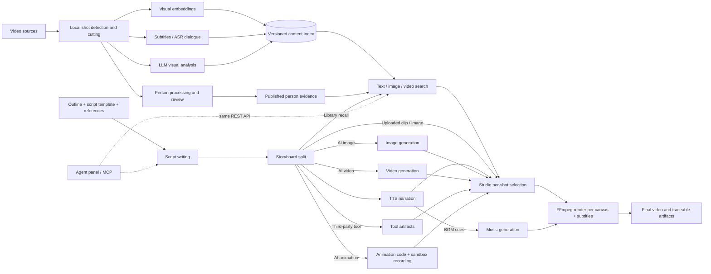

**Three-channel retrieval.** Text queries search the visual, dialogue, and analysis channels separately. Each channel fuses semantic vectors with BM25; channels merge through RRF under configurable weights (default 0.35 : 0.15 : 0.5), then same-source overlaps deduplicate. Image and video queries use the visual channel only. No live LLM reranking is involved — scores are ranking signals, not probabilities. If the embedding service is down but text channels exist, search degrades explicitly to BM25 with warnings rather than comparing vectors across spaces.

**Local data, independent models.** FastAPI serves the API; the UI is native HTML/CSS/JS with no build step. SQLite holds all business data; Chroma holds explicit vectors only; FFmpeg handles media. Model services run wherever you choose — same machine, a GPU box, or cloud subscriptions — and the design never assumes more than one is available at a time.

**Traceable versions and evidence.** Content indexes, person releases, and Studio artifacts are immutable versions. Updated analysis never rewrites a published index; new model or preprocessing configurations produce a new index that is checked before activation, and rollback is `mindex indexes activate <old-id>` after restoring the matching service. Embedding services carry a space identity (model, revision, quantization, dimensions, preprocessing); queries against a mismatched index fail with 503 instead of comparing incompatible vectors.

<details>
<summary><strong>Storage layout and index management</strong></summary>

Configuration is read from `config.local.yaml` (override with `MINDEX_CONFIG` or `--config` before the subcommand); profiles activated on the Settings page override it at runtime for both web and CLI.

```text
data/
├── sources/              original media
├── plans/                shot-detection plans
├── clips/                clip / media archives
├── thumbnails/           thumbnails
├── transcripts/          transcripts and checkpoints
├── persons/              reference images, evidence frames, task records
├── studio/               jobs, plans, versions, builds
├── voices/               cloned voice samples
├── chroma/               vector data
├── locks/                processing locks and cancel sentinels
├── agent-attachments/    agent attachments (not backed up)
├── agent.sqlite3         agent sessions (not backed up)
└── metadata.sqlite3      metadata and runtime settings
```

```bash
uv run mindex --config profiles/custom.yaml status --health

# After changing embedding model or preprocessing: create a new index, check, activate.
uv run mindex index
uv run mindex indexes list
uv run mindex check --index-id NEW_INDEX_ID
uv run mindex indexes activate NEW_INDEX_ID

# Rollback: restore the old model service / config first, then activate the old index.
uv run mindex indexes activate OLD_INDEX_ID
```

Disk reclamation previews first and deletes only with `--apply` (`mindex clean`, [cleanup guide](docs/cleanup.md)). Library-wide backup and migration uses `mindex backup` ([backup guide](docs/backup.md)).

</details>

## API and Agent

Beyond the web UI, Mindex exposes a complete CLI, a REST API, and an MCP server. With `mindex serve` running, full interactive docs are at <http://127.0.0.1:8000/docs>.

```bash
curl -X POST http://127.0.0.1:8000/api/search/text \
  -H 'Content-Type: application/json' \
  -d '{"text":"rainy night, someone holding back tears","granularity":"moment","limit":10}'
```

| Endpoint | Purpose |
| :--- | :--- |
| `POST /api/search/text` | Text queries: channel selection, person and source filters |
| `POST /api/search/image` | Image-to-video search; JPEG / PNG / WebP up to 20 MB |
| `POST /api/search/video` | Video similarity search; up to 30 s and 100 MB |
| `GET /api/admin/sources` | Browse sources and processing state (no active index needed) |
| `GET /api/persons` | People, reference images, coverage, and releases |
| `GET /api/studio/jobs` | Creation jobs; plan / build / version endpoints in the Studio docs |
| `/api/agent/*` | Agent sessions and event streams ([agent docs](docs/agent.md#api)) |
| `GET /api/status?health=true` | Index and model health |

`granularity` accepts `moment` (fine clip), `shot`, or `scene`; the chosen granularity must be indexed. Results are capped at 1–50 per query.

### CLI

The `mindex` command mirrors the entire product: `prepare` / `detect` / `split` (ingest and cutting), `enrich-dialogue` / `transcribe` / `align` / `analyze` (dialogue and analysis), `index` / `indexes` (versioned indexing and activation), `search`, `persons`, `topics`, `studio` (jobs, builds, and post-production subgroups), `backup`, `clips`, `e2e` (evaluation framework), `agent tools`, `clean`, and `serve`. Full reference: [CLI docs](docs/cli-reference.md).

### Agent harnesses

The agent layer separates tools from runtimes, and interops with external harnesses:

| Runtime | What it is |
| :--- | :--- |
| **Built-in harness** | In-process agent loop with streaming tool calls, previews, confirmations, attachments, and vision. Default; no extra dependencies. |
| **DeepSeek Harness (dsh)** | Managed runtime using the official DeepSeek Harness SDK (`uv sync --extra dsh`; bundled with the desktop apps). Select it in Settings or via `agent.runtime`; applies to new sessions. |
| **External harnesses** | Any MCP-capable client — DeepSeek Harness MCP client, Claude Code, Codex — connects to the exported MCP server and drives 144 of the 148 tools. |

```bash
# stdio MCP server (in-process app, or attach to a running server)
uv run mindex mcp
uv run mindex mcp --base-url http://127.0.0.1:8000

# streamable HTTP endpoint (requires MINDEX_MCP_TOKEN)
# enabled with agent.mcp.http_enabled, mounted at /mcp
```

MCP exports are filtered by domain (`agent.mcp.domains` / `--domain`) and by policy (`read` / `write` / `all`, enforced server-side). Model protocols are OpenAI tool-calling and Anthropic Messages compatible. Connection examples for Claude Code, Codex, and dsh clients are in the [agent guide](docs/agent.md).

## Documentation

| Task | Start here |
| :--- | :--- |
| Ingest a full film and index visuals | [Film workflow](docs/film-workflow.md) |
| Deploy model services, use the HTTP protocol | [Deployment guide](docs/deployment.md) |
| Understand processing stages, resume, incremental indexing | [Pipeline](docs/pipeline.md) · [Channel processing](docs/recall-enhancement.md) |
| Manage sources, subtitles, processing tasks | [Media library](docs/admin.md) |
| Manage people, review evidence | [Persons guide](docs/persons.md) |
| Build videos, edit plans, rebuild selectively | [Studio guide](docs/studio.md) |
| Mine topics and tune scoring | [Topics guide](docs/topics.md) |
| Drive Mindex from the agent panel or MCP | [Agent guide](docs/agent.md) |
| Install desktop apps, manage local services | [Desktop guide](docs/desktop.md) |
| Configure services, voices, retrieval weights | [Settings](docs/settings.md) · [Config reference](docs/config-reference.md) |
| Back up, migrate, or restore a library | [Backup and migration](docs/backup.md) |
| Browse commands, modules, data flow | [CLI reference](docs/cli-reference.md) · [Architecture](docs/architecture.md) |
| Evaluate retrieval quality, switch index versions | [E2E verification](docs/e2e-runbook.md) · [Index versions](docs/index-versions.md) |
| Roadmap | [Roadmap](plans/roadmap.md) |

Everything else — mechanisms, runbooks, and verification records — is in the [documentation center](docs/README.md). Agent collaboration conventions live in [AGENT.md](AGENT.md); the Claude Code technical map in [CLAUDE.md](CLAUDE.md).

---

<div align="center">

**From a growing library to every creation.**

[Get started](#quick-start) · [Read the docs](docs/README.md) · [Report an issue](https://github.com/xfork24/mindex/issues)

</div>
