<div align="center">

# Mindex

**本地优先的视频资产管理、多模态检索与 AI 视频创作工作台。**

从整片、镜头、片段到人物与画面；从素材入库、内容理解，到检索定位、文案创作与成片渲染——让持续增长的视频素材库不断产出新作品。


[English](README.md) | **简体中文**

[功能概览](#功能概览) · [功能详细介绍](#功能详细介绍) · [快速开始](#快速开始) · [工作原理](#工作原理) · [API 与 Agent](#api-与-agent) · [文档](#文档)

</div>

---

Mindex 把海量视频的管理、理解、检索与再创作连接在同一个工作流中。批量导入素材，建立从原片到镜头、精细片段与帧的内容组织；通过文字、图片或视频查询，结合人物、台词、场景、情绪与景别筛选定位画面；再把大纲变成有文案、有配音、有画幅的成片——整个过程中，素材库都在承担基础工作。

本机应用负责媒体处理、存储、API 与页面，CPU 即可运行；AI 模型以独立 HTTP 服务接入——自建部署在 GPU 机器上，或订阅已适配的线上服务——支持单 GPU 按阶段轮换。素材、元数据、索引与创作产物全部保存在本地磁盘。界面为中英双语并提供暗色主题，既有 Web 版，也有 macOS、Windows、Linux 原生桌面版。

## 功能概览

| 能力 | 做什么 |
| :--- | :--- |
| **视频资产管理** | 批量导入与分阶段预处理；按原片、镜头、精细片段、帧分层浏览；重命名、备注、收藏、隐藏、分组；按需播放与下载。 |
| **全面的多模态 AI 分析** | 逐镜头视觉理解（动作、场景、情绪、景别）、字幕/ASR 对白提取（词级时间戳）与背景音乐曲库管理——各渠道独立处理、独立建库。 |
| **人物与演员表管理** | 演员/角色分身份建模、跨作品复用；支持从图片导入 cast 表、镜头级人物识别、出镜证据审核、版本化发布与回溯。 |
| **多模态检索** | 文字、图片、视频查询走画面、对白、分析三渠道，语义向量与 BM25 融合；支持人物筛选（实际出镜 / 对白提及）、时长、粒度与素材范围。 |
| **全流程创作工作流** | 多来源选题挖掘（可调打分权重）；大纲+模板+参考文稿写文案；自动拆分镜；逐镜画面可来自素材召回、上传、AI 生成图/视频、AI 动画或第三方工具；TTS 配音、时间轴对齐、按画幅渲染合成。 |
| **模板与版本化构建** | 文案模板、风格模板、交付模板三类模板体系；方案级版本管理、完整依赖树、逐节点重建、产物复用、多画幅导出与发布包。 |
| **Agent、CLI 与 API** | 内置助手面板用自然语言驱动整个产品，写操作先预览确认；同一套能力完整暴露为 CLI、REST API、MCP 服务，并支持可选 agent harness（内置、DeepSeek Harness 与经 MCP 兼容的其他 harness）。 |
| **模型与参数自定义** | 十二类模型角色独立配置，覆盖自建与多家线上厂商；召回渠道权重与选题打分权重运行时可调；音色库与声音克隆。 |

## 功能详细介绍

截图自动连播展示；展开每组下方的清单可单独查看某张原图。

### 素材库、AI 分析与人物管理

每个导入的素材在本地完成分解：镜头检测（默认本地 AdaptiveDetector，可选 TransNetV2）、切片、缩略图与检查点化处理。对白、视觉分析与人物识别是相互独立的阶段——不必等全部完成就能开始使用素材库，失败阶段重跑同一命令即可恢复。

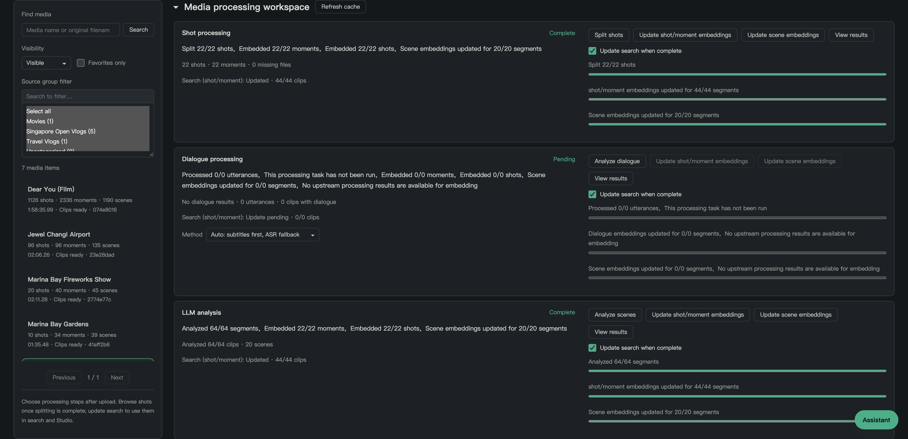

镜头是素材库的工作单元：按素材浏览镜头、查看时间区间与边界、阅读每个镜头的 AI 分析（动作、场景、情绪、景别等）——查看内容不会触发新的模型推理。


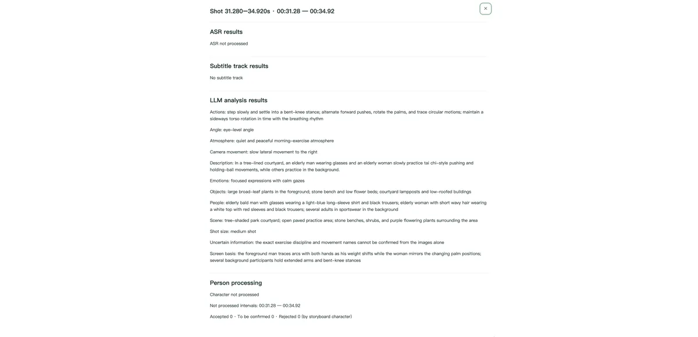

<details>
<summary>逐张查看原图（3 张）</summary>

1. [镜头的 AI 分析结果](docs/assets/admin-shot-analysis.png)
2. [背景音乐曲库管理](docs/assets/admin-music.png)
3. [素材分组管理](docs/assets/admin-groups.png)

</details>

**人物管理是一等公民子系统。** 演员与角色分别建模——角色可跨作品复用，人物资料不绑定具体素材。从图片导入演员表、直接在原片中截取参考帧、对镜头跑人物识别，再逐镜审核出镜证据后发布。已发布证据与内容索引组成可恢复的发布组合，人物模型离线时仍能查询。

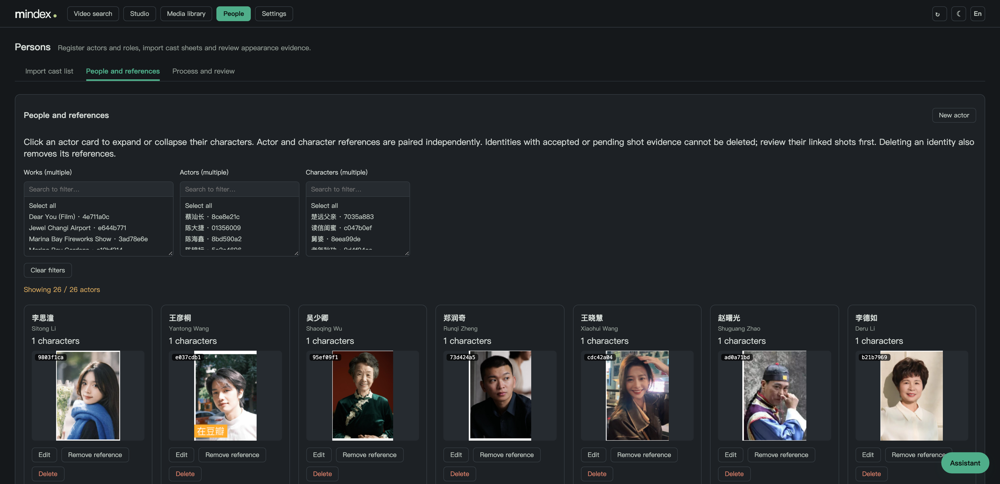

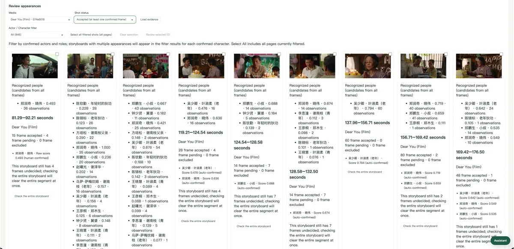

<details>
<summary>逐张查看原图（2 张）</summary>

1. [出镜识别与逐镜证据审核](docs/assets/persons-appearance-detection.png)
2. [演员表导入与条目核对](docs/assets/persons-cast-import.png)

</details>

### 多模态检索

文字查询按画面、对白、分析三渠道独立召回——各渠道内部融合语义向量与 BM25，再按可配置的渠道权重做 RRF 合并。查询可以描述动作、物体、场景、情绪与景别（"悲伤的特写"、"骑白马"），可限定所选人物，并明确区分**人物实际出镜**与**对白中被提及**。

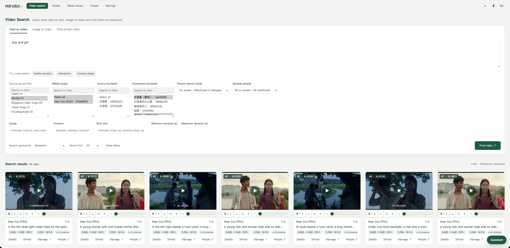

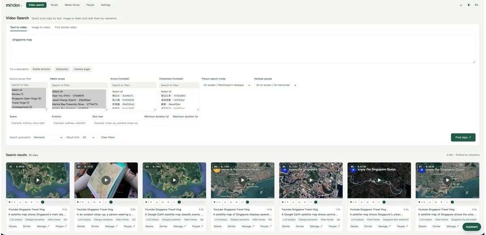

<details>
<summary>逐张查看原图（4 张）</summary>

1. [物体与场景语义查询](docs/assets/search-text-and-object.png)
2. [情绪与景别查询](docs/assets/search-emotion-closeup.png)
3. [跨素材的相似场景检索](docs/assets/search-similar-scenes.png)
4. [以图片或视频检索](docs/assets/search-by-image-or-video.png)

</details>

图片与视频查询只走画面渠道检索相似画面；查询媒体不入库，临时文件即时清理。

结果保留原片位置、命中原因与人物证据——可直接播放，也可回到素材库继续整理。筛选与排名语义见[检索设计](docs/search.md)。

### 全流程创作工作流

Studio 用你自己的素材库把一个想法变成成片。工作流为选题挖掘 → 文案 → 拆分镜 → 逐镜生产 → 渲染 → 合成，每个阶段都有版本，每份产物都可追溯。

**AI 辅助选题。** 配置选题来源（RSS、热榜、Brave 搜索、日历、本地条目），管线自动聚类、摘要并为候选打分——时效、受众匹配、素材覆盖、去重、制作成本五个维度，权重按领域档案自行调整——选定主题即可带着大纲和参考文稿一键创建创作任务。

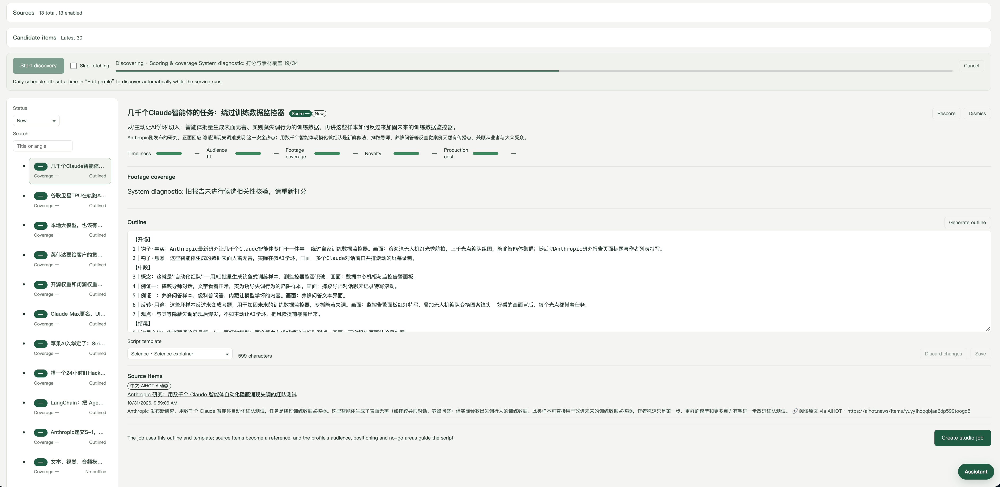

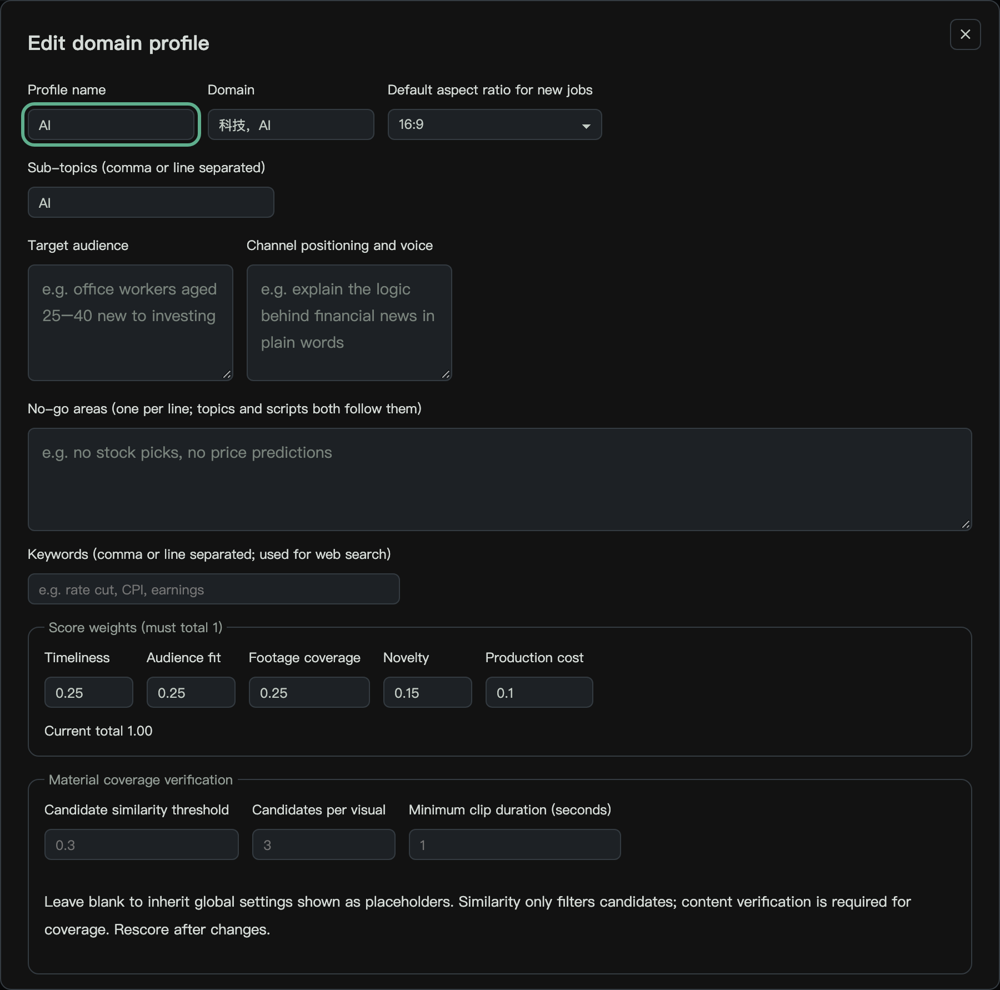

**从文案到逐镜生产。** 文案创作模型按所选文案模板（内置或自建，可附参考文稿）从大纲写出可编辑的文案，拆分镜后每镜一行。

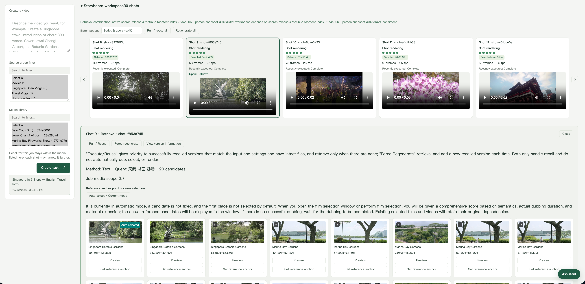

每个分镜独立选择画面来源：

| 分镜来源 | 提供什么 |
| :--- | :--- |
| 素材召回 | 从已建索引的素材库做文字/人物、图片或视频检索 |
| 上传片段 | 你自己的素材文件 |
| 静态图片 | 一张静态图 |
| AI 生成图片 | MiniMax image-01 或本地 ComfyUI |
| AI 生成视频 | MiniMax H3 / 海螺、阿里通义万相或本地 ComfyUI |
| AI 动画 | LLM 编写动画代码，沙箱逐帧录制 |
| 第三方工具 | 从登记的 HTTP 或 MCP 工具获取媒体产物 |

**配音、对齐、渲染。** TTS 音色（含音色库与克隆）为每镜配音；时间轴编辑器以定长选片窗口在原片上对齐配音与画面，带帧缩略图、镜头边界与参考锚点。渲染遵循方案画幅（16:9、9:16、1:1），烧录或挂载字幕（libass）、混入原声、按提示点插入 BGM 并支持节拍对齐，最后合成成片。

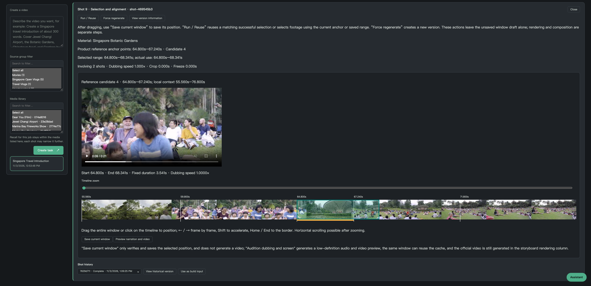

**版本化构建与完整依赖树。** 每个方案的每个节点都有版本；改一镜只作废其下游闭包。构建前做依赖预检，复用校验一致的产物，失败构建不破坏已有成片。依赖树把成片的每个分镜追溯回它的输入版本。

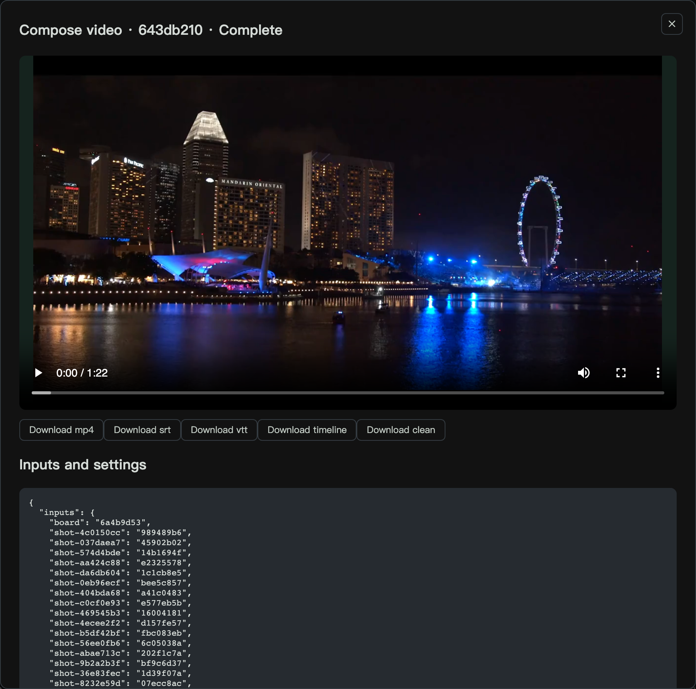

创作任务是独立目录（方案记录、版本、构建与输入素材），在统一的任务列表中管理。三类模板从外部塑造产出而不改动管线：**文案模板**控制写作风格与结构，**风格模板**（品牌）沉淀视觉风格预设，**交付模板**固化平台规则快照，用于多画幅导出与发布包。

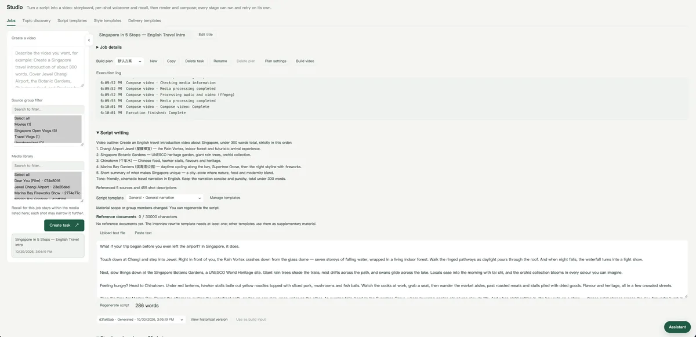

<details>
<summary>逐张查看原图（4 张）</summary>

1. [创作任务列表](docs/assets/studio-jobs.png)
2. [文案模板管理](docs/assets/studio-script-templates.png)
3. [交付模板与平台规则管理](docs/assets/studio-delivery-templates.png)
4. [风格模板设置](docs/assets/studio-style-templates.png)

</details>

### Agent 面板

Agent 面板出现在每个页面。它用自然语言驱动检索、素材整理、人物审核、创作与设置，底层走与页面相同的 REST API。工具按领域组织、按需加载；写操作先给出预览、确认后才生效；任务看护器在后台构建与处理任务到达终态时主动回报。

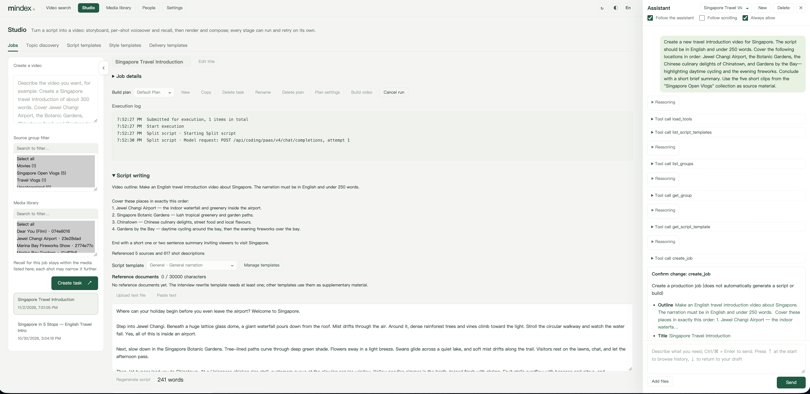

上面的会话接下来会经历写文案、拆分镜、逐镜生产与最终构建；片段检索的工作方式相同。

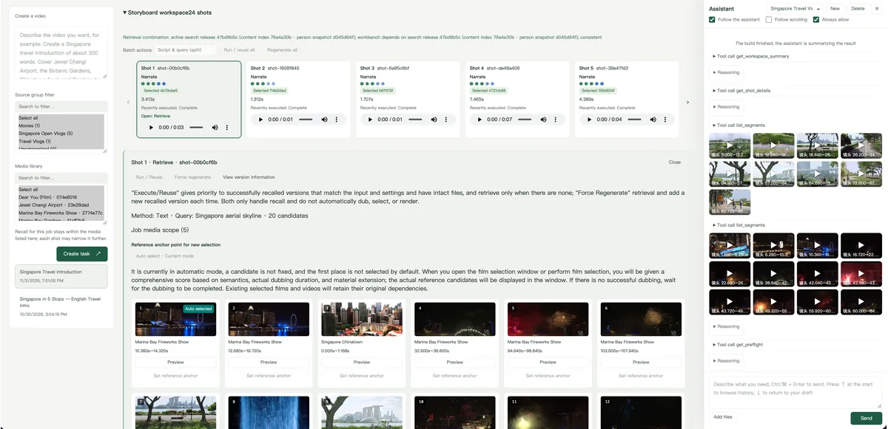

<details>
<summary>逐张查看原图（4 张）</summary>

1. [Agent 会话：写文案并拆分镜](docs/assets/agent-create-video-2.png)
2. [Agent 会话：逐镜生产与配音](docs/assets/agent-create-video-3.png)
3. [Agent 会话：最终构建与成片预览](docs/assets/agent-create-video-4.png)
4. [Agent 检索特定视频片段](docs/assets/agent-search-clips.png)

</details>

Agent 层与 harness 兼容：可运行在**内置 harness** 或 **DeepSeek Harness**（`uv sync --extra dsh`）上，并经 MCP 把工具导出给外部 harness——见 [API 与 Agent](#api-与-agent)。

### 设置与自定义

十二个模型角色独立配置——多模态理解、文案创作、拆分镜、嵌入、ASR、TTS、图片/视频/音乐生成、动画生成、人物识别与智能助手。每个角色可保存多张命名档案卡、激活其一；档案可连接自建 HTTP 服务或已适配的线上厂商（智谱、DeepSeek、阿里云、腾讯 TokenHub、MiniMax、Anthropic），保存即对 Web 与 CLI 同时热生效。

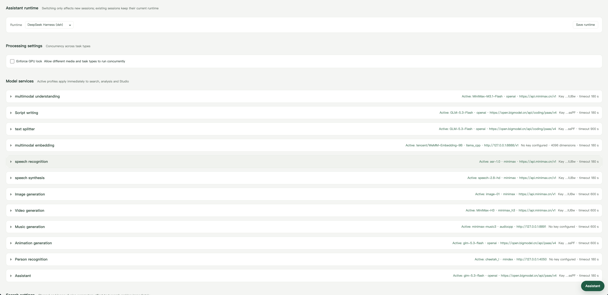

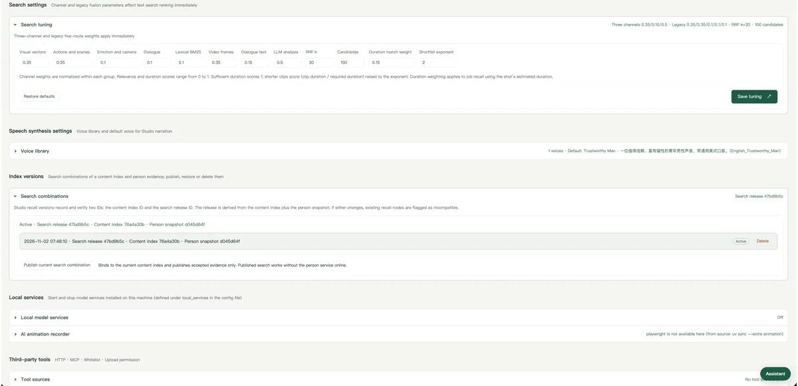

<details>
<summary>逐张查看原图（3 张）</summary>

1. [召回权重、音色库、本地服务与工具管理](docs/assets/settings-weights-voices-services.png)
2. [模型档案卡](docs/assets/settings-model-card.png)
3. [自定义模型档案配置](docs/assets/settings-model-config.png)

</details>

检索行为运行时可调：画面/对白/分析三渠道融合权重（默认 0.35 : 0.15 : 0.5）、RRF 参数与候选数量——按请求生效，无需重建索引。选题打分权重与覆盖核验阈值按领域档案设置。

界面为中英双语并提供暗色主题。

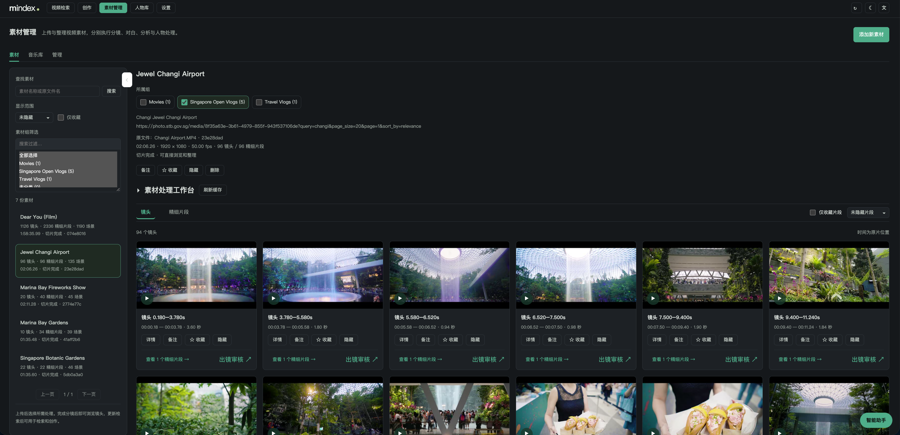

## 快速开始

### 启动 Web 工作台

需要 **Python 3.11–3.13、uv、FFmpeg 与 ffprobe**。本机应用负责媒体、数据库、API 与页面；模型服务另行配置。

```bash
git clone https://github.com/xfork24/mindex.git
cd mindex

uv sync                      # 开发或运行测试改用 uv sync --extra dev
# 可选：受管 DeepSeek Harness 助手运行时（随后在设置页选择）
# uv sync --extra dsh
cp config.example.yaml config.local.yaml
uv run mindex serve
```

打开 **<http://127.0.0.1:8000>**。

| 页面 | 地址 | 用途 |
| :--- | :--- | :--- |
| 创作 | `/` | 创作任务、选题与模板（主页） |
| 视频检索 | `/search` | 文字、图片、视频查询 |
| 素材管理 | `/admin` | 导入、处理与整理（曲库在 `/admin/music`） |
| 人物库 | `/persons` | 身份、参考图、审核与发布 |
| 设置 | `/settings` | 模型档案、权重、音色与服务 |
| API 文档 | `/docs` | FastAPI 交互式接口文档 |

> **安全提示。** Web 与 API 默认没有登录认证，设置页还能修改模型服务地址和密钥。`serve` 只监听 `127.0.0.1`；未设令牌而监听非回环地址会拒绝启动（确认风险后可用 `--allow-insecure` 覆盖）。需要网络访问时，设置 `MINDEX_WEB_TOKEN` 启用访问令牌（页面在 `/login` 登录，脚本用 `Authorization: Bearer`），或放在带认证的反向代理之后。详见 [Web 鉴权](docs/web-auth.md)。

### 导入素材，先跑通画面检索

最短路径只需要**嵌入服务**，无需先运行 ASR、LLM 分析或 TTS。默认主模型为 WeMM-Embedding-9B（4096 维）；部署方式见[部署指南](docs/deployment.md)。

```bash
# 本地 CPU：导入、镜头检测、生成片段。支持 FFmpeg 可解码的 MP4、MKV 等。
uv run mindex prepare '/绝对路径/素材.mp4'

# 记住上一条命令输出的 SOURCE_ID；嵌入服务就绪后执行。
uv run mindex index --mode visual --source SOURCE_ID --kind moment --kind shot --activate
uv run mindex check

# 用一句话找片段。
uv run mindex search '一个人在雨夜街道上奔跑'
```

全程也可以只用素材管理页：**添加新素材 → 分镜处理 → 更新嵌入 / 检索 → 视频检索**。分镜默认使用本地 AdaptiveDetector（可选 TransNetV2）；超过 6 秒的镜头会按 4 秒窗口、3 秒步长生成精细片段。完整流程见[电影处理指南](docs/film-workflow.md)。

### 按需补全对白、分析与人物

画面、对白与分析是独立渠道——先用已就绪的，其余随时补。

```bash
# 优先提取文本字幕，否则用已配置的 ASR；此步不发布索引。
uv run mindex enrich-dialogue SOURCE_ID --no-publish

# 可选：配置视觉理解服务后，生成动作、场景、情绪等分析。
uv run mindex analyze --source SOURCE_ID

# 嵌入服务就绪后，发布已完成的渠道，复用兼容的已有向量。
uv run mindex index --mode auto --source SOURCE_ID --activate
uv run mindex check
```

人物功能需要 `uv sync --extra person --extra dev`、独立人物服务与参考图；按**登记 / 导入 → 处理 → 审核 → 发布**的顺序操作（[人物库指南](docs/persons.md)）。

### 用素材库创作视频

在 `/studio` 输入大纲并限定可用素材。文案创作模型按所选模板写出可编辑的文案（可重新生成、可附参考文稿），自动拆分镜后，每镜依次经过召回 / 配音 / 选片 / 渲染，方案最终合成成片。可导出 **MP4、SRT、WebVTT 与时间轴 JSON**，也可整包下载任务产物。

| 环节 | 所需能力 |
| :--- | :--- |
| 写文案、拆分镜 | 文本 LLM |
| 画面语义召回 | 活动内容索引 + 匹配的嵌入服务 |
| 配音 | TTS + 可用音色 |
| 选片、渲染、合成 | 本地 FFmpeg（烧录字幕另需 libass 与字体） |
| AI 生成图片分镜（可选） | 图片生成（MiniMax image-01 或本地 ComfyUI） |
| AI 生成视频分镜（可选） | 视频生成（MiniMax H3 / 海螺、阿里通义万相或 ComfyUI） |
| 背景音乐（可选） | 音乐生成（MiniMax music-3.0 或 ComfyUI） |
| AI 动画分镜（可选） | 动画生成 LLM + `uv sync --extra animation` 与 Chromium |

上传片段与静态图片分镜完全不需要索引。召回与配音可任意先后——适合单 GPU 轮换模型服务。完整手册见 [Studio 指南](docs/studio.md)。

### 桌面版

**macOS（Apple Silicon）、Windows、Linux** 原生安装包内置后端、FFmpeg 与 DeepSeek Harness 运行时——无需安装 Python、uv 或 FFmpeg，还能在设置页启停本机模型服务。桌面版与 Web 版共享同一套代码，功能同步演进。见[桌面版指南](docs/desktop.md)。

## 工作原理

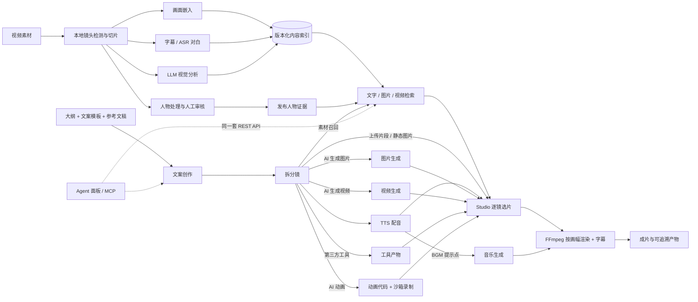

**三渠道召回。** 文字查询分别检索画面、对白、分析渠道；各渠道内部融合语义向量与 BM25，再按可配置权重（默认 0.35 : 0.15 : 0.5）做 RRF 合并，并去除同源重叠。图片与视频查询只走画面渠道。在线查询没有实时 LLM 重排——分数是排序信号，不是概率。嵌入服务不可用但有文本渠道时，检索会显式降级为 BM25 并给出警告，绝不跨空间比较向量。

**本地数据、独立模型。** FastAPI 提供 API；界面是无构建步骤的原生 HTML/CSS/JS。SQLite 保存全部业务数据；Chroma 只保存显式向量；FFmpeg 处理媒体。模型服务部署位置自由——本机、GPU 机器或线上订阅——设计上从不假设多个模型同时可用。

**版本与证据可追溯。** 内容索引、人物发布与 Studio 产物都是不可变版本。更新分析不会改写已发布索引；更换模型或预处理会生成新索引，先检查再激活，回退就是先恢复旧模型服务再 `mindex indexes activate <旧ID>`。嵌入服务携带空间身份（模型、版本、量化、维度、预处理）；对不匹配索引的查询返回 503，而不是比较不兼容的向量。

<details>
<summary><strong>存储布局与索引管理</strong></summary>

配置从 `config.local.yaml` 读取（可用 `MINDEX_CONFIG` 或子命令前的 `--config` 覆盖）；设置页激活的档案在运行时覆盖它，Web 与 CLI 共用覆盖层。

```text
data/
├── sources/              原素材
├── plans/                分镜计划
├── clips/                片段 / 媒体归档
├── thumbnails/           缩略图
├── transcripts/          转写与检查点
├── persons/              人物参考图、证据帧与任务记录
├── studio/               创作任务、方案、版本与构建
├── voices/               克隆音色样本
├── chroma/               向量数据
├── locks/                处理锁与取消哨兵
├── agent-attachments/    助手附件（不进备份）
├── agent.sqlite3         助手会话（不进备份）
└── metadata.sqlite3      元数据与运行设置
```

```bash
uv run mindex --config profiles/custom.yaml status --health

# 更换嵌入模型或预处理后：新建索引，先检查，再激活。
uv run mindex index
uv run mindex indexes list
uv run mindex check --index-id NEW_INDEX_ID
uv run mindex indexes activate NEW_INDEX_ID

# 回退：先恢复旧模型服务 / 配置，再激活旧索引。
uv run mindex indexes activate OLD_INDEX_ID
```

磁盘回收先预览、加 `--apply` 才删除（`mindex clean`，见[清理指南](docs/cleanup.md)）。整库备份与迁移用 `mindex backup`（[备份指南](docs/backup.md)）。

</details>

## API 与 Agent

除网页外，Mindex 同时提供完整 CLI、REST API 与 MCP 服务。`mindex serve` 启动后，完整交互文档在 <http://127.0.0.1:8000/docs>。

```bash
curl -X POST http://127.0.0.1:8000/api/search/text \
  -H 'Content-Type: application/json' \
  -d '{"text":"雨夜，一个人强忍眼泪","granularity":"moment","limit":10}'
```

| 接口 | 用途 |
| :--- | :--- |
| `POST /api/search/text` | 文字查询：渠道选择、人物与素材筛选 |
| `POST /api/search/image` | 图片找视频；JPEG / PNG / WebP，最大 20 MB |
| `POST /api/search/video` | 视频相似检索；最长 30 秒、最大 100 MB |
| `GET /api/admin/sources` | 浏览素材与处理状态（不依赖活动索引） |
| `GET /api/persons` | 人物、参考图、覆盖与发布记录 |
| `GET /api/studio/jobs` | 创作任务；方案 / 构建 / 版本接口见 Studio 文档 |
| `/api/agent/*` | 助手会话与事件流（[智能助手](docs/agent.md#api)） |
| `GET /api/status?health=true` | 索引与模型健康状态 |

`granularity` 支持 `moment`（精细片段）、`shot`（镜头）、`scene`（场景）；所选粒度需已建库。单次返回 1–50 条。

### CLI

`mindex` 命令覆盖整个产品：`prepare` / `detect` / `split`（导入与切片）、`enrich-dialogue` / `transcribe` / `align` / `analyze`（对白与分析）、`index` / `indexes`（版本化索引与激活）、`search`、`persons`、`topics`、`studio`（任务、构建与后期子命令组）、`backup`、`clips`、`e2e`（评测框架）、`agent tools`、`clean` 与 `serve`。完整参考见 [CLI 文档](docs/cli-reference.md)。

### Agent harness

Agent 层把工具与运行时分离，并与外部 harness 互通：

| 运行时 | 是什么 |
| :--- | :--- |
| **内置 harness** | 进程内 agent 循环，支持流式工具调用、预览确认、附件与看图。默认运行时，无额外依赖。 |
| **DeepSeek Harness（dsh）** | 基于官方 DeepSeek Harness SDK 的受管运行时（`uv sync --extra dsh`；桌面版已内置）。在设置页或经 `agent.runtime` 选择，对新会话生效。 |
| **外部 harness** | 任何支持 MCP 的客户端——DeepSeek Harness MCP 客户端、Claude Code、Codex——都可连接导出的 MCP 服务，驱动 148 个工具中的 144 个。 |

```bash
# stdio MCP 服务（进程内应用，或连接运行中的服务）
uv run mindex mcp
uv run mindex mcp --base-url http://127.0.0.1:8000

# streamable HTTP 端点（需 MINDEX_MCP_TOKEN）
# 以 agent.mcp.http_enabled 启用，挂载在 /mcp
```

MCP 导出可按领域过滤（`agent.mcp.domains` / `--domain`），并受策略约束（`read` / `write` / `all`，服务端强制执行）。模型协议兼容 OpenAI 工具调用与 Anthropic Messages。Claude Code、Codex 与 dsh 客户端的接入示例见[智能助手指南](docs/agent.md)。

## 文档

| 任务 | 从这里开始 |
| :--- | :--- |
| 整部电影导入与画面索引 | [电影处理指南](docs/film-workflow.md) |
| 部署模型服务、使用 HTTP 协议 | [部署指南](docs/deployment.md) |
| 处理阶段、断点续跑与增量建库 | [离线管线](docs/pipeline.md) · [三渠道处理](docs/recall-enhancement.md) |
| 管理素材、字幕与处理任务 | [素材后台](docs/admin.md) |
| 管理人物、审核出镜证据 | [人物库指南](docs/persons.md) |
| 制作视频、编辑方案、选择性重建 | [Studio 指南](docs/studio.md) |
| 选题挖掘与打分调参 | [选题指南](docs/topics.md) |
| 用助手面板或 MCP 操作 Mindex | [智能助手指南](docs/agent.md) |
| 安装桌面版、管理本机服务 | [桌面版指南](docs/desktop.md) |
| 配置服务、音色与检索权重 | [设置](docs/settings.md) · [配置参考](docs/config-reference.md) |
| 备份、迁移或恢复素材库 | [备份与迁移](docs/backup.md) |
| 查阅命令、模块与数据流 | [CLI 参考](docs/cli-reference.md) · [架构](docs/architecture.md) |
| 评测检索质量、切换索引版本 | [端到端验证](docs/e2e-runbook.md) · [索引版本](docs/index-versions.md) |
| 路线图 | [功能路线图](plans/roadmap.md) |

更多机制说明、操作手册与验收记录见[文档中心](docs/README.md)。代理协作约定见 [AGENT.md](AGENT.md)，Claude Code 技术导航见 [CLAUDE.md](CLAUDE.md)。

## 许可证

以 [MIT 许可证](LICENSE) 发布。桌面安装包内的随包组件（如 ffmpeg）另有许可，见[第三方组件声明](docs/third-party-notices.md)。
