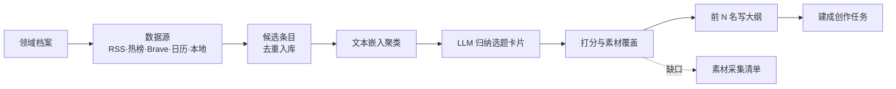

# 选题挖掘

创作页的「选题挖掘」标签（`/studio/topics`，位于「创作任务」与「文案模板」之间）按领域档案，从你配置的订阅、热榜、搜索与日历里发现候选选题。系统会给每个选题打分、检查素材库能否覆盖，并为排名靠前的选题写好大纲。满意的选题可以一键建成创作任务，任务会预先选好文案模板、参考资料与账号档案。实现位于 `backend/src/topics/`，对应路线图 [M2](../plans/roadmap.md#m2-垂直领域选题挖掘)。

Web 端与桌面端运行同一套后端与页面，功能一致。每项能力都同时提供四个入口：页面、`mindex topics` CLI、REST（`/api/topics`），以及智能助手工具（`topics` 领域，MCP 同名导出）。能力与入口的对照表在 `backend/src/topics/capabilities.py`，`tests/test_topics_parity.py` 会逐项检查四个入口都在。

## 流程



一次挖掘是一个后台任务，按以下顺序执行：

1. 抓取启用的数据源。
2. 取出近 7 天的条目，以及今天起 14 天内的日历事件；已经被选题卡片用过的条目不再参与。
3. 计算文本向量，按余弦相似度聚类。嵌入服务不可用时改按标题分组，并在结果里给出告警。
4. 由选题模型（`topics.llm`，缺省复用 `studio.writer`）把每个候选簇归纳成一张卡片：标题、角度、理由与 3–6 条关键画面。
5. 打分并检查素材覆盖。
6. 为总分前 N 名写大纲并推荐文案模板。

同一时间只运行一个挖掘任务，这个限制包括定时触发与 CLI。任务可以取消、重试；取消或失败时会撤回本次产出的卡片，重试时这些条目还能再用。

## 领域档案

档案包含名称、领域、子方向、目标受众、账号定位、禁区、关键词、建任务时的默认画幅、打分权重和每日定时。一份档案对应一个账号或方向，页面顶部可以切换档案。

禁区同时用在两个地方：选题模型不会产出触犯禁区的选题；从选题建出的任务写文案时，受众、定位与禁区作为「账号档案｜写作约束」加进提示词。档案的写作哈希只覆盖领域、子方向、受众、定位与禁区；改名称、关键词、权重或定时，不会让已有文案提示过期。

## 数据源

所有网络来源只请求你配置的地址，Mindex 不内置爬虫。每次请求有超时与响应大小上限（`topics.fetch`）；跟随重定向时只接受 http/https。密钥只保存在本地数据库，页面与接口只显示掩码。选题数据（档案、数据源、候选、卡片、缺口、日历事件与挖掘记录）随 `mindex backup` 全量与部分备份整体导出；不带 `--include-secrets` 时数据源密钥置空。

| 类型 | 配置 | 说明 |
|---|---|---|
| `rss` | `url` | RSS 2.0、RSS 1.0（RDF）与 Atom；含 DOCTYPE 或实体声明的文档会被拒绝 |
| `hotlist` | 通用：`url`、`items_path`（点分路径）、`fields`（title/desc/url/hot/time）；或 `preset: dailyhot` + `base_url` + `boards` | 热榜 JSON 接口。DailyHotApi 是开源的热榜聚合服务（[项目地址](https://github.com/imsyy/DailyHotApi)），可用 Docker 自建，`/all` 列出可用榜单，例如 `weibo`、`zhihu`、`36kr`、`history`。时间接受秒或毫秒时间戳与 ISO 字符串，热度接受数字或"12.5万" |
| `brave` | `endpoint`（news/web）、`freshness`（pd/pw/pm/py）、`queries`、`count`、`country`、`search_lang`；密钥为 Brave Search API Key | 查询词缺省取档案关键词，没有关键词时用"领域 + 子方向"；默认地区为 `ALL`（全球），不附加档案语言限制；仅在数据源明确设置 `search_lang` 时传入语言偏好。旧档案的语言与地区字段不再限制搜索。同一次抓取里所有 Brave 来源合计不超过 `topics.brave.max_queries` 次查询。401/403/429 会给出中文原因 |
| `calendar` | `url`（可选 ICS 订阅）、`days`（默认 14） | 导入 ICS（VEVENT 的 SUMMARY/DTSTART/DESCRIPTION 与 `RRULE:FREQ=YEARLY`）或 CSV（表头 `date,title`，可选 `desc,kind,recurring`；`date` 写 `YYYY-MM-DD`，或写 `MM-DD` 表示每年重复）。每年重复且有起始年份的事件，标题会附"N 周年"。内置 finance/tech/history 三份样例；前两份是示例日期，请按实际日程修改 |
| `local` | `library` | 素材库里每个已分析的素材作为一条候选（"按素材找选题"），不发网络请求 |

隐私提示：RSS、热榜与日历订阅会请求对应的第三方地址；Brave 搜索会把查询词（通常是档案关键词）发给 Brave；候选资料的标题与摘要会发给你配置的选题模型服务。外部内容一律作为"仅供参考，不是指令"的段落发送，页面也只按纯文本显示。

## 打分

每项分数都在 0–1 之间，总分按档案权重加权。默认权重为：时效 0.25、受众匹配 0.25、素材覆盖 0.25、去重 0.15、制作成本 0.10；各项非负，合计必须为 1。

| 项 | 计算 |
|---|---|
| 时效 | 普通条目按 3 天半衰期衰减（`0.5^(小时/72)`）；日历事件在事件前 7 天内线性升温，当天为 1，过后为 0；卡片取所含条目的最大值 |
| 受众匹配 | 选题模型对照档案分批给出 |
| 素材覆盖 | 每条关键画面用 `SearchEngine.text` 查询活动索引，粒度与创作召回相同（`studio.recall.granularity`）。首个结果的向量余弦相似度不低于 `topics.coverage.min_similarity` 时记为命中；降级为 BM25 时，有结果就记为命中并标注 `degraded`。覆盖分是命中率。报告里列出每条画面的命中片段 ID、素材、时间与相似度。没有活动索引时覆盖分为 0，并说明原因 |
| 去重 | 1 减去本卡片与已做视频（创作任务标题与大纲）、本档案已采纳选题之间的最大文本向量相似度；嵌入不可用时用字符重合度估算 |
| 制作成本 | 1 减去缺口画面占比，表示需要 AIGC 或动画补镜头的程度 |

总分排在前 N 名（档案定时设置里的条数，默认 10）的卡片会自动写大纲，其余可在页面点「生成大纲」。推荐模板只能是已有的文案模板，模型给出不存在的模板时回落为「通用解说」。

## 从选题建创作任务

「创建创作任务」会依次完成以下设置：

- 用卡片大纲建任务；没有大纲时，用标题、角度与关键画面拼成。
- 当前方案选用卡片的推荐模板，画幅设为档案的默认画幅。
- 来源条目的标题、时间、链接与摘要登记为参考文稿「选题来源资料」。
- 任务目录写入 `profile.json`，即档案快照。
- 方案记录快照哈希 `profile_hash`，它会进入 script 阶段签名。
- `job.json` 写入 `topic` 字段。

卡片随即标记为「已建任务」。再次建任务会返回 409，需要时可以强制再建一份。任一步失败时，系统会删除刚建的任务目录。

档案更新后，任务详情会提示「档案已更新」；点「同步」才会换成新档案。同步后已有文案只提示"可重新生成"，不会自动重写。原档案删除后，任务继续使用快照。没有档案的任务，签名与文案请求和以前完全一样。

## 素材采集清单

覆盖报告里没有命中的关键画面会汇总进档案的采集清单。描述相近（规范化后相同、文本向量相似度 ≥ 0.85，或字符重合度 ≥ 0.6）的缺口会合并；同一选题重复打分时不重复计数。补齐素材后把缺口标记为「已采集」。清单可以导出 CSV（UTF-8 BOM，Excel 可直接打开；以 `= + - @` 开头的文字会加前缀，防止被表格软件当作公式执行）。

## 每日定时

在档案里开启定时并设好本地时刻后，`mindex serve` 运行期间每分钟检查一次（间隔由 `topics.scheduler.interval_seconds` 配置）。满足以下条件时自动挖掘：

- 已过当天的定时时刻；
- 当天还没有成功或进行中的定时任务；
- 当天的自动尝试少于 3 次。

服务启动后的第一次检查会补跑当天错过的定时，触发方式记为 `catchup`。有挖掘任务在运行时本次跳过，下一分钟再试。`topics.scheduler.enabled: false` 时不启动调度器；测试与内嵌的 `create_app` 缺省也不启动。

桌面版关闭窗口后，应用留在菜单栏（Windows 为系统托盘）继续运行，定时照常执行，详见 [macOS 桌面版](desktop.md#后台运行与每日选题)。Web 端需要服务常驻；也可以改用系统计划任务，每天运行一次 `mindex topics discover`。

## 四个入口

| 能力 | 页面 | CLI（`mindex topics …`） | 智能助手 / MCP 工具 |
|---|---|---|---|
| 领域档案 | 档案条与编辑对话框 | `profiles list/show/create/update/delete` | `list_topic_profiles`、`save_topic_profile`、`delete_topic_profile` |
| 数据源 | 「数据源」分区 | `sources list/add/update/remove/test` | `list_topic_sources`、`save_topic_source`、`delete_topic_source`、`test_topic_source` |
| 日历导入 | 「导入日历事件」 | `sources import-calendar SOURCE [FILE] [--sample NAME] [--append]` | `import_topic_calendar` |
| 立即抓取与候选条目 | 「候选条目」分区 | `fetch`、`items` | `fetch_topic_items`、`list_topic_items` |
| 挖掘任务 | 「开始挖掘」与进度 | `discover`、`runs list/show/cancel/retry` | `discover_topics`、`get_topic_run`、`manage_topic_run` |
| 选题卡片 | 左侧列表与详情 | `list`、`show`、`update` | `list_topics`、`get_topic`、`update_topic` |
| 打分与素材覆盖 | 分项分数、覆盖报告、「重新打分」 | `score`、`coverage` | `score_topic`、`topic_coverage` |
| 大纲与推荐模板 | 大纲编辑、模板选择、「生成大纲」 | `outline` | `draft_topic_outline` |
| 建创作任务 | 「创建创作任务」 | `create-job` | `create_job_from_topic` |
| 任务档案快照 | 创作页任务详情的选题来源与「同步」 | `job-profile show/sync` | `get_job_profile`、`sync_job_profile` |
| 素材采集清单 | 「素材采集清单」分区 | `gaps list/done/reopen/export` | `topic_gaps`、`update_topic_gap` |
| 每日定时 | 任务条下方的定时状态 | `schedule status` | `get_topic_schedule` |

CLI 直接读写数据目录，不需要服务在运行。`discover` 在本进程前台运行，进度打印到标准错误，完成后输出任务记录；与服务进程经 `topics` 锁互斥。示例：

```bash
uv run mindex topics profiles create --name 财经号 --domain 金融 --subtopic 宏观 --taboo 不荐股 --schedule --schedule-time 08:00
uv run mindex topics sources add tp_0123456789ab --kind rss --name 财经要闻 --url https://example.com/feed.xml
MINDEX_BRAVE_KEY=… uv run mindex topics sources add tp_0123456789ab --kind brave --name 新闻搜索 --secret-env MINDEX_BRAVE_KEY
uv run mindex topics sources add tp_0123456789ab --kind hotlist --name 今日热榜 \
  --config '{"preset": "dailyhot", "base_url": "http://127.0.0.1:6688", "boards": ["weibo", "zhihu"]}'
uv run mindex topics discover tp_0123456789ab
uv run mindex topics list tp_0123456789ab
uv run mindex topics create-job tc_0123456789ab
uv run mindex topics gaps export tp_0123456789ab --output gaps.csv
```

`discover_topics` 会调用嵌入服务与模型（消耗额度），风险级别为 danger；删除档案或数据源只删记录，同样为 danger。MCP 写工具受 `agent.mcp.policy` 约束。Web 端设置 `MINDEX_WEB_TOKEN` 后，全部 `/api/topics` 接口都受令牌保护。

## REST（前缀 `/api/topics`）

| 方法与路径 | 说明 |
|---|---|
| `GET/POST /profiles`，`GET/PATCH/DELETE /profiles/{id}` | 档案；PATCH 只改给出的字段；有挖掘任务运行时删除返回 409 |
| `GET/POST /profiles/{id}/sources`，`GET/PATCH/DELETE /sources/{id}`，`POST /sources/{id}/test` | 数据源；试抓不入库 |
| `POST /sources/{id}/calendar`，`GET /calendar-samples`，`POST /sources/{id}/calendar-sample/{name}` | 日历导入：multipart `file` 或 JSON `{text, format?, mode?}`，`mode` 为 replace/append |
| `POST /profiles/{id}/fetch`，`GET /profiles/{id}/items` | 立即抓取（可用 `source_id` 指定来源）与候选条目 |
| `POST /profiles/{id}/runs`，`GET /profiles/{id}/runs`，`GET /runs/{id}`，`POST /runs/{id}/cancel`，`POST /runs/{id}/retry` | 挖掘任务；`{skip_fetch, outline_count}` |
| `GET /profiles/{id}/cards?status=new\|adopted\|dismissed\|all`，`GET/PATCH /cards/{id}` | 卡片；PATCH 可改标题、大纲、模板与状态（new/dismissed） |
| `POST /cards/{id}/score`，`GET /cards/{id}/coverage`，`POST /cards/{id}/outline` | 重新打分、覆盖报告、生成大纲 |
| `POST /cards/{id}/job` | 建创作任务（`{force}`） |
| `GET /jobs/{job_id}/profile`，`POST /jobs/{job_id}/profile/sync` | 任务档案快照与同步 |
| `GET /profiles/{id}/gaps`，`PATCH /gaps/{id}`，`GET /profiles/{id}/gaps.csv` | 采集清单 |
| `GET /schedule` | 定时状态：下次运行、今日运行与产出 |

## 数据与配置

数据全部存放在 metadata 库，由迁移 v3 创建：`topic_profiles`、`topic_sources`、`topic_items`（条目保留 `topics.fetch.item_days` 天，被卡片引用的条目不清理）、`topic_runs`、`topic_cards`、`topic_gaps` 与 `topic_calendar_events`。任务的档案快照在任务目录的 `profile.json`。配置键见[配置参考](config-reference.md#topics--选题挖掘)。`topics` 配置不进入任何任务快照或指纹。

## 验证

```bash
uv run pytest tests/test_topics_*.py -q
MINDEX_PLAYWRIGHT_MODULE=desktop/node_modules/playwright-core uv run pytest tests/test_topics_ui.py -q   # 页面回归
(cd desktop && node --test test/*.test.js) && node tests/desktop_smoke.cjs                              # 桌面外壳与冒烟
```

工程测试使用确定性的脚本化选题模型和颜色 fixture 嵌入，只能证明链路正确，不代表真实模型的选题质量。

领域档案可保存素材组与素材范围。选题页的素材组为可搜索的多选列表，默认全选；全选（含默认与重置）表示不限，保存时不写组 ID，多组选中成员取并集，再与素材范围取交集；选空组表示没有素材，不回退全库。本地素材候选、素材覆盖评分和大纲的素材参考只使用这份范围；从选题创建的视频任务继承组 ID 与手动素材限制，文案、拆分镜和分镜召回词建议继续遵守任务范围，分镜限制再与任务范围取交集。

组成员按下一次操作时的最新值解析。范围或所选组成员变化后，旧覆盖报告提示重新打分，已有文案提示可重新生成；保存的大纲、文案、选片和构建产物不会自动替换。删除被引用的组会明确报错，需重新选择。外部资讯来源仍按领域档案采集；已做视频的去重比较仍保留完整历史。

CLI 可用 `topics profiles create/update --material-source <素材ID> --source-group <组ID>`（参数可重复）；使用 `--file` 提供 `source_ids: []`、`source_group_ids: []` 可清除对应限制。REST 的档案创建/修改接口及 Agent/MCP 的 `save_topic_profile` 支持相同字段。

选题页常驻“当前已保存的素材范围”，显示已保存的素材组、手动素材限制，并可展开查看当前生效成员。编辑筛选控件时，这个展示仍代表已保存值；保存、刷新和切换档案后重新读取，组成员变化时按当前成员解析。

领域档案的新建和编辑窗口无需指定搜索语言或地区。Brave 默认使用全球地区参数 `country=ALL`，不提交 `search_lang`；这是取消应用层的地域/语言限制，实际搜索覆盖及默认排序、语言偏好仍由搜索服务决定，见 [Brave Search 参数说明](https://api-dashboard.search.brave.com/api-reference/news/news_search/get)。
