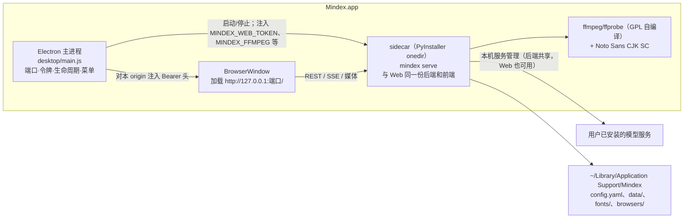

# macOS 桌面端实施计划（Electron 外壳 + Python sidecar）

状态：已确认，待在 `main` 上新建分支实施。调查基于提交 `a445d46`（当时 `main` 与 `mindex-features` 指向同一提交），文中的行号以该提交为准，实施前先复核。

## 1. 目标

- 提供 macOS 桌面应用：DMG 安装后双击即可使用，不需要手动执行 `mindex serve`，不依赖用户安装的 Python、uv 或 ffmpeg。
- 功能与 Web 版完全一致（全部页面与 API），并且与 Web 版同步演进：不维护第二份业务代码。
- 桌面端可以管理本机已安装的模型服务（启动、停止、健康、日志、随应用自启、退出时停止），不负责安装模型或下载权重。

不在本轮范围：

- Windows（后续阶段；需要先把 `shared/locks.py` 改为跨平台）。
- Intel 机器（只出 arm64）。
- 签名公证与自动更新（没有 Apple Developer ID 前推迟，见任务 13、14）。
- 把 GPU 模型服务打进安装包。
- 随包提供 `mindex` 命令行（以后可加“安装命令行工具”菜单项）。

## 2. 决策记录

| # | 问题 | 决定 |
|---|---|---|
| D1 | 外壳框架 | Electron，替代 ROADMAP M4 原推荐的 Tauri 2 |
| D2 | 模型服务范围 | 本机服务管理面板：启停用户已安装的服务，不打包模型 |
| D3 | 首版平台 | 先 macOS，后 Windows |
| D4 | 随包 ffmpeg | GPL 构建（含 libx264），从锁定版本的源码自行编译，发布时提供对应源码与构建脚本；首次对外发布前请法务确认 |
| D5 | Apple Developer ID | 暂无：首版用 ad-hoc 签名内部分发，签名公证与自动更新推迟 |
| D6 | CPU 架构 | 只做 Apple Silicon（arm64） |

### D1 选型理由

两种外壳的后端完全相同（都是 sidecar 运行 `mindex serve`），“功能完整”和外壳选型无关，差异只在外壳这一层：

| 维度 | Electron | Tauri 2 |
|---|---|---|
| 渲染引擎 | 自带 Chromium，与开发和测试 Web 版用的 Chrome 一致 | macOS 用 WKWebView（WebKit），Windows 用 WebView2；macOS 上要多维护一个 WebKit 兼容面 |
| 自动化测试 | Playwright 原生支持 `_electron.launch`，可沿用现有 `tests/*_ui.cjs` 思路 | WebDriver（tauri-driver），macOS 支持有限 |
| 外壳语言 | JS，与现有前端同一技能栈 | Rust + JS |
| 体积 | 外壳多约 100–150 MB | 外壳约 10 MB |
| 常驻内存 | Chromium 多约 150–300 MB | 更轻 |
| 安全默认值 | 需手动开 `contextIsolation`/`sandbox`、关 `nodeIntegration` | 能力白名单，默认更严 |
| 自动更新 | electron-updater 成熟，支持 blockmap 差分 | 默认整包，差分需自建 |

体积和内存是原 ROADMAP 否定 Electron 的主要依据，但 sidecar 本身已经包含 CPython、numpy、chromadb（含 onnxruntime）、opencv、ffmpeg 和 CJK 字体，安装包本就有几百 MB（未实测，粗估），Electron 的增量不是数量级差异；渲染、检索时的内存大头是 Python 和 ffmpeg。ROADMAP 的验收标准是“性能不低于 Web 版”，而 Web 版本就跑在 Chrome 里，Electron 在界面层与之等价。

### 不采用的做法

- 把后端改写成 Node 放进 Electron 主进程：会产生第二份业务代码。
- 把前端打包成 `file://` 或自定义协议加载：前端的根相对路径、`EventSource`、`location.href` 都要改，形成分叉。
- 通过 Electron IPC 实现业务功能：业务一律走 REST。

## 3. 现状调查（实施依据）

### 前端

- 所有请求都是根相对路径（`/api/...`，统一经 `frontend/src/shared/api.js`）；实时推送用 `EventSource('/api/agent/...')`（`shared/agent-panel.js:291、394`）；跳转用 `location.href`（`agent-panel.js:252`、`studio/templates.js:393`）。窗口加载 `http://127.0.0.1:<port>/` 时前端无需改动。
- `localStorage` 存界面语言和偏好，其作用域包含端口：端口必须固定并持久化，不能每次随机。
- `target="_blank"` 链接：`search/app.js:167、178`、`admin/admin.js:515`、`shared/agent-panel.js:1077`，需 `setWindowOpenHandler` 处理。
- 下载：`?download=true`（`studio/studio-state.js` 的 `link()`）由 `studio/studio_files.py`、`admin/admin.py` 以 `Content-Disposition: attachment` 返回；助手附件见 `agent/api.py:274`。需处理 `will-download`。
- 拖放：`admin.js:537`、`search/app.js:87`、`agent-panel.js:1091`；拖到这些区域之外时须阻止窗口导航到文件。
- 原生 `confirm()` 在设置、素材后台、创作、助手面板中使用，Electron 中可用。
- `ShotPlayer` 只切换 mp4 的 `video.src`，没有 MSE/HLS；没有 service worker；`navigator.clipboard` 在 127.0.0.1 安全上下文中可用。

### 后端启动与认证

- `serve`（`backend/src/cli.py:642–693`）：`create_app` → `warm_up_in_background` → `uvicorn.run(app, host, port)`；默认端口 8000；回环地址可不设令牌。全局选项（`--config`、`--data-dir`）必须放在子命令之前。
- 没有专门的健康接口；`/api/status`（`search/api.py:23`）较重且需要认证。
- `shared/web_auth.py`：设置 `MINDEX_WEB_TOKEN` 后启用；接受 `Authorization: Bearer <令牌>`（`authorized()`），或 Cookie `mindex_session = HMAC-SHA256(token, "mindex-web-session-v1")`；公开路径只有 `/login`、`/logout`、`/mcp` 与 `/assets/shared/`、`/api/agent/attachments` 前缀。
- 后台工作全部在 daemon 线程（搜索预热、`BackgroundTaskRunner`、studio 执行器、标题线程等），没有信号处理或 atexit；被杀后下次启动由 `recover_tasks` 恢复；flock 锁随进程退出释放。

### 配置与数据目录

- `load_config`（`shared/config.py:630–651`）：配置文件存在时，以其所在目录为基准解析 `data_dir`（默认 `data`）、`deployment_manifest` 与 `studio.subtitle.font_file`；不存在时以 cwd 为基准（Electron 启动时 cwd 可能是 `/`，必须显式传配置）。
- 渲染签名里的 `font_file` 等路径经 `portable_parameters` 相对 `data_dir.parent` 存储，所以字体应放在配置目录之内，路径才能在应用升级或移动后保持稳定。

### 外部二进制

- `ffmpeg`/`ffprobe` 以字面量写死，只能从 PATH 找到：`shared/media.py`（probe、audio_info、atomic_media、frame_data、frame_timestamps）、`processing/dialogue.py:37、77`、`processing/shot_repair.py:22`、`studio/studio_render.py:24、72、578、594`、`studio/animation_capture.py:198–203`、`models/model_server.py:267`；`studio/studio_logs.py:86` 以 `endswith("ffmpeg")` 识别日志标签。
- 字幕烧录需要 libass（`has_subtitles_filter()` 检查 `ffmpeg -filters`），`check_font`（`studio_render.py:59–90`）检查字体文件并做 1 帧渲染。
- 成片编码用 `libx264`（GPL），因此有 D4。
- AI 动画录制：可选 extra `animation`（`playwright==1.64.1`），浏览器在 Playwright 缓存目录。
- 强制对齐：用户自备的 `.venv-align` 解释器，`processing/pipeline.py:448` 以 `Path(__file__).with_name("align_worker.py")` 定位脚本。

### 冻结打包（PyInstaller）后会失效的地方

| 位置 | 问题 |
|---|---|
| `models/llama_cpp.py:259` `content_hash(Path(__file__))` | 冻结后没有 `.py` 源码；改写会改变指纹，使 Web 端已有分析、ASR 缓存失效 |
| `models/model_server.py:90` 同上 | 只在模型服务进程里运行，桌面主后端不受影响，但一并处理 |
| `maintenance/backup_files.py:186–200` `sys.executable -m mindex.maintenance.backup_vectors` | 冻结后的可执行文件不支持 `-m` |
| `cli_persons.py:149–157` `sys.executable -m mindex.persons.person_worker` | 同上 |
| `processing/pipeline.py:448` `align_worker.py` | 需作为数据文件打包 |
| `shared/web_assets.py` `frontend_root()` | 需把 `frontend/src` 打包到 `mindex/web` |
| `studio/script_templates.py:24` `templates/*.yaml` | 需作为数据文件打包 |
| chromadb（Rust 扩展、onnxruntime、tokenizers）、opencv、jieba 字典、大量函数内延迟导入 | 需 hook、datas 与 `collect_submodules` |

### 锁与平台 API

- `shared/locks.py` 全部基于 `fcntl.flock`，macOS 可直接使用（Windows 阶段再改）。没有 `os.fork`、`signal`、写死的 `/tmp`。

### 模型服务现状

| 服务 | 启动方式 | 默认端口 | 健康检查 |
|---|---|---|---|
| WeMM 嵌入 | `scripts/run-wemm.sh` → `bin/llama-server` | `MINDEX_WEMM_PORT` 8888 | `/health` |
| Qwen3 ASR | `scripts/run-qwen3-asr.sh` → `bin/llama-server` | `MINDEX_ASR_PORT` 8889 | `/health` |
| TTS | `scripts/run-tts-voiceclone.sh` / `run-tts-voicedesign.sh` → `bin/tts-server` | `MINDEX_TTS_PORT` 8890 | 待确认 |
| 音乐生成 | `scripts/run-music-gen.sh` → `bin/audiocpp_server` | `MINDEX_MUSIC3_PORT` 8891 | `/health`、`/v1/models` |
| TransNet 分镜 | `scripts/run-transnet.sh` → `.venv-detector` | `MINDEX_TRANSNET_PORT` 18203 | `/health` |
| 人物 | `scripts/run-person-service.sh` → `.venv-person` | `MINDEX_PERSON_PORT` 4050 | `/health` |

代码里没有任何服务启停管理；设置页已有“测试连接”（`settings/settings_api.py:476–500` 的 `_probe`）。

### CI

- `.github/workflows/ci.yml` 只有 `ubuntu-latest` 一个任务；推送和 PR 跑 `pytest -m "not slow"`，定时任务跑全量；没有安装 Playwright，浏览器类 UI 测试在 CI 中跳过。

## 4. 总体架构



关键设计：

1. 外壳不自带前端副本，只加载 sidecar 提供的页面；`desktop/` 目录不放业务逻辑。
2. 桌面专属能力（原生对话框、托盘等）通过 preload 暴露 `window.MindexDesktop`；前端先检测，没有就退回现有行为，Web 端不受影响。
3. 本机服务管理实现在 Python 后端（Web 端同样可用，可用 pytest 测试，可提供智能助手工具）。启动命令只能写在 YAML 里，REST 只能列表、启停、看日志、改自启开关，不能修改命令。功能需在配置中显式开启，桌面配置模板默认开启。
4. ffmpeg 路径改为环境变量可配置，默认仍是 `ffmpeg`；路径不进入任何签名，Web 端与桌面端的产物缓存可以互相复用。
5. 源码摘要类指纹在冻结前后保持完全一致。
6. 字体首次运行时复制到用户数据目录，渲染签名里的相对路径稳定。

## 5. 目录与产物布局

```text
desktop/                         # 新增，只含外壳与打包
  package.json                   # 依赖锁定精确版本；electron、electron-builder
  main.js                        # 主进程
  preload.js                     # window.MindexDesktop（最小能力）
  lib/                           # 纯逻辑：端口、启动参数、origin 过滤、状态文件
  pages/                         # 启动中 / 出错 本地页面
  config.template.yaml           # 桌面默认配置
  sidecar/mindex.spec            # PyInstaller
  test/                          # node --test
scripts/
  build-desktop-ffmpeg.sh        # 从源码编译 GPL ffmpeg（arm64）
  build-desktop-sidecar.sh
  build-desktop-mac.sh           # sidecar + ffmpeg + electron-builder + ad-hoc 签名 → dmg
  check-desktop-sidecar.py       # 冻结后端冒烟
  desktop-bench.sh               # 性能对比
```

`Mindex.app/Contents/Resources/` 内：`backend/`（冻结后端，可执行文件 `mindex`）、`bin/ffmpeg`、`bin/ffprobe`、`fonts/NotoSansCJKsc-Regular.otf`。

用户数据（`~/Library/Application Support/Mindex/`）：`config.yaml`、`data/`、`fonts/`、`browsers/`（Playwright Chromium）、`desktop-state.json`（端口、数据目录选择）。日志在 `~/Library/Logs/Mindex/`。

## 6. 任务拆分

执行顺序与依赖：

```text
T1 ─► T2 ─► T3 ─► T4
T1 ─► T5 ┐
T1 ─► T6 ┴─► T7 ─► T8 ─► T9
T2 ─► T10 ─► T11（需 T3）
T7 ─► T12
T9、T11、T12 ─► T15
T13、T14 推迟（需 Apple Developer ID）
```

每个任务完成后都要通过：`uv run ruff check backend/src tests`、相关 pytest、前端改动时的 `node --check`、`python scripts/build-messages.py --check`、`python scripts/build-assets.py --check`、文档改动时的 `python scripts/check-doc-links.py`。

### T1 文档先行：记录选型决定

- 改动：
  - `plans/ROADMAP.md` M4：推荐方案改为 Electron + Python sidecar，引用本文第 2 节的理由；把 Electron 一行的“不推荐”改为推荐，Tauri 两行改为备选；修正“Tauri updater，配合差分包”的描述；前置条件补充“冻结兼容、端口持久化”；签名公证与自动更新标为等账号后再做。
  - `plans/README.md` 在“素材管理、界面与运维”表中登记本文件。
- 测试：`python scripts/check-doc-links.py`。
- 验收：ROADMAP 与本计划一致。

### T2 后端轻量健康接口

- 改动：新增 `GET /api/health`（不加入 `PUBLIC_PATHS`，随认证中间件保护），返回 `{"version", "pid", "data_dir", "busy"}`。`version` 来自 `importlib.metadata.version("mindex")`；`busy` 汇总 studio 执行器与 `BackgroundTaskRunner`（素材、对白、人物任务）是否有运行中的任务，具体查询方式实施时确认。
- 测试（pytest + TestClient）：开启令牌时，无凭证返回 401，Bearer 返回 200；有运行中的任务时 `busy` 为 true；返回耗时不依赖素材规模。
- 验收：`curl -H "Authorization: Bearer <令牌>" http://127.0.0.1:8000/api/health`。

### T3 Electron 外壳最小可用（开发模式）

开发模式使用系统里的 `uv` 和 ffmpeg，先把外壳行为做完整。

- 主进程：
  - `app.requestSingleInstanceLock()`，第二个实例聚焦已有窗口。
  - 端口：首次选空闲端口并写入 `desktop-state.json`，之后复用；端口被占用时换端口并提示“界面偏好会重置”。
  - 令牌：每次启动生成 32 字节随机令牌，只通过环境变量 `MINDEX_WEB_TOKEN` 传给子进程，不写盘、不进日志。
  - 启动：开发模式 `uv run mindex --config <配置> serve --host 127.0.0.1 --port <端口>`（cwd 为仓库根）；生产模式（T7 起）运行 `Resources/backend/mindex`。stdout/stderr 写入 `~/Library/Logs/Mindex/backend.log`，按大小轮转。
  - 就绪：轮询 `/api/health`（带 Bearer，超时 60 秒），校验 `pid` 与子进程一致、`version` 与外壳期望一致，避免连到端口上的其他进程。
  - 认证：`session.webRequest.onBeforeSendHeaders` 只对 `http://127.0.0.1:<端口>` 注入 `Authorization: Bearer`。需验证页面请求、`EventSource`、`<video>`/`<audio>` 媒体请求和下载都带上该头；若某类请求不经过 `webRequest`，改为通过 `session.cookies` 预置 `mindex_session`（值按 `web_auth.session_value` 计算），并在 `web_auth.py` 注释里注明该值是桌面外壳依赖的约定。
  - 窗口安全：`contextIsolation: true`、`sandbox: true`、`nodeIntegration: false`、`webSecurity: true`；`will-navigate` 只允许本 origin；`setWindowOpenHandler`：本 origin 开新窗口，其他用 `shell.openExternal`（只允许 http/https）；拒绝 `permission` 请求中不需要的权限。智能助手会渲染 LLM 输出的 Markdown，因此这些设置不能放宽。
  - 下载：`will-download` 弹出保存对话框。
  - 拖放：窗口级阻止拖文件导致的导航，不影响页面已有的拖放区。
  - 菜单：包含标准“编辑”菜单（保证输入框复制粘贴快捷键）、“打开日志目录”、“打开数据目录”、“重新加载”。
  - 启动中与出错页（`desktop/pages/`）：显示进度、错误摘要、“重试”和“打开日志”。
  - 子进程意外退出：显示出错页，提供重启。
  - 退出：先查 `/api/health` 的 `busy`，有任务时弹窗确认（任务会中断，下次启动自动恢复）；然后 SIGTERM，10 秒后仍未退出则 SIGKILL。
- preload：暂只暴露 `window.MindexDesktop = { version, platform }`，供前端检测。
- 测试：
  - `node --test desktop/test`：端口持久化与冲突、启动参数拼装（全局选项在子命令之前）、origin 过滤、外链协议白名单。
  - pytest 包装的 Playwright `_electron` 冒烟测试（没装 electron 或 playwright 时跳过）：五个页面可打开，`/studio` 能加载，SSE 连接建立，下载触发保存，退出后子进程不存在。
- 验收：`cd desktop && npm start` 打开完整应用，所有页面可用。

### T4 桌面配置模板与数据目录

- 改动：
  - `desktop/config.template.yaml`：`data_dir: data`；模型服务默认指向 127.0.0.1 上的本机端口（第 3 节表格；各服务的 `backend` 取值对照 `scripts/run-*.sh` 与 `docs/macos-model-migration.md` 确认）；`studio.subtitle.font_file: fonts/NotoSansCJKsc-Regular.otf`；`local_services.enabled: true`（T10 之前该键不存在，T10 时加入）。
  - 首次运行由外壳在 `~/Library/Application Support/Mindex/` 生成 `config.yaml`，之后不覆盖用户修改。
  - 菜单“选择数据目录…”：新建空目录，或选择已有目录（检查其中有 `metadata.sqlite3`）；记录到 `desktop-state.json`，以 `--data-dir` 传入并重启 sidecar。界面提示不要让 Web 端与桌面端同时使用同一数据目录。
- 测试：pytest 对模板执行 `load_config`，验证严格校验通过、`data_dir` 落在配置目录下、`font_file` 解析为配置目录内的绝对路径。以后 `Config` 结构变化导致模板失效时该测试会报错。
- 验收：首次启动后数据出现在 `~/Library/Application Support/Mindex/data`。

### T5 ffmpeg/ffprobe 路径可配置

- 改动：`shared/media.py` 增加 `ffmpeg_bin()`、`ffprobe_bin()`，读取 `MINDEX_FFMPEG`、`MINDEX_FFPROBE`，缺省为 `"ffmpeg"`、`"ffprobe"`；替换第 3 节列出的所有写死位置；`studio_logs.py` 按可执行文件名（`Path(arg).name`）识别。
- 约定：新增的 ffmpeg 调用一律通过这两个函数（写入 CLAUDE.md，见 T15）。
- 测试：把 `MINDEX_FFMPEG` 指向一个记录调用后转发给真实 ffmpeg 的包装脚本，跑一次分镜渲染与成片合成，确认全部调用经过包装脚本；`tests/test_studio_signature_snapshot.py` 不变。
- 验收：PATH 中去掉 ffmpeg，仅设置环境变量，渲染成功。

### T6 冻结运行兼容

- 改动：
  - 新增 `shared/source_digest.py`：`module_digest(module)`，源码文件存在时现场计算 `content_hash`（与现在完全相同），不存在时读取构建时生成的 `mindex/_build_digests.json`；替换 `llama_cpp.py:259`、`model_server.py:90`。
  - 新增冻结入口 `mindex/desktop_entry.py`：参数为 `-m <模块> ...` 时用 `runpy.run_module(<模块>, run_name="__main__")` 执行（覆盖 `backup_vectors`、`person_worker`、`playwright`），否则调用 `mindex.cli:app`。`sys.executable -m ...` 的调用处无需修改。
- 测试：
  - 同一文件两条路径得到相同摘要；现有分析与 ASR 缓存键不变（与改动前的值对比）。
  - 子进程运行 `desktop_entry` 验证 `-m` 分发与普通 CLI 都正常。
- 验收：模拟冻结环境（源码不可读）时指纹与原来一致。

### T7 PyInstaller sidecar 构建

- 改动：
  - `desktop/sidecar/mindex.spec`（onedir，arm64，入口 `desktop_entry.py`，PyInstaller 锁定版本）：`collect_submodules("mindex")`；datas 包括 `frontend/src` → `mindex/web`、`studio/templates/*.yaml`、`processing/align_worker.py`、jieba 字典、`mindex/_build_digests.json`、`mindex` 包元数据（`copy_metadata`，供 `importlib.metadata`）；chromadb、onnxruntime、tokenizers、opencv 的 hook 与二进制；包含 `animation` extra（playwright 的 Python 包与 driver，浏览器另装，见 T12）。不包含 `dev`、`person` extra（人物识别走独立的人物服务）。
  - `scripts/build-desktop-sidecar.sh`：在干净的 uv 环境中安装依赖、生成 `_build_digests.json`、执行 PyInstaller，输出到 `desktop/build/backend/`。
  - 外壳生产模式改为运行 `Resources/backend/mindex`。
  - `scripts/check-desktop-sidecar.py`：用临时配置与数据目录启动冻结后端，依次验证 `/api/health`、五个页面返回 200、`-m mindex.maintenance.backup_vectors --help` 分发、注册并 prepare 一个测试视频（adaptive 本地检测）、文案模板列表非空、对 pyproject 的 package-data 与 spec 的 datas 做一致性检查（防止以后新增数据文件时漏打包）。
- 测试：`check-desktop-sidecar.py` 全部通过。
- 验收：外壳加载冻结后端，机器上不需要 uv。

### T8 ffmpeg（GPL 自编译）与字体随包

- 改动：
  - `scripts/build-desktop-ffmpeg.sh`：从锁定版本与 sha256 校验的源码编译 arm64 静态构建，包含 ffmpeg、x264、libass 及其依赖（freetype、fribidi、harfbuzz）；配置 `--enable-gpl --enable-libx264 --enable-libass`，其余编解码器与滤镜用 ffmpeg 内置实现（实施时对照代码用到的滤镜清单：loudnorm、atempo、amix、sidechaincompress、zoompan、tpad、subtitles、anullsrc 等，以及 mov_text、aac 编码器）。产物在 CI 中缓存。
  - 发布物附带：上述全部源码包与构建脚本（满足 GPL 对应源码义务）；`THIRD_PARTY_NOTICES.md` 写明 ffmpeg/x264 的 GPL 条款、libass 等的许可与源码获取方式。
  - 字体：Noto Sans CJK SC（SIL OFL 1.1），放入 `Resources/fonts/`，首次运行由外壳复制到用户数据目录 `fonts/`；附 OFL 许可文本。
  - 外壳为 sidecar 注入 `MINDEX_FFMPEG`、`MINDEX_FFPROBE`。
- 测试：
  - 在 `PATH=/usr/bin:/bin`（排除 Homebrew）下运行 `check-desktop-sidecar.py`，增加 `check_font` 通过与带烧录字幕的成片合成。
  - 把随包 ffmpeg 所在目录加到 PATH 最前面运行 `uv run pytest -m "not slow"`，验证该构建能覆盖现有媒体测试（测试本身直接调用 `ffmpeg`）。
- 验收：在没有 Homebrew ffmpeg 的机器上生成带烧录字幕的成片。
- 待办：首次对外发布前请法务确认 GPL 分发方式。

### T9 未签名（ad-hoc）DMG

- 改动：
  - electron-builder 配置：`mac.target` 为 dmg 与 zip，`arch: arm64`；`extraResources` 包含 `backend/`、`bin/`、`fonts/`；关闭 Developer ID 签名。
  - 打包后对整个 `.app`（包括 `Resources/backend` 与 `bin` 下的全部 Mach-O）执行 ad-hoc 签名 `codesign --force --deep --sign -`，再 `codesign --verify --deep --strict`。Apple Silicon 上没有签名的可执行文件无法运行，这一步不能省。
  - `scripts/build-desktop-mac.sh` 串起 T7、T8 与本任务；应用版本号读取 `pyproject.toml` 的 `version`，与后端一致（T3 的版本校验依赖这一点）。
  - `docs/desktop.md` 写明首次打开方式：系统设置 → 隐私与安全性 → “仍要打开”，或执行 `xattr -dr com.apple.quarantine /Applications/Mindex.app`（下载的未公证应用可能提示“已损坏”）。
- 测试：在一个干净的 macOS 用户账户中安装 DMG，运行 T3 的 Electron 冒烟测试（针对已安装的 `.app`）。
- 验收：第一个可安装的 DMG，双击即用。

### T10 本机服务管理（后端）

- 改动：
  - `shared/config.py` 新增严格模型 `LocalServicesConfig`：`enabled: bool = False`；`services: list[LocalService]`，每项含 `name`、`role`、`argv`、`cwd`、`env`、`port`、`health_path`、`autostart`、`stop_on_exit`。在 `config.example.yaml` 与 `docs/config-reference.md` 中给出示例。
  - 新增 `settings/local_services.py`：以新会话（`start_new_session=True`）`Popen` 启动，日志写入 `data_dir/logs/services/<name>.log`；pid 文件记录在 `data_dir/locks/services/`，后端重启后重新接管仍在运行的进程（校验 pid 对应的命令行）；停止时向进程组发 SIGTERM，超时后 SIGKILL；健康检查用 httpx 短超时请求 `health_path`。`serve` 启动时自动拉起 `autostart` 的服务。
  - REST（`settings/settings_api.py`）：`GET /api/settings/local-services`（状态列表）、`POST .../{name}/start`、`POST .../{name}/stop`、`GET .../{name}/logs?tail=`、`PATCH .../{name}`（只能改 `autostart`、`stop_on_exit`，写入设置覆盖层）、`POST .../stop-on-exit`（批量停止）。`enabled` 为 false 时全部返回 403。不提供修改 `argv`/`cwd`/`env` 的接口。
  - 预设：参照 `scripts/run-*.sh` 提供 WeMM、ASR、TTS、音乐、TransNet、人物的服务模板，安装位置用 `install_dir` 变量表示，写在桌面配置模板中供用户填写。
  - 智能助手（`agent/tools/settings_tools.py`）：列表为只读工具，启动、停止为 danger 工具；同步 `docs/agent.md` 工具表与测试中的工具数量断言。
- 安全说明：Web 端监听非回环地址时，这些接口受 `MINDEX_WEB_TOKEN` 保护，且只能运行配置文件中预先定义的命令。
- 测试：用一个提供 `/health` 的测试小服务覆盖启动后变为健康、停止后进程组清理干净、崩溃检测、后端重启后重新接管、`enabled=false` 返回 403、PATCH 不能修改命令。
- 验收：用 curl 启停测试服务。

### T11 本机服务管理（页面与外壳联动）

- 改动：
  - 设置页新增“本机服务”区块：状态、端口、健康、启动/停止、日志尾部、自启与退出时停止开关；`enabled=false` 时显示说明而不是按钮。i18n 文案加入 `messages.json`，运行 `build-messages.py`、`build-assets.py`。
  - 外壳退出流程：先调用 `POST /api/settings/local-services/stop-on-exit`，再停止 sidecar。
- 测试：Node vm 桩控制器测试（沿用 `tests/studio_music_material_unit.cjs` 等的写法）与 pytest 包装。
- 验收：在桌面应用中启动 WeMM，健康变为就绪，检索页随之可用；退出应用后 WeMM 被停止。

### T12 AI 动画录制组件按需安装

- 改动：
  - 外壳为 sidecar 设置 `PLAYWRIGHT_BROWSERS_PATH=~/Library/Application Support/Mindex/browsers`。
  - 后端新增后台安装任务接口（带进度与日志），执行 `<sys.executable> -m playwright install chromium`（冻结环境下经 T6 的入口分发）。
  - `studio/animation_capture.py` 的 `INSTALL_HINT`：在桌面模式（通过环境变量识别）下提示到设置页一键安装；页面在动画录制报此错误时显示“去安装”按钮。
- 测试：用替代命令验证接口的进度、成功与失败路径。
- 验收：首次录制 AI 动画时一键安装 Chromium，之后录制成功。

### T13 签名与公证（推迟：需要 Apple Developer ID）

- hardened runtime 与 entitlements（Python 运行可能需要 `com.apple.security.cs.allow-unsigned-executable-memory`、`disable-library-validation`，以实测为准）；sidecar 与 `bin/` 中每个 Mach-O 用 Developer ID 签名；notarytool 公证与 stapler；发布工作流 `.github/workflows/desktop-release.yml`，证书与凭据放在 Secrets。
- 验收：`codesign --verify --deep --strict`、`spctl -a -vv`、`stapler validate` 通过；下载的 DMG 打开时没有 Gatekeeper 警告。

### T14 自动更新（推迟：依赖 T13）

- macOS 上 electron-updater（Squirrel.Mac）会校验应用签名，ad-hoc 签名的包无法可靠自动更新。T13 完成后接入 electron-updater（generic 或 GitHub provider），安装更新前停止 sidecar 与本机服务；数据库迁移照常由新版本启动时执行。
- 在此之前：手动下载新 DMG 覆盖安装；菜单“检查更新”只打开发布页面。

### T15 CI、性能验收与文档收尾

- CI：
  - `ci.yml` 新增 macOS 任务（Apple Silicon runner，`macos-14` 或更新）：`pytest -m "not slow"`、`node --test desktop/test`、Electron 开发模式冒烟。
  - 定时任务新增：构建 ffmpeg（命中缓存时跳过）、构建 sidecar、`check-desktop-sidecar.py`、打包 DMG 并对已安装应用冒烟；产物作为 artifact 保留。
- 性能：`scripts/desktop-bench.sh` 按 ROADMAP 六项指标与同机 Web 版对比（冷启动到可交互、1 万片段文字检索 P50/P95、1 小时 1080p prepare 吞吐、30 镜 3 分钟 1080p 成片渲染、10 秒 25fps 1280×720 动画录制、空闲/检索/渲染时常驻内存），劣化不超过 5%；结果记入 `docs/VERIFICATION.md`。
- 文档：
  - 新增 `docs/desktop.md`（安装与首次打开、数据目录、本机服务、日志、已知限制），登记到 `docs/README.md`。
  - `CLAUDE.md` 与 `AGENT.md` 补充桌面架构与同步演进约定：
    - `desktop/` 不放业务逻辑；业务一律走 REST。
    - 桌面专属能力只经 preload 的 `window.MindexDesktop`，前端必须有 Web 回退。
    - ffmpeg/ffprobe 调用一律经 `ffmpeg_bin()`/`ffprobe_bin()`。
    - 新增包数据文件须同步 `mindex.spec`（`check-desktop-sidecar.py` 会检查）。
    - 以源码哈希作指纹时一律经 `source_digest`。
  - `README.md` 增加桌面版入口说明。
- 验收：CI 全绿；性能报告达标。

## 7. 风险与待确认事项

| 项 | 说明 | 处理 |
|---|---|---|
| GPL 分发 | 随包 ffmpeg 含 libx264 | 自编译并提供对应源码；对外发布前法务确认 |
| 未签名分发 | macOS 新版本对未公证应用拦截更严 | 文档说明“仍要打开”与 `xattr`；T13 解决 |
| 请求头注入覆盖面 | 媒体与下载请求是否经过 `webRequest` | T3 验证；不行则改用预置 Cookie |
| PyInstaller 与 chromadb/onnxruntime | Rust 扩展与动态库收集 | T7 冒烟覆盖索引构建与检索 |
| 冻结后的延迟导入 | 函数内导入、`__import__` 可能漏打包 | `collect_submodules("mindex")` + 冒烟覆盖主要页面与任务 |
| 强制对齐 | 依赖用户自备 `.venv-align`，不打包 | 保持现状；实施时确认 Web 端是否有触发对齐的入口，如有则在桌面文档说明 |
| 模型服务配置 | 桌面模板中各服务的 `backend` 与端口 | T4 对照 `scripts/run-*.sh` 与 `docs/macos-model-migration.md` 确认 |
| Web 与桌面共用数据目录 | 两个后端同时写同一库 | 现有文件锁防止并发破坏；界面提示不要同时使用 |
| 端口变化 | `localStorage` 随端口丢失 | 端口持久化，冲突时提示 |

## 8. 分支与实施方式

- 在 `main` 上新建功能分支（如 `feat/macos-desktop`）实施，按任务顺序提交，每个任务一个或数个提交。
- T13、T14 保留在本文档中，取得 Apple Developer ID 后再排期。
