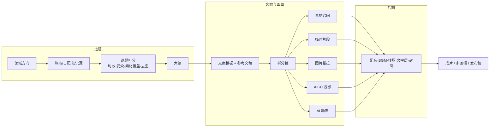

# Mindex 路线图

目标：做 AI 时代的视频创作 agent，覆盖"选题 → 文案 → 成片"的完整工作流。素材和模型都可以私有部署，支持本地运行。

前提：

- 面向某个垂直领域（如金融、科技、历史），素材库按该领域积累；
- 原生桌面端（macOS、Windows）的执行性能不能低于 Web 版；
- 所有能力同时提供页面、CLI、REST 和 agent 工具（含 MCP）四种入口。

现状审查见 [功能集审查](../docs/reviews/2026-10/features-roadmap.md)。

## 总体结构



## M1 创作地基（本期，spec `mindex-review-2026-10`）

- 文案模板：内置六类，用户可复制后修改。现有生成迁移为"通用解说"基础模板。
- 参考文稿：把访谈稿、谈话文稿改写成视频文案。
- 方案级画幅：16:9、9:16、1:1，适配方式 pad 或 crop。
- 五种分镜来源：素材召回、临时片段、静态图片推拉、AIGC 视频、AI 动画。
- 两个新模型角色：视频生成（MiniMax 海螺、通义万相、ComfyUI）和动画生成（LLM 输出 HTML/JS，沙箱内逐帧录制）。
- 架构准备：阶段注册表、`studio/workspace/` 包、StudioExecutor、统一后台任务 runner、版本化迁移、统一锁。

### 文案模板分类

| 模板 | 类型 | 结构要点 |
|---|---|---|
| 通用解说（基础） | outline | 按大纲组织，开头吸引注意，中段展开，结尾总结 |
| 历史解说 | outline | 时间线与因果推进，人物和事件交代清楚，有史实边界，避免演义化 |
| 热点评论 | outline | 先说事件和争议点，再给观点与论据，最后做判断，要有时效感 |
| 影视解说 | outline | 剧情压缩，在关键转折处设悬念，人物动机，控制剧透程度 |
| 知识科普 | outline | 从问题引入，再讲概念、例证和类比，结尾给结论 |
| 访谈改写 | rewrite | 从参考文稿提炼观点，改成第三人称叙述，保留关键原话 |

后续可按领域扩展：金融（财报解读、行情复盘）、科技（产品发布、评测）。

## M2 垂直领域选题挖掘

**目标**：给定领域方向，持续产出带打分的选题，每个选题附素材覆盖报告和大纲草稿，一键进入文案阶段。

**数据源（适配器协议 `TopicSource`，按领域启用）**：

- 通用：联网搜索工具、RSS 或 Atom、平台热榜（通过用户配置的第三方或自建接口，不内置爬虫）；
- 金融：财报日历、宏观数据发布日历、公告；
- 科技：发布会日历、开源与论文动态；
- 历史：历史上的今天、纪念日、新近考古或出版消息；
- 本地：已做视频的标题与文案（用于去重），以及素材库主题分布。

**核心能力**：

1. 领域档案：领域、子方向、受众、账号定位、禁区，作为选题与文案的系统上下文；
2. 候选聚合与去重：先做嵌入聚类，再由 LLM 归纳成选题卡片；
3. 打分：时效、受众匹配、素材覆盖（用选题关键画面查询现有索引，命中率与缺口清单）、与历史视频的重复度、预估制作成本（需要 AIGC 或动画补充的镜头比例）；
4. 选题卡片 → 大纲 → 创建 studio 任务，并预选文案模板；
5. agent 工具：`discover_topics`、`score_topic`、`topic_coverage`、`create_job_from_topic`；
6. 素材缺口反馈：选题缺的画面写进"素材采集清单"，指导素材积累方向。

**验收**：在一个领域配置下，每天产出 10 条带分数的选题；素材覆盖报告能对应到具体片段；从选题到首版成片全程不离开 Mindex。

## M3 后期与第三方工具

- BGM：本地音乐库（带授权元数据），按情绪和节奏选曲，自动 ducking，淡入淡出，可选节拍对齐切点；
- 转场：交叉淡化、黑场、推拉（xfade），按分镜设置；
- 文字层：标题卡、下三分之一信息条、数据卡片（可复用 AI 动画来源）、字幕样式模板（位置、描边、高亮词）；
- 封面：从成片挑帧，或用 AIGC 生成，叠加标题，按平台尺寸导出；
- 片头片尾与品牌模板，以及水印；
- 第三方工具来源：以工具调用方式接入外部生成或特效服务（MCP 客户端或 HTTP 插件），产物登记为不可变文件版本，接入"文件型画面"；
- 发布包：标题、简介、标签、章节时间点、多画幅成片一次导出。

## M4 桌面端（macOS、Windows）

**定位**：复刻 Web 版功能，私有部署时不暴露源码；模型服务可以在本机或局域网。

**推荐方案**：Tauri 2 外壳加 Python sidecar。

| 方案 | 性能 | 体积 | 源码保护 | 结论 |
|---|---|---|---|---|
| Tauri + PyInstaller onedir sidecar | 后端是原生 CPython，与 Web 版相同；界面用系统 WebView | 小（外壳约 10 MB + Python 运行时） | 字节码，保护弱 | 首版可用 |
| Tauri + Nuitka 编译 sidecar | 编译为 C 扩展，启动更快，热点路径略快 | 中 | 编译产物，保护较强 | **推荐正式版** |
| Electron + Python | 后端相同；Chromium 常驻内存高 | 大（+150 MB） | 同上 | 不推荐 |
| pywebview | 后端同进程 | 小 | 弱 | 适合原型 |

关键点：

- 后端仍是 `mindex serve`。由外壳启动 sidecar，监听随机回环端口，并注入一次性 `MINDEX_WEB_TOKEN`，WebView 带令牌访问。不改前端，也不改业务逻辑，所以性能与 Web 版一致；
- FFmpeg、ffprobe 随包分发（LGPL 构建，附 libass 与 CJK 字体）；代码里改为通过配置或环境变量定位二进制，不依赖 PATH；
- AI 动画录制所需的 Chromium 作为可选组件按需下载；
- 数据目录用系统用户数据目录（`~/Library/Application Support/Mindex`、`%APPDATA%\Mindex`），配置文件随之迁移；
- 模型服务：提供"本机服务管理"面板（启停、健康、显存），或者只连接局域网和线上服务；
- 文件锁：现有锁基于 fcntl，Windows 需要 `msvcrt` 或 `filelock` 后端，接口由 `shared/locks.py` 统一；
- 签名与公证：macOS notarization，Windows Authenticode；
- 自动更新：Tauri updater，配合差分包。

**性能验收（与同机 Web 版对比，劣化不超过 5%）**：

| 指标 | 场景 |
|---|---|
| 冷启动到页面可交互 | 首次启动与二次启动 |
| 文字检索 P50/P95 | 1 万片段库，嵌入服务在线 |
| 素材 prepare 吞吐 | 1 小时 1080p 素材 |
| 成片渲染耗时 | 30 镜、3 分钟、1080p |
| 动画录制耗时 | 10 秒、25 fps、1280×720 |
| 常驻内存 | 空闲、检索中、渲染中 |

## 优先级与依赖

```text
M1（本期） ──► M3 后期（依赖文件型画面、画幅）
     └──────► M2 选题（依赖文案模板）
M4 桌面端可与 M2/M3 并行；前置条件：锁跨平台、二进制定位可配置、用户数据目录
```
