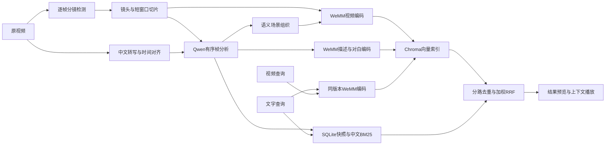

# Mindex 视频片段检索实施计划与设计

更新时间：2026-10-13。第一阶段：中文文字找视频优先，同时支持视频找相似片段；不引入 OmniRetriever，不提供音频查询。本文记录已实现的设计、部署顺序及尚待真实 GPU 和中文素材验证的验收工作。

当前先验收整部电影的 CPU 分镜、实际切片和仅画面索引。WeMM 地址为 `192.168.1.86:4010`，ASR 为 `:4020`；TTS `:4030` 不参与本流程。`index --mode visual` 只需 WeMM，完整的 `enriched` 模式仍分阶段执行 ASR、Qwen 分析、WeMM。具体命令见 [film-workflow.md](../docs/film-workflow.md)。

## 素材后台增量实现

- `/admin` 通过素材名称/原文件名检索素材，分页浏览镜头与精细片段，播放、下载，支持父子片段跳转和父镜头定位。
- 素材通过 CLI 导入；后台从 SQLite 直接读取，不依赖已发布索引。未嵌入素材亦可管理。
- `source_curation` 与 `segment_curation` 单独保存显示名称、备注、收藏、隐藏及更新时间；启动时兼容旧库，原文件和索引快照不变。
- 隐藏状态在检索召回前过滤；素材隐藏影响全部片段，父镜头隐藏影响子片段，恢复父级保留子片段自有设置。改名实时覆盖检索显示，收藏不参与排序。
- 首版不提供网页上传、永久删除、边界修改、合并和拆分。实际 trailer 测试导入默认正式素材库，原合成样片继续隔离。

## 1. 成功标准与模型选择

默认使用 WeMM-Embedding-9B，4096 维归一化浮点向量。其文字、视频与描述编码来自同一固定模型配置。4096 维是保留原生输出的默认选择，不视为中文影视检索效果最优的证明。

离线中文分析使用 `http://192.168.1.86:4040/v1` 的 `qwen3.8:27b`；ASR 使用 Qwen3-ASR-1.7B 和配套 0.6B 对齐模型。用户已确认 WeMM、ASR、TTS、Qwen 均部署在同机，端口依次为 4010、4020、4030、4040，当前未启动，按单 GPU 分阶段运行。分镜可使用本地 AdaptiveDetector 或远程 TransNetV2。专用转写、对齐及边界检测不受主模型不少于 4B 的限制。

首批真实素材为 1–5 小时中文影视。固定文字测试集 40 条，Hit@5 目标至少 85%；融合 nDCG@10 至少达到最佳单路。12 条视频查询检查相似片段及时间定位。模型加载耗时、常驻推理耗时、显存峰值和离线处理耗时分开报告。工程测试不能替代检索效果验收。

## 2. 架构与数据流

本地应用使用 Python 3.11、FastAPI、SQLite、ChromaDB、jieba、FFmpeg、原生 HTML/JavaScript。GPU 模型以独立 HTTP 服务运行，不要求远程服务访问本机路径。媒体直接通过 multipart 上传；Qwen 接收带时间戳的有序图像数据 URL。

### 存储实体

| 实体 | 关键内容 |
|---|---|
| Source | 文件内容 SHA256、名称、受管理的原视频路径、媒体信息、布局配置 |
| Segment | 稳定 ID、来源、shot/moment/scene、原视频起止时间、文件和缩略图、父镜头、切分依据 |
| Transcript | 来源、ASR 配置、带时间戳的文本、complete/no_audio/disabled 状态 |
| Annotation | 片段、分析配置、结构化描述、对应对白 |
| ScenePlan | 来源、分析配置、完整连续的场景区间 |
| IndexVersion | 空间身份、预处理、分析配置、素材快照 manifest、building/ready 状态 |
| IndexMember | 索引版本、片段及不可变的描述和媒体快照、完成状态 |
| Representation | 索引版本、片段、表示类型、稳定 ID、文字内容 |
| ProcessingRun | 阶段、来源、起止时间、状态与错误 |

向量不是记录主键：表示 ID 是稳定主键，向量用于相似度索引，业务信息通过片段 ID 关联。Chroma 显式接收向量，禁用自动默认嵌入函数。SQLite 保存完整结构化标签；Chroma 只保存必要的来源、片段、粒度和表示类型。

## 3. 离线处理

### 3.1 准备与切分

- 检查视频轨道、时长、帧率、尺寸和音轨，损坏文件明确失败。
- 原视频复制到受管理目录，以内容哈希去重，重复导入不重复生成素材。
- 分镜逐帧运行，保留不足一秒的镜头。TransNetV2 连续转场区间取中点、相近重复边界在 2 帧内合并；本地 AdaptiveDetector 的最短场景设为 1 帧。
- 检测出的帧号映射到实际帧时间戳，处理可变帧率，不单纯以平均帧率换算。
- `detect` 把完整切点计划原子写入 `plans/` 后，`split` 再执行编码；切片中断后不重新检测电影。`prepare` 合并两步。`inspect` 查看计划与落盘进度，`export` 导出 JSON、CSV 和分页本地预览页。
- 不超过 6 秒的镜头成为一个 moment；长镜头按 4 秒窗口、3 秒步长拆分，并增加贴近结尾的窗口，确保无覆盖缺口。
- 精确切片重新编码为 H.264/AAC MP4；开始时间归零，保留原素材的 `[start,end)` 坐标。生成缩略图。
- 切分参数变化使用新的 `data_dir`；首版不在同一来源记录上覆盖已有布局。

### 3.2 对白与分析

- 有音轨素材按 30 秒块提取单声道 16kHz WAV，ASR 与对齐输出时间戳，再映射回原视频。
- 每块转写独立保存；无音轨或显式禁用 ASR 时记录状态，禁止默默冒充转写完成。
- Qwen 接收每片段均匀采样的有序帧及带时间戳对白，默认最多 12 帧。
- 输出自然中文描述、人物外观、动作顺序、对象、互动、场景、人物情绪、画面氛围、景别、角度、镜头运动。
- 画面依据与对白推断分开记录；未知字段留空，不确定信息明确记录，不进行跨片段身份识别。
- 对原始镜头与 moment 分别分析，再用连续的 moment 描述组织场景。分组必须按顺序完整覆盖输入，不能重复、遗漏或重排；每个场景最长 45 秒。
- 场景目标 10–30 秒；短转场、结尾和不连续事件允许不足 10 秒。场景边界来自已有窗口边界。
- 场景亦生成真实 MP4、缩略图和独立描述。

首版没有动作起止定位网络，也没有原生音效、音乐分析；声音只通过对白转写贡献语义。采样帧观察到的动作并不保证捕获每个短暂事件，需在开发集上检查。

### 3.3 嵌入与索引发布

- `visual` 模式不要求转写、描述或语义场景，默认只索引 moment 的原生视频向量；未分析字段明确留空，不索引占位说明。可选择单个来源与 shot/moment 粒度。
- `enriched` 为完整默认模式，保留以下多表示设计；两种模式产生独立索引快照。
- 四类表示：视频画面、动作场景描述、情绪镜头描述、对白；空文本不生成向量。
- 长镜头与场景在视频嵌入时再拆成短窗口，默认 4fps、最多 24 帧、单帧最大 262144 像素。
- 文字和视频保持同一模型身份、模板及预处理，不平均合并不同表示向量。
- INT8 为待验证的默认权重量化；必要时比较 NF4。禁止 CPU/disk offload；4096 维输出仍保存为归一化浮点向量。
- 权重 revision、量化、维度、预处理、分析配置或素材快照变化，产生独立索引。
- Chroma upsert 在 SQLite 表示完成记录之前执行，崩溃后可对账恢复。逐表示和逐片段检查点避免重新调用已完成的嵌入。
- 发布前检查向量 ID、表示、片段、文件和完成状态；只有 ready 索引可设为活动版本。活动索引切换在 SQLite 事务内完成。
- 索引保留描述与对白快照；后续分析更新不能改变旧索引的检索内容。回退同时要求切回旧模型服务和对应配置。

### 3.4 单 GPU 执行顺序

`prepare` → `transcribe` → `analyze` → `index --activate` → 在线检索。

各阶段可独立执行和重试。项目模型服务以进程间文件锁互斥；现有 Qwen 不受此锁控制，用户手动停止或启动。GPU 服务单 worker、批量大小 1。网页查询只依赖 WeMM，无在线 Qwen 生成和大模型重排。

## 4. 检索与界面

### 文字查询

默认 moment 粒度，返回前 20 条，可选 shot/scene，最多 50 条。支持来源、时长、场景、人物情绪和景别筛选。

四类向量和中文 BM25 分别召回前 100 个候选片段。视频表示存在多个窗口时，扩展向量候选直到获得足够的不同片段，同一路内每个片段仅保留最佳命中。

初始加权 RRF：视频 1、动作场景描述 1、情绪镜头描述 1、对白 0.5、BM25 0.5，常数 k=60。相同分数使用并列排名，避免无区分度支路引入任意排序偏差。权重由 20 条开发集确定后冻结，测试集不调参。不设跨模型通用余弦阈值，不将分数解释为概率。

同一来源时间交并比超过 0.5 的结果去重，保留高排名片段。页面显示缩略图、视频、来源、原视频时间、描述、标签、命中支路及排序分数，支持精确片段和前后 3 秒上下文播放。

### 视频查询

限制 30 秒、100MB，按相同预处理拆成 4 秒/3 秒窗口。仅检索视频画面表示；查询窗口等权融合，保留动作、场景和画面相似性。查询不自动入库，临时目录在成功或失败后清理。当前不通过在线生成模型推断参考视频的情绪或剧情。

### 接口

- 离线 CLI：`prepare`、`transcribe`、`analyze`、`index`、`ingest`、`check`、`indexes list/activate`、`evaluate`。
- `POST /api/search/text`：文字、粒度、结果数、筛选条件。
- `POST /api/search/video`：文件和相同筛选参数。
- `GET /api/status`：索引、处理记录；可选服务健康检查。
- 片段详情、缩略图、片段媒体和原视频媒体均通过受管理 ID 访问，不接受任意本机路径；媒体支持 HTTP Range。
- 模型适配：`MultimodalEmbedder`、`VisualAnalyzer`、`Transcriber`、`Aligner`、`ShotDetector`。嵌入 HTTP 协议含空间身份和逐响应指纹，实际部署协议见 `deployment.md`。

## 5. 验证、默认假设与交付

工程测试覆盖：逐帧分镜、1 秒镜头、长镜头尾部覆盖、真实重编码时长、重复导入、阶段续跑、缺失文件对账、模型服务失败、部分索引不发布、量化切换独立索引、旧索引回退、RRF 去重与并列、文字与视频 API、筛选、Range 播放及临时文件清理。

真实素材验收：先人工标注约 20 分钟分镜，统计漏切和误切；准备 20 条开发文字查询、40 条固定文字测试查询、12 条视频查询及相关时间区间；比较纯画面、纯描述、融合、INT8 和 NF4。正式结果必须注明模型实际 revision、空间 ID、采样配置、测试集和硬件。

默认假设：单用户本地 Demo、素材以中文影视为主、模型服务由用户部署、无跨镜头身份识别、无音频查询、无在线重排、无并发多 GPU 调度。模型可替换意味着通过适配接口和新索引迁移，不意味着不同模型天然共享一个空间。

交付包括源码、依赖锁、示例配置、本计划、启动与部署文档、自动化测试、标注模板生成器、评测命令及验证报告。当前真实 WeMM/ASR/TransNetV2 的 GPU 运行与中文检索质量须以部署后的记录为准。

### 调研依据

- [WeMM-Embedding-9B 官方模型与调用说明](https://huggingface.co/tencent/WeMM-Embedding-9B)
- [WeMM 技术报告：文字找视频成绩及维度消融](https://arxiv.org/html/2608.24053v1)
- [Qwen3-ASR 官方代码与对齐示例](https://github.com/QwenLM/Qwen3-ASR)
- [TransNetV2 官方推理实现](https://github.com/soCzech/TransNetV2)
